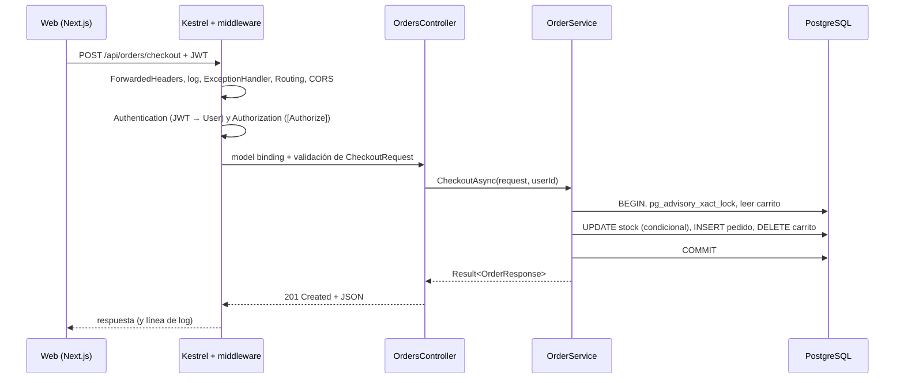
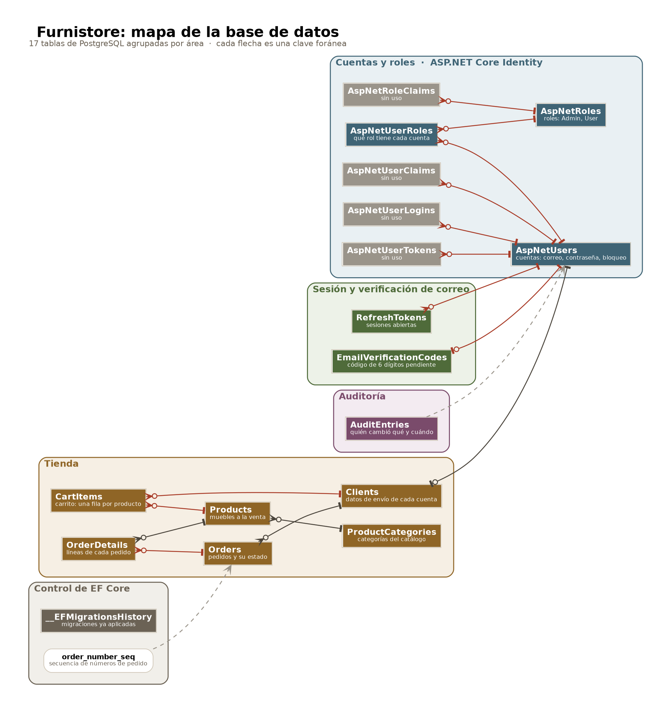
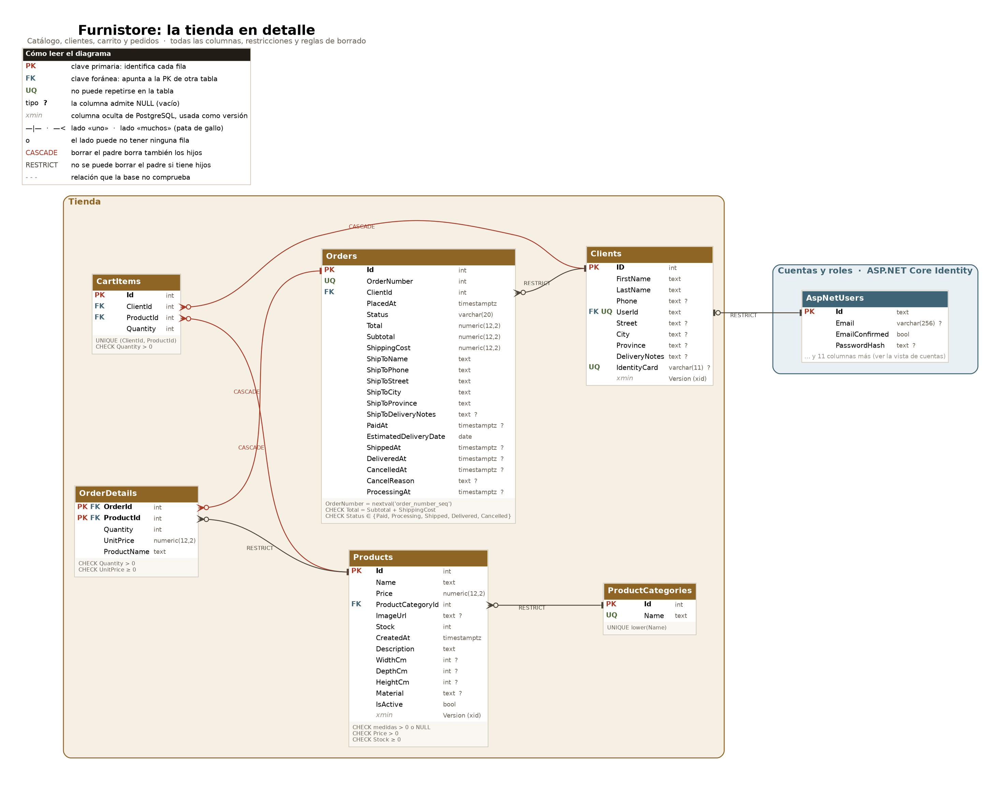
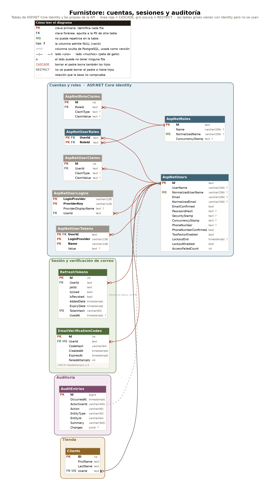

# Guía de la API de Furnistore

Esta guía explica la API de Furnistore (`apps/api`) de punta a punta: qué es cada pieza, cómo encaja con las demás y por qué se construyó así. Está pensada para alguien que sabe programar pero no conoce .NET, y quiere llegar a poder modificar este proyecto, o cualquier otro proyecto .NET existente, con criterio.

**Cómo leerla.** Casi todos los apartados siguen el mismo esquema:

- **Concepto:** qué es la pieza en .NET y qué problema resuelve, independientemente de Furnistore.
- **En Furnistore:** dónde está en el código, con fragmentos reales.
- **Por qué así:** qué alternativa se descartó y en qué situación convendría cambiar la decisión.

Las rutas de archivo son relativas a `apps/api/`. Los fragmentos de código se copiaron del repositorio; a veces se recortan con `…` para no repetir lo que no aporta.

---

## Índice

**Parte I. Fundamentos de .NET, con Furnistore como ejemplo**

1. Mapa general
2. Anatomía de una solución .NET
3. `Program.cs` paso a paso
4. Inyección de dependencias
5. Configuración

**Parte II. Arquitectura**

6. Las capas y por qué existen
7. Recorrido completo de una petición: el checkout
8. Patrones transversales
9. Logging

**Parte III. Base de datos**

10. Modelo de datos completo, con los diagramas
11. EF Core desde cero
12. Conexión a PostgreSQL
13. Migraciones
14. Transacciones y concurrencia

**Parte IV. Seguridad** *(próxima entrega)*

15. ASP.NET Core Identity
16. JWT y refresh tokens
17. Autorización, rate limiting y CORS
18. Verificación de correo

**Parte V. Referencia del dominio** *(próxima entrega)*

19. Controladores y endpoints
20. Servicios de aplicación
21. Catálogo de errores
22. Integraciones externas

**Parte VI. Calidad y operación** *(próxima entrega)*

23. Pruebas
24. Contrato OpenAPI
25. Recetas para modificar el proyecto
26. Deuda conocida y glosario

---

# Parte I. Fundamentos de .NET, con Furnistore como ejemplo

## 1. Mapa general

### 1.1 Qué es la API

La API es una aplicación **ASP.NET Core Web API** escrita en **C#** sobre **.NET 10**. Su trabajo es recibir peticiones HTTP, aplicar las reglas de negocio de la tienda, leer y escribir en una base de datos **PostgreSQL** y responder en **JSON**. No genera HTML: la interfaz la pinta la aplicación web (`apps/web`, Next.js), que es el único cliente de la API.

Tres nombres que conviene no confundir:

| Nombre | Qué es |
|---|---|
| **.NET** | La plataforma: el *runtime* que ejecuta el código, la biblioteca estándar y las herramientas (`dotnet`). |
| **C#** | El lenguaje en que está escrito el código. |
| **ASP.NET Core** | El framework web de .NET: servidor HTTP (Kestrel), enrutado, controladores, autenticación, etc. |

### 1.2 Qué expone al final

Cuando la API está en marcha ofrece esto:

| Qué | Dónde | Para qué |
|---|---|---|
| 54 endpoints REST | `http://localhost:5135/api/...` | Todo lo que usa la web: catálogo, auth, carrito, pedidos, panel de administración. |
| Swagger UI | `http://localhost:5135/swagger` | Página interactiva para probar los endpoints. **Solo en entorno Development.** |
| Health check | `http://localhost:5135/health` | Responde `Healthy` si la API está viva y llega a la base de datos. |
| Contrato OpenAPI | `apps/api/openapi.json` (archivo en el repo) | Descripción formal de todos los endpoints; de él se generan los tipos TypeScript de la web. |
| Comando de consola | `dotnet run ... -- admin promote <correo>` | Dar el rol de administrador a una cuenta sin pasar por HTTP. |

Los endpoints se agrupan así (el detalle está en la Parte V):

| Prefijo | Quién puede llamarlo | Qué hace |
|---|---|---|
| `/api/authentication` | Cualquiera | Registro, login, verificación de correo, renovación de sesión, logout. |
| `/api/products`, `/api/product-categories` | Cualquiera | Catálogo público. |
| `/api/clients/me` | Usuario con sesión | Perfil del cliente. |
| `/api/cart` | Usuario con sesión | Carrito. |
| `/api/orders` | Usuario con sesión | Checkout, historial y cancelación de sus pedidos. |
| `/api/admin/...` | Solo rol `Admin` | Panel: pedidos, productos, categorías, clientes, reportes, auditoría. |

### 1.3 Cómo se arranca

Hay dos formas:

```bash
# Desde la raíz del monorepo: arranca la API y la web a la vez
pnpm dev

# Solo la API, desde apps/api
dotnet watch --project API.Furnistore.API/API.Furnistore.API.csproj run
```

La primera llega a la segunda: Turborepo ejecuta el script `dev` de `apps/api/package.json`, que es exactamente ese `dotnet watch`. El `package.json` de la API existe solo para que Turborepo la trate como un paquete más del monorepo; .NET no lo lee.

`dotnet watch` compila, arranca y **vuelve a compilar y reiniciar** cada vez que guardas un archivo `.cs`. El puerto `5135` sale de `API.Furnistore.API/Properties/launchSettings.json` (perfil `http`), y la web lo conoce por su variable `API_BASE_URL=http://localhost:5135`.

### 1.4 Las carpetas de un vistazo

```
apps/api/
├── API.sln                          la "solución": lista los proyectos
├── global.json                      fija la versión del SDK de .NET
├── .config/dotnet-tools.json        herramientas de línea de comandos del proyecto
├── openapi.json                     contrato generado de la API
├── package.json                     solo para Turborepo
├── API.Furnistore.API/              proyecto web: el ejecutable
├── API.Furnistore.Application/      reglas de negocio
├── API.Furnistore.Data/             acceso a datos (EF Core) y migraciones
├── API.Furnistore.Shared/           entidades y tipos básicos
├── API.Furnistore.IntegrationTests/ pruebas
└── API.Furnistore.UnitTests/        restos de compilación, no es un proyecto (ver 2.2)
```

---

## 2. Anatomía de una solución .NET

### 2.1 SDK, runtime y la herramienta `dotnet`

**Concepto.** Para *ejecutar* una aplicación .NET basta el **runtime**. Para *compilarla* hace falta el **SDK**, que incluye el runtime más el compilador y la herramienta `dotnet` (`dotnet build`, `dotnet run`, `dotnet test`, `dotnet publish`…).

**En Furnistore.** `global.json` fija qué SDK usar:

```json
{
  "sdk": {
    "version": "10.0.100",
    "rollForward": "latestMinor",
    "allowPrerelease": false
  }
}
```

`rollForward: latestMinor` significa: "usa la 10.0.100 o cualquier versión 10.x más nueva que tengas instalada, pero nunca la 11". Así todo el equipo compila con la misma versión mayor sin obligar a tener exactamente el mismo parche.

### 2.2 La solución (`.sln`) y los proyectos (`.csproj`)

**Concepto.** En .NET el código se organiza en **proyectos**. Cada proyecto es un archivo `.csproj` más los `.cs` de su carpeta, y al compilarse produce un **ensamblado** (un `.dll`, o un ejecutable). Una **solución** (`.sln`) es solo una lista de proyectos que se abren y compilan juntos; no contiene código.

**En Furnistore.** `API.sln` lista cinco proyectos:

| Proyecto | Tipo | Produce | Archivos `.cs`* | Líneas* |
|---|---|---|---:|---:|
| `API.Furnistore.API` | Web (`Microsoft.NET.Sdk.Web`) | El ejecutable de la API | 29 | ~1.450 |
| `API.Furnistore.Application` | Biblioteca (`Microsoft.NET.Sdk`) | `API.Furnistore.Application.dll` | 41 | ~4.870 |
| `API.Furnistore.Data` | Biblioteca | `API.Furnistore.Data.dll` | 9 | ~265 |
| `API.Furnistore.Shared` | Biblioteca | `API.Furnistore.Shared.dll` | 13 | ~340 |
| `API.Furnistore.IntegrationTests` | Pruebas (xUnit) | Ensamblado de pruebas | 14 | ~2.200 |

\* Sin contar migraciones, que son código generado.

La carpeta `API.Furnistore.UnitTests` **no es un proyecto**: no tiene `.csproj` ni aparece en `API.sln`. Solo contiene carpetas `bin` y `obj` que quedaron de un proyecto que se borró. Se puede eliminar sin consecuencias.

### 2.3 Qué hay dentro de un `.csproj`

Este es el de la capa `Application`, completo:

```xml
<Project Sdk="Microsoft.NET.Sdk">

  <ItemGroup>
    <ProjectReference Include="../API.Furnistore.Data/API.Furnistore.Data.csproj" />
    <ProjectReference Include="../API.Furnistore.Shared/API.Furnistore.Shared.csproj" />
  </ItemGroup>

  <ItemGroup>
    <PackageReference Include="Microsoft.Extensions.Logging.Abstractions" Version="10.0.0" />
    <PackageReference Include="System.IdentityModel.Tokens.Jwt" Version="8.14.0" />
  </ItemGroup>

  <PropertyGroup>
    <TargetFramework>net10.0</TargetFramework>
    <ImplicitUsings>enable</ImplicitUsings>
    <Nullable>enable</Nullable>
  </PropertyGroup>

</Project>
```

Pieza por pieza:

- **`Sdk="..."`**: qué tipo de proyecto es. `Microsoft.NET.Sdk` es una biblioteca o una app de consola; `Microsoft.NET.Sdk.Web` añade todo lo de ASP.NET Core (servidor web, `appsettings.json`, `launchSettings.json`…). Solo `API.Furnistore.API` usa el SDK Web.
- **`TargetFramework`**: para qué versión de .NET se compila (`net10.0`).
- **`ImplicitUsings`**: el compilador añade solo los `using` más comunes (`System`, `System.Linq`, `System.Threading.Tasks`…), por eso muchos archivos no los declaran.
- **`Nullable`**: activa el análisis de nulos. Con él, `string` significa "nunca null" y `string?` significa "puede ser null", y el compilador avisa si usas algo que podría ser null sin comprobarlo. Por eso verás `Phone!` (el `!` le dice al compilador "sé que aquí no es null").
- **`ProjectReference`**: este proyecto usa el código de otro proyecto de la solución.
- **`PackageReference`**: este proyecto usa un paquete de **NuGet**, el gestor de paquetes de .NET (el equivalente de npm).

### 2.4 Los paquetes NuGet y para qué sirve cada uno

| Paquete | Proyecto | Para qué |
|---|---|---|
| `Microsoft.EntityFrameworkCore` | API, Data | EF Core, el ORM: traduce LINQ a SQL y objetos a filas. |
| `Npgsql.EntityFrameworkCore.PostgreSQL` | API, Data | El "proveedor" que enseña a EF Core a hablar con PostgreSQL. |
| `Microsoft.EntityFrameworkCore.Design` y `.Tools` | API, Data | Soporte para la herramienta `dotnet ef` (crear y aplicar migraciones). No se incluyen en el ejecutable final (`PrivateAssets=all`). |
| `Microsoft.AspNetCore.Identity.EntityFrameworkCore` | Data | Tablas de usuarios y roles de ASP.NET Core Identity guardadas con EF Core. |
| `Microsoft.AspNetCore.Identity.UI` | API | Aporta `AddDefaultIdentity`, el método con el que `Program.cs` registra Identity. |
| `Microsoft.AspNetCore.Authentication.JwtBearer` | API | Validar los tokens JWT que llegan en la cabecera `Authorization`. |
| `System.IdentityModel.Tokens.Jwt` | Application | Generar los tokens JWT en el login. |
| `Microsoft.Extensions.Logging.Abstractions` | Application | La interfaz `ILogger<T>`, sin atarse a ninguna librería de logging concreta. |
| `NLog.Web.AspNetCore` | API | La librería de logging real (ver capítulo 9). |
| `Swashbuckle.AspNetCore` | API | Genera el documento OpenAPI y la página Swagger UI. |
| `Microsoft.Extensions.Diagnostics.HealthChecks.EntityFrameworkCore` | API | El health check que comprueba la conexión a la base de datos. |
| `MailKit` | API | Enviar correos por SMTP (códigos de verificación). |
| `dotenv.net` | API | Cargar el archivo `.env` como variables de entorno en desarrollo. |
| `System.Security.Cryptography.Xml` | Data | Fija una versión concreta de una dependencia indirecta. |
| `Microsoft.AspNetCore.OpenApi` | API | No se usa directamente en el código; es un resto que podría quitarse. |

Que algunos paquetes aparezcan en dos proyectos es normal: `Data` necesita EF Core y Npgsql para definir el modelo y las migraciones, y `API` los necesita para llamar a `UseNpgsql(...)` al configurar la conexión y para que `dotnet ef` pueda arrancarse desde el proyecto ejecutable.

### 2.5 Compilar: `restore`, `build`, `bin` y `obj`

Al compilar (`dotnet build`) pasan dos cosas:

1. **Restore:** se descargan los paquetes NuGet a una caché global (`~/.nuget/packages`) y se escribe en `obj/project.assets.json` qué versión exacta de cada paquete se usa.
2. **Build:** se compila cada proyecto en orden de dependencias. En `obj/` quedan los archivos intermedios y en `bin/<Configuración>/net10.0/` queda el resultado.

En `bin/` del proyecto `API` se copian **todos** los `.dll` que necesita para ejecutarse: los de los otros cuatro proyectos y los de todos los paquetes NuGet. Por eso `bin` y `obj` pesan cientos de megas mientras el código fuente pesa unos pocos. No se suben a Git y se regeneran con `dotnet build`.

`Debug` y `Release` son las dos **configuraciones**: `Debug` (la de `dotnet run` y `dotnet watch`) incluye información para depurar; `Release` (la de `pnpm build`) está optimizada.

### 2.6 Herramientas locales

**Concepto.** Las herramientas de línea de comandos de .NET se instalan como paquetes NuGet. Pueden ser globales (para toda la máquina) o **locales** (fijadas por proyecto, con su versión).

**En Furnistore.** `apps/api/.config/dotnet-tools.json` declara dos herramientas locales:

| Herramienta | Versión | Comando | Para qué |
|---|---|---|---|
| `dotnet-ef` | 10.0.11 | `dotnet ef ...` | Crear y aplicar migraciones de la base de datos. |
| `swashbuckle.aspnetcore.cli` | 6.6.2 | `dotnet swagger ...` | Generar `openapi.json` desde el `.dll` compilado. |

`dotnet tool restore` las instala con la versión exacta del manifiesto. **Por qué así:** si cada desarrollador usara su `dotnet-ef` global, versiones distintas podrían generar migraciones distintas.

### 2.7 Namespaces

Cada archivo declara un **namespace** que coincide con su carpeta: `API.Furnistore.Application/Orders/OrderService.cs` está en `namespace API.Furnistore.Application.Orders`. Para usar una clase de otro namespace se importa con `using`. Es una convención, no una obligación del compilador, pero toda la API la respeta y conviene mantenerla: así el nombre completo de una clase dice dónde está su archivo.

---

## 3. `Program.cs` paso a paso

**Concepto.** `Program.cs` es el punto de entrada. En ASP.NET Core moderno se escribe con **instrucciones de nivel superior** (sin `class Program` ni `static void Main`) y tiene siempre tres fases:

1. **Construir:** `WebApplication.CreateBuilder(args)` crea el `builder`, y sobre `builder.Services` se **registran servicios** en el contenedor de inyección de dependencias.
2. **Compilar:** `builder.Build()` crea la aplicación (`app`). A partir de aquí ya no se pueden registrar servicios.
3. **Configurar el pipeline y ejecutar:** con `app.Use...` se declara por qué middleware pasa cada petición, con `app.Map...` qué endpoints hay, y `app.Run()` arranca el servidor.

**En Furnistore.** `API.Furnistore.API/Program.cs` tiene 261 líneas. Lo recorremos en orden.

### 3.1 Envoltorio de arranque

```csharp
var logger = NLog.LogManager.Setup().LoadConfigurationFromAppSettings().GetCurrentClassLogger();

try
{
    var builder = WebApplication.CreateBuilder(args);
    …
    app.Run();
}
catch (Exception ex)
{
    logger.Error(ex, "Stopped program because of exception");
    throw;
}
finally
{
    NLog.LogManager.Shutdown();
}
```

Se crea un logger de NLog **antes** que nada, para poder registrar errores que ocurran mientras se configura la app (por ejemplo, que falte `DATABASE_URL`). El `finally` vacía los logs pendientes al apagar.

### 3.2 Fase 1: registrar servicios

En orden de aparición:

| Línea(s) | Qué registra | Detalle en |
|---|---|---|
| `AddCors(...)` | Política `WebApp`: qué orígenes (dominios) pueden llamar a la API desde un navegador. Lee `CORS_ORIGINS`; por defecto `localhost:3000` y `3001`. | 17 |
| `DotEnv.Load(...)` | Solo en Development: carga `.env` como variables de entorno. | 5 |
| `AddApiContract()` | Controladores, JSON con enums como texto, Swagger. | 8 |
| `AddProblemDetails(...)` | Formato estándar de errores, con `traceId`. | 8.2 |
| `AddExceptionHandler<GlobalExceptionHandler>()` | Qué hacer con una excepción no controlada. | 8.2 |
| `AddHttpContextAccessor()` | Permite leer la petición actual fuera de un controlador. | — |
| `AddApplicationServices()` | Todos los servicios de negocio. | 4 |
| `AddHealthChecks().AddDbContextCheck<...>()` | El health check de `/health`. | 11 |
| `AddDbContext<APIFurnistoreContext>(...)` | La conexión a PostgreSQL. | 11 |
| `AddHostedService<DatabaseWarmupService>()` | Tarea de fondo que "calienta" la base al arrancar. | 11 |
| `AddSingleton(new JwtOptions {...})` | Secreto, emisor, audiencia y duración de los JWT. | 16 |
| `Configure<SmtpSettings>(...)`, `Configure<SupabaseStorageSettings>(...)` | Configuración tipada de correo e imágenes. | 5 |
| `Configure<ForwardedHeadersOptions>(...)` | Confiar en la IP real que envía un proxy. | 17 |
| `AddAuthRateLimiting()` | Límites de peticiones en auth. | 17 |
| `AddAuthentication(...).AddJwtBearer(...)` | Autenticación por JWT. | 16 |
| `AddDefaultIdentity<IdentityUser>(...).AddRoles<IdentityRole>()...` | Usuarios, contraseñas, bloqueo y roles. | 15 |
| `builder.Host.UseNLog()` | NLog como proveedor de logging. | 9 |

Varios de estos registros están agrupados en **métodos de extensión** propios (`AddApiContract`, `AddApplicationServices`, `AddAuthRateLimiting`) en la carpeta `Extensions/`. Es la convención de ASP.NET Core para que `Program.cs` se lea como un índice y cada bloque grande viva en su archivo.

### 3.3 Fase 2: `Build()` y tareas de arranque

```csharp
var app = builder.Build();
```

Después del `Build`, y antes de atender peticiones, `Program.cs` hace cuatro cosas:

1. **Avisos de configuración incompleta.** Si faltan las credenciales SMTP o las de Supabase Storage, escribe un *warning* en el log. La API arranca igualmente; solo fallarán el envío de correos o la subida de imágenes.
2. **Crear los roles.** Si no existen los roles `Admin` y `User`, los crea:

   ```csharp
   using (var scope = app.Services.CreateScope())
   {
       var roleManager = scope.ServiceProvider.GetRequiredService<RoleManager<IdentityRole>>();
       if (!await roleManager.RoleExistsAsync("Admin"))
           await roleManager.CreateAsync(new IdentityRole("Admin"));
       …
   }
   ```

   Se crea un *scope* a mano porque `RoleManager` depende del `DbContext`, que es *Scoped* (capítulo 4) y fuera de una petición no hay scope.
3. **Comando de consola.** `AdminCommand.TryRunAsync(app, args)` mira si la API se lanzó como `... -- admin promote <correo>`. Si es así, da el rol de administrador, imprime el resultado y **termina sin levantar el servidor**. Así se crea el primer administrador, que de otro modo sería imposible: para dar el rol desde el panel hace falta ya ser administrador.

### 3.4 Fase 3: el pipeline de middleware

**Concepto.** Un **middleware** es un eslabón por el que pasa cada petición. Cada uno puede hacer algo antes, llamar al siguiente y hacer algo después, cuando vuelve la respuesta. **El orden en que se declaran es el orden en que se ejecutan**, y en muchos casos el orden es obligatorio.

**En Furnistore.**

```csharp
if (app.Environment.IsDevelopment())
{
    app.UseSwagger();
    app.UseSwaggerUI();
}

app.UseForwardedHeaders();
app.UseMiddleware<RequestLoggingMiddleware>();
app.UseExceptionHandler();

if (!app.Environment.IsDevelopment())
    app.UseHttpsRedirection();

app.UseRouting();
app.UseCors("WebApp");
app.UseAuthentication();
app.UseAuthorization();
app.UseRateLimiter();
app.MapControllers();

app.LogRegisteredEndpoints();
app.MapHealthChecks("/health");
app.Run();
```

| # | Middleware | Qué hace | Por qué en esta posición |
|---|---|---|---|
| 1 | `UseSwagger`, `UseSwaggerUI` | Sirve `/swagger`. | Solo en Development; no debe exponerse en producción. |
| 2 | `UseForwardedHeaders` | Si hay un proxy delante, toma la IP real del cliente de `X-Forwarded-For`. | Antes que cualquiera que use la IP (el log y el rate limiting). |
| 3 | `RequestLoggingMiddleware` | Cronometra la petición y escribe una línea de log al terminar. | Muy arriba, para medir el tiempo total y registrar también las peticiones que fallan. |
| 4 | `UseExceptionHandler` | Si algo más abajo lanza una excepción, la convierte en un 500 con formato estándar. | Solo atrapa excepciones de lo que está **después**; por eso va antes de todo lo que puede fallar. |
| 5 | `UseHttpsRedirection` | Redirige HTTP a HTTPS. | Solo fuera de Development. |
| 6 | `UseRouting` | Decide qué endpoint corresponde a la URL. | Antes de CORS y autorización, que necesitan saber el endpoint. |
| 7 | `UseCors` | Añade las cabeceras CORS y responde a las peticiones *preflight*. | Después del routing y **antes** de autenticación: un *preflight* no lleva token y no debe rechazarse. |
| 8 | `UseAuthentication` | Lee el JWT y construye el usuario (`HttpContext.User`). | Antes de la autorización: no se puede decidir si alguien tiene permiso sin saber quién es. |
| 9 | `UseAuthorization` | Aplica `[Authorize]`: responde 401 o 403 si no hay permiso. | Después de autenticación. |
| 10 | `UseRateLimiter` | Aplica los límites de peticiones. | Después del routing, porque los límites se asignan por endpoint. |
| 11 | `MapControllers` | Registra los endpoints de los controladores. | Es el final del camino. |
| 12 | `MapHealthChecks("/health")` | Registra `/health`. | — |

`LogRegisteredEndpoints()` no es un middleware: en Development escribe al arrancar la lista de todos los endpoints con su método y nivel de acceso.

### 3.5 La última línea

```csharp
public partial class Program;
```

Con instrucciones de nivel superior, el compilador genera una clase `Program` interna. Esta línea la hace pública para que el proyecto de pruebas pueda arrancar la API completa en memoria con `WebApplicationFactory<Program>` (lo usa `AdminAuthorizationTests`).

---

## 4. Inyección de dependencias

### 4.1 Concepto

La **inyección de dependencias** (DI) consiste en que una clase **no crea** los objetos que necesita: los **pide en su constructor** y alguien se los entrega. En ASP.NET Core ese "alguien" es el **contenedor de servicios**, que viene integrado.

```csharp
public sealed class OrdersController(OrderService orders) : ControllerBase
```

Esta línea usa un **constructor primario** (sintaxis de C# 12): equivale a declarar un campo `orders` y un constructor que lo recibe. Cuando llega una petición a `/api/orders`, ASP.NET Core le pide al contenedor un `OrdersController`; el contenedor ve que necesita un `OrderService`, ve que `OrderService` necesita un `APIFurnistoreContext`, un `OrderWorkflow` y un `ILogger<OrderService>`, y así hasta el final de la cadena. Construye todo el árbol y entrega el controlador listo.

Ventajas:

- Ninguna clase decide cómo se construyen sus dependencias, así que se puede cambiar una implementación sin tocar a quien la usa.
- En las pruebas se puede registrar otra implementación (por ejemplo, un almacén de imágenes falso).
- El contenedor controla **cuánto vive** cada objeto.

### 4.2 Tiempos de vida

| Tiempo de vida | Se crea… | Ejemplo en Furnistore |
|---|---|---|
| **Singleton** | Una vez para toda la aplicación. | `SmtpEmailSender`, `TimeProvider.System`, `JwtOptions`, `TokenValidationParameters`. |
| **Scoped** | Una vez por petición HTTP. Todos los que lo pidan en la misma petición reciben el mismo. | `APIFurnistoreContext` y todos los servicios de negocio. |
| **Transient** | Cada vez que alguien lo pide. | Los clientes HTTP tipados (`SupabaseImageStorage`). |

La regla que no se puede romper: **un servicio no puede depender de otro que vive menos que él.** Si un Singleton guardara un `DbContext` (Scoped), ese `DbContext` quedaría vivo para siempre, compartido entre peticiones simultáneas, y EF Core no es seguro para eso. Esto se llama **dependencia cautiva**, y en Development ASP.NET Core lanza un error al detectarla.

### 4.3 En Furnistore

Los servicios de negocio se registran en `Extensions/ApplicationServiceCollectionExtensions.cs`:

```csharp
services.AddScoped<ProductService>();
services.AddScoped<OrderService>();
services.AddScoped<OrderWorkflow>();
services.AddScoped<AuditLog>();
… (14 servicios Scoped en total)

services.AddSingleton<IVerificationEmailSender, SmtpEmailSender>();
services.AddHttpClient<IProductImageStorage, SupabaseImageStorage>();
services.AddSingleton(TimeProvider.System);
```

**Por qué los servicios son Scoped.** Todos usan el `DbContext`, que es Scoped. Además, que todos los servicios de una misma petición compartan **el mismo** `DbContext` es útil: si `OrderService` y `AuditLog` modifican entidades en la misma petición, un único `SaveChangesAsync()` guarda todo junto.

**Por qué la mayoría se registran sin interfaz** (`AddScoped<OrderService>()` y no `AddScoped<IOrderService, OrderService>()`). Una interfaz solo aporta algo si existe, o se espera, más de una implementación. `OrderService` tiene una sola y las pruebas usan la real contra una base de datos real (capítulo 23), así que una interfaz `IOrderService` sería un archivo más sin beneficio.

**Por qué dos servicios sí tienen interfaz.** `IVerificationEmailSender` (enviar correo) e `IProductImageStorage` (guardar imágenes) hablan con **sistemas externos**. Tener la interfaz permite dos cosas:

- La interfaz se declara en `Application`, pero la implementación (`SmtpEmailSender`, `SupabaseImageStorage`) vive en `API`. Así la lógica de negocio no depende de MailKit ni de Supabase (ver 6.4).
- En las pruebas se registra `FakeImageStorage` en lugar de Supabase.

**`AddHttpClient<IProductImageStorage, SupabaseImageStorage>()`** registra un **cliente HTTP tipado**: el contenedor le inyecta a `SupabaseImageStorage` un `HttpClient` gestionado por una fábrica que reutiliza las conexiones. Crear `new HttpClient()` en cada llamada es un error clásico que agota los *sockets*.

**`TimeProvider.System`** es el reloj de .NET registrado como servicio. Los servicios que necesitan la hora la piden por inyección (`TimeProvider clock`) en lugar de llamar a `DateTime.UtcNow`, y así una prueba puede inyectar un reloj falso para simular, por ejemplo, que un código ya caducó. *Nota:* `OrderService.CheckoutAsync` todavía usa `DateTime.UtcNow` directamente; es una inconsistencia menor.

**Servicios de fondo.** `DatabaseWarmupService` es un `BackgroundService` (Singleton). Como no puede recibir un `DbContext` en el constructor (sería una dependencia cautiva), recibe un `IServiceScopeFactory` y crea su propio scope:

```csharp
using var scope = scopeFactory.CreateScope();
var db = scope.ServiceProvider.GetRequiredService<APIFurnistoreContext>();
```

Es el patrón correcto siempre que algo de larga duración necesita un servicio Scoped.

---

## 5. Configuración

### 5.1 Concepto: fuentes y precedencia

ASP.NET Core junta la configuración de varias **fuentes** en un único diccionario de claves. Si una clave aparece en varias, **gana la última fuente cargada**. Por defecto, de menor a mayor prioridad:

1. `appsettings.json`
2. `appsettings.{Entorno}.json`, por ejemplo `appsettings.Development.json`
3. *User secrets* (solo en Development)
4. Variables de entorno
5. Argumentos de la línea de comandos

Las claves son jerárquicas y se separan con `:`. En una variable de entorno no se puede usar `:`, así que se usa **doble guion bajo**: la variable `SmtpSettings__Password` es la clave `SmtpSettings:Password`, la misma que en JSON sería:

```json
{ "SmtpSettings": { "Password": "..." } }
```

### 5.2 En Furnistore

**`appsettings.json`** tiene los valores no secretos y por defecto: niveles de log, `JwtConfig:ExpiryTime` (`01:00:00`), servidor y puerto SMTP, nombre del remitente. Los campos secretos están vacíos.

**El archivo `.env`** tiene los secretos. Lo carga la librería `dotenv.net`, **solo en Development**:

```csharp
if (builder.Environment.IsDevelopment())
{
    DotEnv.Load(
        options: new DotEnvOptions(
            envFilePaths: new[] { ".env", "../.env", "../../.env" },
            overwriteExistingVars: false
        )
    );
    builder.Configuration.AddEnvironmentVariables();
}
```

- Busca el `.env` en tres rutas porque el directorio de trabajo cambia según desde dónde se arranque (`dotnet run` en la carpeta del proyecto, `pnpm dev` desde la raíz…).
- `overwriteExistingVars: false`: si una variable ya existe en el entorno real, el `.env` no la pisa.
- `AddEnvironmentVariables()` se vuelve a llamar porque el `builder` ya había leído las variables de entorno **antes** de que se cargara el `.env`.

En producción no se carga ningún `.env`: las variables las pone el entorno de ejecución (un contenedor Docker, un servidor…). Es la práctica estándar: los secretos no viajan en archivos dentro de la aplicación.

**Variables que usa la API** (lista completa en `apps/api/.env.example`):

| Variable | Para qué |
|---|---|
| `DATABASE_URL` | Cadena de conexión a PostgreSQL. |
| `JWT_SECRET`, `JWT_ISSUER`, `JWT_AUDIENCE` | Firmar y validar los tokens. |
| `SmtpSettings__UserName`, `SmtpSettings__Password`, `SmtpSettings__SenderEmail` | Credenciales del correo. |
| `SupabaseStorage__Url`, `SupabaseStorage__ServiceKey` | Subida de imágenes. |
| `ForwardedHeaders__KnownProxies` | IPs de proxies de confianza. |
| `CORS_ORIGINS` | Orígenes permitidos, separados por comas. |
| `ASPNETCORE_ENVIRONMENT`, `ASPNETCORE_URLS` | Entorno y dirección en la que escucha el servidor. Las lee ASP.NET Core directamente. |

### 5.3 Dos estilos de leer la configuración

En `Program.cs` conviven dos estilos.

**Estilo 1: leer valores sueltos.** Se usa para la base de datos y JWT:

```csharp
var connectionString =
    Environment.GetEnvironmentVariable("DATABASE_URL")
    ?? builder.Configuration.GetConnectionString("APIFurnistoreContext")
    ?? throw new InvalidOperationException("DATABASE_URL not configured");
```

Se mira primero la variable de entorno, después la configuración, y si no hay nada **la aplicación no arranca**. Fallar al arrancar es deliberado: es mucho mejor que arrancar y fallar en la primera petición.

**Estilo 2: el patrón Options.** Se usa para SMTP y Supabase Storage:

```csharp
builder.Services.Configure<SmtpSettings>(builder.Configuration.GetSection("SmtpSettings"));
```

Esto enlaza la sección `SmtpSettings` con una clase normal de C# (`Configuration/SmtpSettings.cs`), propiedad por propiedad. Quien la necesite pide `IOptions<SmtpSettings>` por inyección y recibe un objeto tipado:

```csharp
public class SmtpSettings
{
    public string Server { get; set; } = string.Empty;
    public int Port { get; set; }
    public SecureSocketOptions Security { get; set; } = SecureSocketOptions.StartTls;
    …
    public bool HasCredentials =>
        !string.IsNullOrWhiteSpace(UserName) && !string.IsNullOrWhiteSpace(Password);
}
```

**Por qué así.** El patrón Options es el idiomático en .NET: tipado, con valores por defecto, y la clase puede incluir lógica como `HasCredentials`. Que JWT y la base de datos usen el estilo 1 es histórico: se configuraron antes y con nombres de variable "planos" (`DATABASE_URL`) en lugar de jerárquicos. Si se añade configuración nueva, conviene usar Options.

### 5.4 El entorno: Development y Production

`ASPNETCORE_ENVIRONMENT` (por defecto `Production`; `launchSettings.json` lo pone en `Development` al trabajar en local) cambia el comportamiento en estos puntos:

| Comportamiento | Development | Production |
|---|---|---|
| Carga `.env` | Sí | No |
| Swagger UI | Sí | No |
| Lista de endpoints al arrancar | Sí | No |
| Redirección a HTTPS | No | Sí |
| Formato de logs (`nlog.config`) | Texto con colores | JSON |

### 5.5 Sobre los *user secrets*

El `.csproj` de la API tiene un `<UserSecretsId>`, que habilita la fuente "user secrets" de .NET: un archivo fuera del repositorio donde guardar secretos de desarrollo. El proyecto no la usa (usa `.env`), así que esa línea puede ignorarse. Se menciona porque la encontrarás en muchos proyectos .NET.

---

# Parte II. Arquitectura

## 6. Las capas y por qué existen

### 6.1 La regla

La API está dividida en cuatro proyectos de código más el de pruebas, y **las dependencias solo van en una dirección**:

```
API.Furnistore.API ──────────┐
        │                    │
        ▼                    │
API.Furnistore.Application ──┤
        │                    │
        ▼                    ▼
API.Furnistore.Data ──► API.Furnistore.Shared
```

| Proyecto | Depende de | No puede conocer |
|---|---|---|
| `Shared` | Nada | Nada de los demás, ni EF Core, ni ASP.NET Core |
| `Data` | `Shared` | Las reglas de negocio ni HTTP |
| `Application` | `Data`, `Shared` | HTTP, controladores, MailKit, Supabase |
| `API` | Los tres | — |

El compilador **hace cumplir** esta regla: como `Data` no tiene un `ProjectReference` a `Application`, es imposible escribir en `Data` código que use un servicio de negocio. Esa es la razón principal para separar en proyectos y no solo en carpetas: con carpetas, nada impediría que un día una entidad llamara a un controlador.

### 6.2 Qué hay en cada capa

**`API.Furnistore.Shared`: el modelo del dominio.**

- Las **entidades**: `Product`, `ProductCategory`, `Client`, `CartItem`, `Order`, `OrderDetail`, `OrderStatus`, `AuditEntry`, `RefreshToken`, `EmailVerificationCode`.
- Tipos básicos que usan todas las capas: `Result`/`Result<T>`/`Error` (8.1), `PagedResult<T>` (8.5) y `RandomGenerator`.

Las entidades son clases con propiedades y casi sin comportamiento:

```csharp
public class Product
{
    public int Id { get; set; }
    public string Name { get; set; } = string.Empty;
    public decimal Price { get; set; }
    public int Stock { get; set; }
    public int ProductCategoryId { get; set; }
    public ProductCategory Category { get; set; } = null!;
    public bool IsActive { get; set; } = true;
    public uint Version { get; set; }
    …
}
```

Este estilo se llama **modelo anémico**: las reglas no viven en la entidad, viven en los servicios. La única excepción es `Client.IsProfileComplete`, una propiedad calculada.

*Sobre el nombre.* "Shared" sugiere "cosas compartidas", pero en la práctica es la capa de **dominio**. En otros proyectos .NET la encontrarás como `Domain` o `Core`.

**`API.Furnistore.Data`: persistencia.**

- `APIFurnistoreContext`: el `DbContext` de EF Core, el objeto a través del cual se consulta y se guarda en la base de datos.
- `Configurations/`: una clase por entidad que define tabla, índices, restricciones y relaciones.
- `Migrations/`: el historial de cambios del esquema.

Se explica a fondo en la Parte III. Depende de Identity porque el `DbContext` hereda de `IdentityDbContext`, que añade las tablas de usuarios y roles.

**`API.Furnistore.Application`: la lógica de negocio.** Es el proyecto más grande (~4.900 líneas). Está organizado **por funcionalidad**, no por tipo de archivo:

```
Application/
├── Auth/                 AuthService, AuthContracts, VerificationCodes, RefreshTokenHasher, …
├── Carts/                CartService, CartContracts
├── Clients/              ClientService, ClientContracts, IdentityCardAttribute
├── Orders/               OrderService, OrderWorkflow, OrderMapping, ShippingPolicy, OrderContracts
├── Products/             ProductService, ProductContracts
├── ProductCategories/    ProductCategoryService, ProductCategoryContracts
├── Admin/
│   ├── Audit/            AuditLog, AuditService, AuditContracts
│   ├── Categories/       …
│   ├── Customers/        …
│   ├── Orders/           …
│   ├── Products/         AdminProductService, IProductImageStorage, …
│   └── Reports/          AdminReportService, ReportPeriod, ReportContracts
└── Common/               ApiEvents, SortMap, LikePattern, TextInput
```

Cada funcionalidad tiene casi siempre dos archivos:

- **`XxxService.cs`**: los métodos que implementan los casos de uso ("hacer checkout", "cancelar pedido"). Devuelven `Result<T>`.
- **`XxxContracts.cs`**: los **contratos**, es decir, las clases que entran (`CheckoutRequest`, `OrderQuery`) y salen (`OrderResponse`) de la API, con sus reglas de validación (8.3).

**Por qué por funcionalidad.** Cuando cambias "pedidos", todo lo de pedidos está en una carpeta. La alternativa (una carpeta `Services/` con todos los servicios y otra `Dtos/` con todos los contratos) obliga a saltar entre carpetas para cada cambio y crece mal.

**`API.Furnistore.API`: el host web.**

```
API/
├── Program.cs            arranque (capítulo 3)
├── Controllers/          traducen HTTP ↔ llamadas a servicios
│   └── Admin/            controladores del panel, con AdminControllerBase
├── Middleware/           RequestLoggingMiddleware, GlobalExceptionHandler
├── Extensions/           registro de servicios y utilidades HTTP
├── Configuration/        clases de Options (SmtpSettings, SupabaseStorageSettings)
├── Services/             SmtpEmailSender, SupabaseImageStorage, DatabaseWarmupService
├── Commands/             AdminCommand (comando de consola)
├── SwaggerHostFactory.cs host mínimo para generar openapi.json (capítulo 24)
├── appsettings*.json
└── nlog.config
```

Los controladores son finos a propósito: reciben la petición, sacan el usuario del token, llaman a **un** método del servicio y convierten el `Result` en una respuesta HTTP. No contienen reglas ni tocan el `DbContext`.

```csharp
[HttpGet("{id:int}")]
public async Task<IActionResult> GetById(int id, CancellationToken cancellationToken) =>
    (await orders.GetByIdAsync(id, User.UserId(), cancellationToken)).ToActionResult(this);
```

### 6.3 Qué se ejecuta al final

Solo `API.Furnistore.API` es ejecutable. `Application`, `Data` y `Shared` son bibliotecas (`.dll`) que se copian a su carpeta `bin` al compilar. Desplegar la API es publicar ese proyecto (`dotnet publish`), que produce una carpeta con el ejecutable y todos los `.dll`.

### 6.4 Inversión de dependencias en un caso concreto

`AdminProductService` (en `Application`) necesita guardar imágenes, pero `Application` no puede conocer Supabase. La solución:

1. `Application` declara **qué necesita**, como una interfaz:

   ```csharp
   // Application/Admin/Products/IProductImageStorage.cs
   public interface IProductImageStorage { … }
   ```

2. `API` aporta **cómo se hace**: `Services/SupabaseImageStorage.cs` implementa esa interfaz con HTTP.
3. `Program.cs` los une: `AddHttpClient<IProductImageStorage, SupabaseImageStorage>()`.
4. Las pruebas registran `FakeImageStorage` en su lugar.

La dependencia "natural" sería servicio → Supabase; con la interfaz se **invierte**: la implementación de Supabase depende de una interfaz definida por el negocio. Si mañana las imágenes se guardan en disco o en S3, se escribe otra clase y se cambia una línea en el registro; `AdminProductService` no se toca. Lo mismo ocurre con `IVerificationEmailSender` y `SmtpEmailSender`.

### 6.5 Por qué esta arquitectura y no otra

Hay tres puntos de referencia habituales en .NET:

| Opción | Cómo es | Por qué no |
|---|---|---|
| **Un solo proyecto** | Controladores que usan el `DbContext` directamente. | Funciona para proyectos pequeños, pero las reglas acaban repartidas por los controladores y nada impide mezclar capas. La API empezó así; un refactor movió la lógica a servicios y los cinco controladores que existían entonces pasaron de 727 a 294 líneas. |
| **"Clean Architecture" completa** | Proyectos `Domain`, `Application`, `Infrastructure`, `WebApi`; repositorios (`IProductRepository`…) entre la lógica y EF Core; a menudo MediatR (un comando y un *handler* por caso de uso). | Mucha ceremonia: varios archivos por caso de uso. Los repositorios sobre EF Core suelen limitarse a reenviar llamadas, porque el `DbContext` ya es un repositorio (cada `DbSet`) y una unidad de trabajo (`SaveChangesAsync`). |
| **Capas pragmáticas (la elegida)** | Cuatro capas con dependencias en un sentido; servicios que usan el `DbContext` directamente; interfaces solo en las integraciones externas. | — |

La concesión consciente es que **`Application` depende de `Data`, y por tanto de EF Core**: los servicios escriben consultas LINQ sobre el `DbContext` y no son independientes de la base de datos. A cambio:

- Las consultas se escriben donde se usan, sin una capa intermedia.
- Se puede usar todo EF Core y PostgreSQL (transacciones, `FOR UPDATE`, `ExecuteUpdateAsync`, bloqueos *advisory*) sin pelear con una abstracción.
- Las pruebas usan un PostgreSQL real (capítulo 23) en lugar de simular repositorios, así que prueban también el SQL.

**Cuándo habría que revisarla.** Si se necesitara cambiar de motor de base de datos con frecuencia, o probar la lógica sin ninguna base de datos, valdría la pena introducir repositorios. Si una funcionalidad creciera mucho (por ejemplo, reportes), podría separarse en su propio proyecto.

---

## 7. Recorrido completo de una petición: el checkout

Este capítulo sigue una petición real de principio a fin: un cliente con sesión confirma su compra.

```http
POST /api/orders/checkout
Authorization: Bearer eyJhbGciOi…
Content-Type: application/json

{ "expectedTotal": 526.90 }
```



### Paso 1. Kestrel recibe la conexión

**Kestrel** es el servidor HTTP integrado en ASP.NET Core. Lee la petición y crea un `HttpContext`, el objeto que representa la petición y la respuesta durante todo el recorrido.

### Paso 2. Middleware de entrada

En el orden del capítulo 3.4:

- `UseForwardedHeaders` fija la IP real del cliente.
- `RequestLoggingMiddleware` arranca un cronómetro y abre un **scope de log** con `TraceId` y `UserId`: todo lo que se registre durante esta petición llevará esos datos.
- `UseExceptionHandler` queda preparado para atrapar cualquier excepción.
- `UseRouting` encuentra que `POST /api/orders/checkout` corresponde a `OrdersController.Checkout`, gracias a:

  ```csharp
  [Route("api/orders")]                  // en la clase
  [HttpPost("checkout")]                 // en el método
  ```

- `UseCors` comprueba el origen.

### Paso 3. Autenticación y autorización

`UseAuthentication` lee la cabecera `Authorization: Bearer ...` y valida el JWT: la firma con el secreto, el emisor, la audiencia y la caducidad. Si es válido, construye `HttpContext.User` (un `ClaimsPrincipal`) con los datos del token, entre ellos el *claim* `"Id"` con el identificador del usuario.

`UseAuthorization` ve que `OrdersController` tiene `[Authorize]`. Sin token válido, la petición termina aquí con **401**.

### Paso 4. Model binding y validación

ASP.NET Core convierte el JSON del cuerpo en un objeto (*model binding*):

```csharp
public sealed record CheckoutRequest
{
    [Range(typeof(decimal), "0", "100000000")]
    public decimal ExpectedTotal { get; init; }
}
```

Como el controlador tiene `[ApiController]`, **valida automáticamente** las anotaciones. Si `expectedTotal` fuera negativo, respondería **400** con la lista de errores sin llegar a ejecutar el método del controlador.

El `CancellationToken cancellationToken` del método se rellena solo: se cancela si el cliente cierra la conexión (8.6).

### Paso 5. El controlador

```csharp
[HttpPost("checkout")]
public async Task<IActionResult> Checkout(CheckoutRequest request, CancellationToken cancellationToken)
{
    var result = await orders.CheckoutAsync(request, User.UserId(), cancellationToken);

    return result.IsSuccess
        ? CreatedAtAction(nameof(GetById), new { id = result.Value.Id }, result.Value)
        : result.ToActionResult(this);
}
```

`User.UserId()` es un método de extensión (`Extensions/ClaimsPrincipalExtensions.cs`) que lee el *claim* `"Id"`. El controlador no decide nada: delega.

### Paso 6. El servicio: `OrderService.CheckoutAsync`

Aquí está toda la lógica. Resumida:

1. **Busca el cliente** asociado al usuario. Si no existe → `checkout.client_not_found`. Si el perfil está incompleto → `checkout.profile_incomplete`.
2. **Abre una transacción dentro de una estrategia de reintentos:**

   ```csharp
   var strategy = db.Database.CreateExecutionStrategy();
   return await strategy.ExecuteAsync(async () =>
   {
       await using var transaction = await db.Database.BeginTransactionAsync(cancellationToken);
       …
   });
   ```

   La conexión está configurada para reintentar ante fallos transitorios de red, y en ese caso hay que repetir **la transacción entera**, no solo la última sentencia. Por eso se envuelve en `ExecuteAsync`.
3. **Bloquea al cliente** con un bloqueo *advisory* de PostgreSQL:

   ```csharp
   await db.Database.ExecuteSqlAsync(
       $"SELECT pg_advisory_xact_lock({CheckoutLockNamespace}, {client.ID})", cancellationToken);
   ```

   Si el mismo cliente pulsa "Pagar" dos veces, la segunda petición espera a que termine la primera y encontrará el carrito vacío. El bloqueo se libera solo al terminar la transacción.
4. **Lee el carrito con los productos** en una sola consulta (un `join` en LINQ).
5. **Comprueba**, en orden: que el carrito no esté vacío, que ningún producto esté archivado, y que el total calculado coincida con `expectedTotal` (si no, `checkout.price_changed`: el precio cambió desde que el cliente lo vio).
6. **Reserva stock** con un `UPDATE` condicional por producto:

   ```csharp
   var affected = await db.Products
       .Where(p => p.Id == line.ProductId && p.Stock >= line.Quantity)
       .ExecuteUpdateAsync(s => s.SetProperty(p => p.Stock, p => p.Stock - line.Quantity), cancellationToken);
   ```

   Si `affected == 0`, otro cliente se llevó las últimas unidades → `checkout.insufficient_stock`, y la transacción se deshace entera.
7. **Crea el pedido** con sus líneas, copiando la dirección del cliente y los precios del momento. `OrderNumber` lo asigna PostgreSQL con una secuencia que empieza en 1000.
8. **Vacía el carrito** (`ExecuteDeleteAsync`) y hace **`COMMIT`**.
9. **Registra** `CheckoutCompleted` en el log y devuelve `Result.Ok(OrderResponse)`.

Si cualquier comprobación falla, se hace `RollbackAsync` y se devuelve `Result.Fail(...)` con un `Error`. **No se lanza ninguna excepción** para un fallo esperado (8.1). Los detalles de transacciones y bloqueos están en el capítulo 14.

### Paso 7. Vuelta al controlador y respuesta

- **Éxito:** `CreatedAtAction(...)` responde **201 Created**, con el pedido en el cuerpo y una cabecera `Location: /api/orders/{id}` que apunta a `GetById`.
- **Fallo:** `ToActionResult` traduce el `Error` a un código HTTP (por ejemplo, 409 para `checkout.insufficient_stock`) y a un cuerpo `ProblemDetails` (8.2).

El objeto se serializa a JSON con `System.Text.Json`: nombres en *camelCase* (`orderNumber`) y enums como texto (`"status": "Paid"`).

### Paso 8. Salida

La respuesta recorre el middleware en sentido inverso. `RequestLoggingMiddleware` para el cronómetro y escribe:

```
POST /api/orders/checkout responded 201 in 184ms
```

Si hubiera tardado más de un segundo, la línea saldría como *warning* (`SlowRequest`).

---

## 8. Patrones transversales

Estas piezas no son de una funcionalidad concreta: aparecen en toda la API.

### 8.1 `Result<T>`: fallos esperados sin excepciones

**Concepto.** Una operación puede fallar por motivos **esperados** (no hay stock, el correo ya existe) o **inesperados** (se cayó la base de datos, un bug). Usar excepciones para los esperados tiene dos problemas: la firma del método no dice que puede fallar, y las excepciones son caras y ensucian los logs.

**En Furnistore.** `Shared/Common/Result.cs` define:

```csharp
public enum ErrorType { Validation, NotFound, Conflict, Unauthorized, Forbidden, TooManyRequests, Unexpected }

public sealed record Error(string Code, string Message, ErrorType Type)
{
    public static Error NotFound(string code, string message) => new(code, message, ErrorType.NotFound);
    …
}

public class Result
{
    public bool IsSuccess { get; }
    public Error? Error { get; }
    public static Result<T> Ok<T>(T value) => …;
    public static Result<T> Fail<T>(Error error) => …;
}
```

Un servicio devuelve `Result<T>`: o un valor, o un `Error` con tres datos:

- **`Code`:** identificador estable para máquinas, como `checkout.insufficient_stock`. La web decide qué mostrar según este código.
- **`Message`:** texto para personas, en español.
- **`Type`:** qué clase de fallo es; determina el código HTTP.

Leer `Value` de un `Result` fallido lanza una excepción: obliga a comprobar `IsSuccess` antes.

La traducción a HTTP está en un solo lugar, `Extensions/ResultExtensions.cs`:

| `ErrorType` | HTTP |
|---|---|
| `Validation` | 400 Bad Request |
| `Unauthorized` | 401 Unauthorized |
| `Forbidden` | 403 Forbidden |
| `NotFound` | 404 Not Found |
| `Conflict` | 409 Conflict |
| `TooManyRequests` | 429 Too Many Requests |
| `Unexpected` | 500 Internal Server Error |

**Por qué así.** La capa `Application` no sabe nada de HTTP: dice "esto es un conflicto" y la capa `API` decide que un conflicto es un 409. Las excepciones quedan para lo verdaderamente inesperado.

### 8.2 `ProblemDetails`: un único formato de error

**Concepto.** `ProblemDetails` es un formato estándar (RFC 9457, antes RFC 7807) para describir errores HTTP en JSON. ASP.NET Core lo trae integrado.

**En Furnistore.** Todos los errores tienen esta forma:

```json
{
  "type": "https://tools.ietf.org/html/rfc9110#section-15.5.10",
  "title": "No hay stock suficiente de Silla Plegable Bambú: quedan 2.",
  "status": 409,
  "code": "checkout.insufficient_stock",
  "traceId": "0HN7…"
}
```

Hay cuatro sitios que producen errores, y todos usan este formato:

| Origen | Cuándo | Qué añade |
|---|---|---|
| `ResultExtensions` | Un servicio devuelve `Result.Fail` | `title` = mensaje del `Error`; `code` = código del `Error` |
| `[ApiController]` | Falla la validación de un contrato | Un diccionario `errors` con los mensajes de cada campo (`ValidationProblemDetails`), status 400 |
| `GlobalExceptionHandler` | Una excepción no controlada | Status 500, título genérico "Ocurrió un error inesperado." |
| Rate limiter (`RateLimitingExtensions`) | Demasiadas peticiones | Status 429, `code = "rate_limited"` y cabecera `Retry-After` |

`AddProblemDetails` en `Program.cs` añade el `traceId` a los errores, el mismo identificador que aparece en el log de esa petición, para poder cruzar un error que ve el usuario con su línea de log.

`GlobalExceptionHandler` (`Middleware/GlobalExceptionHandler.cs`) implementa `IExceptionHandler`: registra la excepción completa en el log, pero al cliente solo le devuelve un mensaje genérico. **Nunca se devuelve el detalle de una excepción al cliente**, porque puede revelar información interna. Si la excepción es una cancelación porque el cliente cerró la conexión, no hace nada.

### 8.3 Contratos (DTOs): nunca exponer entidades

**Concepto.** Un **DTO** (*Data Transfer Object*) es una clase que solo sirve para transportar datos de entrada o salida. Aquí se llaman "contratos".

**En Furnistore.** Los controladores nunca reciben ni devuelven entidades (`Order`, `Product`); siempre contratos (`CheckoutRequest`, `OrderResponse`). Se escriben como **records**:

```csharp
public sealed record OrderResponse(
    int Id,
    int OrderNumber,
    OrderStatus Status,
    bool CanCancel,
    …
    IReadOnlyList<OrderLineResponse> Lines
);
```

Un `record` es una clase pensada para datos: se declara en una línea, es inmutable si usa `init`, y dos records con los mismos valores se consideran iguales. En los contratos de entrada se usa `required` para que el compilador exija rellenar el campo y `init` para que no se pueda cambiar después de crearse.

**Por qué no exponer entidades:**

- **Seguridad:** devolver `Client` expondría `UserId` y `Version`; aceptar `Product` en un `PUT` permitiría a un cliente enviar campos que no debería tocar.
- **Estabilidad:** si cambia una tabla, el contrato de la API no cambia por accidente.
- **Forma:** la respuesta puede tener otra estructura que la tabla. `OrderResponse` incluye `CanCancel` y la URL de la imagen de cada línea, que no son columnas de `Orders`.

La conversión entidad → contrato se escribe a mano (por ejemplo, `Orders/OrderMapping.cs`), sin librerías como AutoMapper. Es más código, pero es explícito y el compilador detecta un campo olvidado.

### 8.4 Validación en capas

Cada tipo de regla se comprueba en el lugar más adecuado:

| Nivel | Dónde | Ejemplo | Respuesta |
|---|---|---|---|
| 1. Formato | Anotaciones en los contratos | `[Required]`, `[StringLength(60, MinimumLength = 2)]`, `[Range(1, 100)]`, `[RegularExpression(...)]` | 400 automático |
| 2. Entre campos | `IValidatableObject` en el contrato | `ProductQuery`: `minPrice` no puede ser mayor que `maxPrice` | 400 automático |
| 3. Atributo propio | Clase que hereda de `ValidationAttribute` | `[IdentityCard]`: 11 dígitos y fecha válida | 400 automático |
| 4. Negocio | Servicios, con `Result.Fail` | Stock suficiente, transición de estado válida, carnet no repetido | 400/404/409 |
| 5. Base de datos | Restricciones `CHECK`, `UNIQUE`, claves foráneas | `Price > 0`, `Stock >= 0` | Última defensa |

Un atributo de validación propio es corto. Este es el del carnet (`Application/Clients/IdentityCardAttribute.cs`):

```csharp
public sealed class IdentityCardAttribute()
    : ValidationAttribute("El carnet de identidad debe tener 11 dígitos y empezar por una fecha de nacimiento válida y no futura.")
{
    public override bool IsValid(object? value) => value is null || (value is string text && IsValidNumber(text));
    …
}
```

y se usa así:

```csharp
[Required, IdentityCard]
public required string IdentityCard { get; init; }
```

**Por qué en capas.** Las reglas de formato no necesitan base de datos y deben rechazarse cuanto antes. Las de negocio necesitan datos ("¿hay stock?") y viven en el servicio. Las restricciones de la base de datos protegen los datos incluso de un error en el código o de alguien que escriba SQL a mano.

### 8.5 Paginación y ordenación

Los listados nunca devuelven toda la tabla. El cliente pide `?page=2&pageSize=20` y recibe:

```csharp
public sealed record PagedResult<T>(IReadOnlyList<T> Items, int Total, int Page, int PageSize)
{
    public int TotalPages => …;
}
```

En el servicio, el patrón es siempre contar el total, ordenar, saltar y tomar:

```csharp
var total = await orders.CountAsync(cancellationToken);
var items = await orders
    .OrderByDescending(o => o.PlacedAt)
    .Skip((query.Page - 1) * query.PageSize)
    .Take(query.PageSize)
    .ToListAsync(cancellationToken);
```

`PageSize` está limitado con `[Range(1, 100)]` para que nadie pida un millón de filas.

Los listados del panel aceptan `?sort=price` o `?sort=-price` (el `-` invierte el orden). `Common/SortMap.cs` traduce ese texto a un `OrderBy` **solo** sobre campos permitidos:

```csharp
private static readonly SortMap<Product> Sorts = new SortMap<Product>()
    .Add("name", p => p.Name)
    .Add("price", p => p.Price)
    .Add("stock", p => p.Stock)
    .Add("createdAt", p => p.CreatedAt);
```

Un campo desconocido devuelve `query.invalid_sort` con la lista de opciones válidas. Así el cliente no puede ordenar por columnas arbitrarias, y no hay que escribir un `switch` en cada servicio.

### 8.6 Asincronía, `CancellationToken` y `AsNoTracking`

**`async`/`await`.** Todo acceso a la base de datos o a la red es asíncrono (`ToListAsync`, `SaveChangesAsync`). Mientras se espera la respuesta de PostgreSQL, el hilo queda libre para atender otras peticiones. Un método `async` devuelve `Task<T>`, y quien lo llama usa `await`. Regla práctica: si un método llama a algo `async`, él también es `async`, hasta el controlador.

**`CancellationToken`.** Los métodos de los controladores lo reciben como último parámetro y ASP.NET Core lo conecta con la conexión del cliente. Se pasa hacia abajo hasta cada llamada a EF Core. Si el usuario cierra la pestaña, la consulta en curso se cancela en lugar de seguir gastando la base de datos para una respuesta que nadie leerá. La API lo pasa en más de un centenar de métodos.

**`AsNoTracking()`.** Por defecto EF Core "sigue" cada entidad que lee, para detectar cambios y guardarlos en `SaveChangesAsync`. En una consulta de solo lectura ese seguimiento es memoria y tiempo perdidos. `AsNoTracking()` lo desactiva:

```csharp
var order = await db.Orders.AsNoTracking()
    .Include(o => o.OrderDetails)
    .FirstOrDefaultAsync(o => o.Id == id && o.ClientId == clientId, cancellationToken);
```

Regla: `AsNoTracking()` en todo lo que solo se lee; sin él cuando se va a modificar y guardar la entidad.

### 8.7 Búsquedas de texto seguras

Las búsquedas (`?search=mesa`) usan `ILIKE` de PostgreSQL, que ignora mayúsculas. Como en `LIKE` los caracteres `%` y `_` son comodines, `Common/LikePattern.cs` los escapa antes de construir el patrón. Lo usan las búsquedas del panel; el catálogo público (`ProductService`) tiene su propio método `EscapeLikePattern`, que hace lo mismo y podría sustituirse por `LikePattern`:

```csharp
public static string Contains(string value) =>
    $"%{value.Trim().Replace("\\", "\\\\").Replace("%", "\\%").Replace("_", "\\_")}%";
```

Sin esto, buscar `%` devolvería todos los productos. No hay riesgo de inyección SQL: EF Core envía el valor como parámetro, nunca concatenado en el SQL.

### 8.8 Serialización JSON

`AddApiContract()` configura `System.Text.Json`, el serializador integrado en .NET:

- Las propiedades se escriben en *camelCase* (`OrderNumber` → `orderNumber`), el comportamiento por defecto de ASP.NET Core.
- Los enums se escriben como texto gracias a `JsonStringEnumConverter`: `"status": "Paid"` en lugar de `"status": 0`. Es más legible y no se rompe si cambia el orden del enum.

### 8.9 Detalles de C# que verás en todo el código

| Sintaxis | Qué significa |
|---|---|
| `public sealed class X` | Nadie puede heredar de `X`. Se usa por defecto salvo que la herencia sea intencionada. |
| `class X(Dep dep)` | Constructor primario: `dep` está disponible en toda la clase. |
| `record` | Clase de datos con igualdad por valor (8.3). |
| `required`, `init` | Propiedad obligatoria al crear el objeto; solo se puede asignar al crearlo. |
| `string?` frente a `string` | Puede ser null / nunca es null (2.3). |
| `x!` | "Sé que `x` no es null aquí". |
| `x ?? y` | Si `x` es null, usa `y`. |
| `is int id` | Comprueba el tipo y, si coincide, lo guarda en `id`. |
| `switch` con `=>` | *Switch expression*: devuelve un valor según el caso (ver `StatusFor` en 8.1). |
| `[OrderStatus.Paid]`, `[]` | Expresión de colección: crea una lista o un array con esos elementos. |
| `value[..6]`, `label[1..]` | Rango: los 6 primeros caracteres / todo desde el segundo. |
| `=> …` en un método | Método de una sola expresión. |
| `$"Texto {valor}"` | Cadena interpolada. En `ExecuteSqlAsync` se convierte en parámetros SQL, no en texto concatenado. |

---

## 9. Logging

### 9.1 Concepto: abstracción y proveedor

.NET separa **cómo se escribe un log** de **adónde va**:

- El código usa la interfaz `ILogger<T>` (paquete `Microsoft.Extensions.Logging.Abstractions`). La pide por inyección y llama a `LogInformation`, `LogWarning`, `LogError`…
- Un **proveedor** decide qué se hace con cada mensaje: consola, archivo, un servicio externo. Furnistore usa **NLog**.

Por eso `Application` solo referencia el paquete de abstracciones: no sabe que existe NLog. Cambiar de proveedor sería cambiar `Program.cs` y la configuración, sin tocar los servicios.

### 9.2 Logs estructurados

```csharp
logger.LogInformation(
    ApiEvents.CheckoutCompleted,
    "Checkout created order {OrderId} ({OrderNumber}) for client {ClientId}, total {Total}",
    order.Id, order.OrderNumber, order.ClientId, order.Total);
```

Las `{llaves}` **no son interpolación**: son nombres de propiedades. El proveedor recibe el mensaje y además los valores con su nombre (`OrderId = 57`), de modo que en un sistema de logs se puede filtrar por `OrderId` en lugar de buscar texto. Por eso nunca se escribe `$"... {order.Id}"` en un log.

### 9.3 El catálogo de eventos

`Application/Common/ApiEvents.cs` da un número fijo (`EventId`) a cada suceso relevante:

```csharp
public static readonly EventId CheckoutCompleted = new(3004, nameof(CheckoutCompleted));
public static readonly EventId OrderCancelled    = new(3007, nameof(OrderCancelled));
```

| Rango | Área |
|---|---|
| 1001–1311 | Catálogo, clientes y carrito |
| 2001–2022 | Autenticación y correo |
| 3004–3013 | Pedidos |
| 5001–5010 | Infraestructura: peticiones, excepciones, arranque, base de datos |

**Por qué.** Un número estable permite contar o alertar sobre un tipo de suceso ("cuántos `CheckoutRejected` hubo hoy") aunque cambie el texto del mensaje. Y tenerlos en un solo archivo evita números repetidos.

### 9.4 Qué nivel usar

La API sigue esta política:

| Nivel | Cuándo | Ejemplos |
|---|---|---|
| `Information` | Algo salió bien y es relevante | `CheckoutCompleted`, `LoginSucceeded`, cada petición completada |
| `Warning` | Algo se rechazó por una regla, o algo va lento | `CheckoutRejected`, `LoginFailed`, `SlowRequest`, `RequestRateLimited`, configuración incompleta |
| `Error` | Algo falló de forma inesperada | `UnhandledException` |

Que un cliente se quede sin stock no es un error del sistema: es un *warning*. Reservar `Error` para lo inesperado permite alertar sobre los `Error` sin ruido.

### 9.5 El middleware de log de peticiones

`Middleware/RequestLoggingMiddleware.cs` hace tres cosas en cada petición:

1. Abre un **scope** con `TraceId` y `UserId`. Todo log escrito durante la petición, desde cualquier servicio, lleva esos dos datos sin que el servicio los pase.
2. Al terminar, escribe método, ruta, status y milisegundos. Más de 1.000 ms → `Warning`.
3. **Oculta** los valores de parámetros sensibles en la URL (`code`, `token`, `refreshToken`, `password`) como `***`. Un log nunca debe contener secretos.

### 9.6 `nlog.config`

El archivo `API.Furnistore.API/nlog.config` define **destinos** (*targets*) y **reglas** (*rules*):

- **En Development:** consola con colores. Los logs propios (`API.Furnistore.*`) desde nivel `Debug`, con sus propiedades estructuradas; el SQL que ejecuta EF Core (`Microsoft.EntityFrameworkCore.Database.Command`) desde `Info`, útil para ver qué consultas genera cada LINQ; y de las librerías (`Microsoft.*`, `Npgsql.*`, `System.*`) solo `Warning` o más.
- **En Production:** una línea **JSON** por log en la salida estándar, con fecha UTC, nivel, propiedades y scope. Es el formato que esperan Docker y los sistemas de recogida de logs.

El cambio de formato se decide dentro del propio `nlog.config` con la variable `isDevelopment`, que lee el entorno de ASP.NET Core.

---

# Parte III. Base de datos

Esta parte explica dónde viven los datos de Furnistore, cómo los lee y escribe la API, cómo cambia la estructura de la base con el tiempo y cómo se evita que dos personas estropeen los mismos datos a la vez. Empieza por los diagramas, porque todo lo demás se entiende mejor con el dibujo delante.

## 10. Modelo de datos completo

### 10.1 Los diagramas

Los tres diagramas están en la carpeta `guia-api-diagramas/`, junto a esta guía, en PNG para leerlos y en SVG para ampliarlos sin perder nitidez. Los genera el script `generar-diagramas-bd.py` de la misma carpeta, que **lee el esquema real de la base local**: no hay nada dibujado a mano, así que lo que ves es exactamente lo que hay. Si mañana se añade una migración, basta con volver a ejecutarlo desde la raíz del repositorio, con la base local en marcha:

```bash
python3 docs/guia-api-diagramas/generar-diagramas-bd.py docs/guia-api-diagramas
```

**Diagrama 1. Mapa general.** Las 17 tablas agrupadas por área, con una flecha por cada clave foránea. Sirve para orientarse.



**Diagrama 2. La tienda en detalle.** Catálogo, clientes, carrito y pedidos con todas sus columnas, sus tipos, sus restricciones y la regla de borrado de cada relación. Es el diagrama más importante.



**Diagrama 3. Cuentas, sesiones y auditoría.** Las tablas de ASP.NET Core Identity y las tablas propias de la API que dependen de una cuenta.



**Cómo leerlos.** Cada caja es una tabla y cada fila, una columna. A la izquierda va el papel de la columna (`PK`, `FK`, `UQ`), en el centro su nombre y a la derecha su tipo en PostgreSQL; un `?` tras el tipo significa que admite `NULL`. Las líneas usan la notación "pata de gallo": el extremo con tres patas es el lado "muchos" (el de la clave foránea) y el extremo con una raya es el lado "uno". Un círculo indica que ese lado puede no tener ninguna fila: una categoría puede no tener productos todavía. El color dice qué pasa al borrar: rojo es `CASCADE`, gris oscuro es `RESTRICT` (10.4).

### 10.2 Las áreas de un vistazo

| Área | Tablas | Quién las escribe |
|---|---|---|
| **Tienda** | `ProductCategories`, `Products`, `Clients`, `CartItems`, `Orders`, `OrderDetails` | Los servicios de `Application`: catálogo, carrito, checkout, perfil y panel |
| **Cuentas y roles** | `AspNetUsers`, `AspNetRoles`, `AspNetUserRoles` y cuatro tablas de Identity sin uso | ASP.NET Core Identity (`UserManager`, `RoleManager`) y el panel de clientes |
| **Sesión y verificación** | `RefreshTokens`, `EmailVerificationCodes` | `AuthService` |
| **Auditoría** | `AuditEntries` | `AuditLog`, desde los servicios del panel y el checkout |
| **Control de EF Core** | `__EFMigrationsHistory` y la secuencia `order_number_seq` | Las migraciones |

Hay una separación importante que el diagrama 1 deja ver: **la cuenta y el cliente son tablas distintas**. `AspNetUsers` guarda lo necesario para iniciar sesión (correo, hash de la contraseña, bloqueos) y la gestiona Identity. `Clients` guarda lo necesario para vender (nombre, teléfono, carnet, dirección) y la gestiona la API. Se unen uno a uno por `Clients.UserId`. Así Identity puede cambiar su esquema en una versión futura sin tocar los datos de la tienda, y la tienda no mezcla datos de envío con datos de seguridad.

### 10.3 Tabla por tabla

#### `ProductCategories`

Las categorías del catálogo (Sillas, Mesas, Estanterías, Lámparas). Solo tiene `Id` y `Name`.

- El nombre no se puede repetir **sin distinguir mayúsculas**: "Mesas" y "mesas" chocan. Lo garantiza el índice único `UX_ProductCategories_Name_Lower`, creado sobre `lower("Name")`. EF Core no sabe declarar un índice sobre una expresión, así que se creó con SQL dentro de la migración `ReshapeDomainModel` (13.5).

#### `Products`

Los muebles a la venta.

- **Dinero:** `Price` es `numeric(12,2)`: hasta 9.999.999.999,99 con exactamente dos decimales. Nunca se usa `float` ni `double` para dinero, porque redondean en binario (`0.1 + 0.2` no da `0.3`). En C# es `decimal`. Desde el 16 de octubre los precios están en CUP (13.5).
- **Restricciones `CHECK`:** precio mayor que 0, stock mayor o igual que 0, y medidas positivas o vacías. Aunque la API ya valida todo esto, la base lo vuelve a comprobar: si un error de programación intentara guardar stock negativo, PostgreSQL lo rechazaría.
- **`IsActive`:** en lugar de borrar un producto que ya se vendió, se archiva (`false`). Desaparece del catálogo, pero los pedidos antiguos siguen apuntando a él.
- **`CreatedAt`:** lo rellena la propia base con `now()` al insertar.
- **`xmin`:** no aparece entre las columnas normales porque es una columna oculta que PostgreSQL tiene en todas las tablas. El modelo la usa como número de versión del producto para detectar ediciones simultáneas (14.6).

#### `Clients`

Los datos de cada cliente para vender y enviar.

- Su clave primaria se llama `ID`, en mayúsculas, a diferencia del resto (`Id`). Es una herencia de la primera migración; cambiarla obligaría a renombrar la columna y todas sus referencias, y no aporta nada.
- `UserId` es único: una cuenta tiene como mucho un cliente. El registro crea siempre los dos a la vez.
- `Phone`, `Street`, `City` y `Province` admiten `NULL`, porque al registrarse solo se piden nombre, carnet y correo. `IdentityCard` también admite `NULL`: el registro lo pide, pero las cuentas creadas antes de ese cambio pueden no tenerlo. El checkout comprueba que todo esté completo (`IsProfileComplete`) antes de dejar comprar.
- `IdentityCard` es `varchar(11)` y único: dos clientes no pueden tener el mismo carnet. Si alguien lo intenta, la base lanza una violación de unicidad y la API la traduce a un mensaje claro (14.8).
- También usa `xmin` como versión, por el mismo motivo que `Products`.

#### `CartItems`

El carrito: una fila por cada producto que un cliente tiene en él.

- La pareja `(ClientId, ProductId)` es única: si añades una silla que ya estaba, se suma la cantidad a la fila existente en lugar de crear otra.
- `Quantity` debe ser mayor que 0. Quitar del carrito es borrar la fila, no dejarla en 0.
- Las dos claves foráneas son `CASCADE`: si se borra el cliente o el producto, su línea de carrito desaparece. El carrito es efímero; no hay nada que conservar.

#### `Orders`

Los pedidos. Es la tabla más rica del modelo.

- **Dos identificadores.** `Id` es la clave interna (1, 2, 3…). `OrderNumber` es el número que ve el cliente ("Pedido #1004"): lo da la secuencia `order_number_seq`, que empezó en 1000. Separarlos permite que el número público tenga un formato propio sin depender de la clave interna.
- **Estado.** `Status` es texto (`Paid`, `Processing`, `Shipped`, `Delivered`, `Cancelled`) y un `CHECK` impide cualquier otro valor. En C# es el enum `OrderStatus`; EF Core lo convierte a texto con `HasConversion<string>()`. Guardarlo como texto hace la base legible con cualquier herramienta y no se rompe si cambia el orden del enum.
- **Importes.** `Subtotal`, `ShippingCost` y `Total` son `numeric(12,2)`, y un `CHECK` exige `Total = Subtotal + ShippingCost`. Un total incoherente es imposible de guardar.
- **Copia de la dirección.** Las columnas `ShipTo*` copian el nombre, el teléfono y la dirección del cliente **en el momento de comprar**. Si mañana el cliente se muda y cambia su perfil, el pedido de ayer conserva la dirección a la que se envió. Un pedido es un documento histórico, no una vista del perfil actual.
- **Fechas del ciclo de vida.** `PlacedAt`, `PaidAt`, `ProcessingAt`, `ShippedAt`, `DeliveredAt` y `CancelledAt`. Todas son `timestamptz` y se guardan en UTC; la web las muestra en hora de La Habana. `EstimatedDeliveryDate` es `date`, sin hora.
- **Índices.** `(ClientId, PlacedAt)` acelera "Mis pedidos, los más recientes primero"; `(Status, PlacedAt)` acelera el panel cuando filtra por estado.

#### `OrderDetails`

Las líneas de cada pedido: qué producto, cuántas unidades y a qué precio.

- **Clave compuesta** `(OrderId, ProductId)`: un mismo producto aparece una sola vez por pedido, con su cantidad total.
- **Copia del precio y del nombre.** `UnitPrice` y `ProductName` guardan los valores de ese momento. Si mañana la silla sube de precio o cambia de nombre, la factura de ayer no cambia. Es el mismo principio que las columnas `ShipTo*`.
- Hacia `Orders` es `CASCADE`: las líneas no tienen sentido sin su pedido. Hacia `Products` es `RESTRICT`: un producto vendido no se puede borrar (10.4).

#### `AspNetUsers`, `AspNetRoles` y `AspNetUserRoles`

Las crea ASP.NET Core Identity; la Parte IV las explica en detalle. Lo esencial:

- `AspNetUsers` es la cuenta. Su `Id` es un texto (un GUID), no un número. Guarda el correo, si está confirmado (`EmailConfirmed`), el hash de la contraseña, el control de bloqueo (`LockoutEnd`, `AccessFailedCount`) y dos sellos: `SecurityStamp` cambia cuando cambia algo de seguridad de la cuenta y `ConcurrencyStamp` detecta ediciones simultáneas.
- `NormalizedEmail` y `NormalizedUserName` son el correo en mayúsculas. Identity busca siempre por ellos, con índice, para que `Ana@Gmail.com` y `ana@gmail.com` sean la misma cuenta.
- `AspNetRoles` tiene dos filas, `Admin` y `User`, que crea `Program.cs` al arrancar si no existen. `AspNetUserRoles` dice qué rol tiene cada cuenta.

#### Las cuatro tablas grises

`AspNetUserClaims`, `AspNetUserLogins`, `AspNetUserTokens` y `AspNetRoleClaims` vienen con Identity y están vacías. Servirían para permisos finos (*claims*), inicio de sesión con Google o Facebook (*logins*) y tokens propios de Identity. Furnistore no usa nada de eso, pero no se eliminan: forman parte del esquema estándar de `IdentityDbContext` y quitarlas exigiría personalizar Identity sin ningún beneficio.

#### `RefreshTokens`

Una fila por cada sesión abierta (16 en la Parte IV).

- Nunca se guarda el token en sí, sino su hash SHA-256 (`TokenHash`, único). Si alguien robara una copia de la base, no podría usar esos tokens.
- `IsUsed` y `UsedAt` marcan que un token ya se canjeó por otro; `IsRevoked` lo anula al cerrar sesión o al desactivar la cuenta.

#### `EmailVerificationCodes`

El código de 6 dígitos pendiente de cada cuenta, guardado también como hash.

- `UserId` es único: como mucho hay un código vivo por cuenta. Pedir otro borra el anterior.
- El código caduca a los 15 minutos (`ExpiresAt`).
- `FailedAttempts` cuenta los intentos fallidos; con 5 se borra el código y hay que pedir uno nuevo.

#### `AuditEntries`

El registro de auditoría: quién cambió qué y cuándo.

- `Id` es `bigint`, no `int`, porque es la tabla que más crece.
- `EntityType` y `EntityId` dicen sobre qué se actuó (`Order` y `57`, `Product` y `12`…). Como una entrada puede apuntar a tablas distintas, **no hay clave foránea**: una FK solo puede apuntar a una tabla.
- `ActorUserId` tampoco es FK, aunque normalmente sea el `Id` de una cuenta. Puede valer `console` (una acción desde la línea de comandos) y, sobre todo, **la auditoría debe sobrevivir a la cuenta**: si algún día se borrara un usuario, su rastro no debe desaparecer. Por eso en el diagrama 3 la línea es discontinua.
- `Changes` es `jsonb`: un objeto con el antes y el después de cada campo, por ejemplo `{"price": {"from": "79200", "to": "96000"}}`. Una tabla con una columna por campo auditado sería imposible de mantener; `jsonb` admite cualquier forma y PostgreSQL puede consultarlo.

#### `__EFMigrationsHistory`

La lleva EF Core: una fila por migración aplicada (13.1). No se toca nunca a mano.

### 10.4 Qué pasa al borrar: `CASCADE` frente a `RESTRICT`

Cada clave foránea tiene una regla para cuando se borra la fila a la que apunta:

| Relación | Regla | Por qué |
|---|---|---|
| `CartItems` → `Clients`, `Products` | CASCADE | El carrito es temporal; sin cliente o sin producto no significa nada |
| `OrderDetails` → `Orders` | CASCADE | Las líneas son parte del pedido |
| `OrderDetails` → `Products` | **RESTRICT** | Un producto vendido no se puede borrar: se archiva |
| `Orders` → `Clients` | **RESTRICT** | Un cliente con pedidos no se puede borrar: se desactiva su cuenta |
| `Products` → `ProductCategories` | **RESTRICT** | No se borra una categoría con productos |
| `Clients` → `AspNetUsers` | **RESTRICT** | No se borra una cuenta que tiene datos de cliente |
| `RefreshTokens`, `EmailVerificationCodes` → `AspNetUsers` | CASCADE | Sesiones y códigos mueren con la cuenta |
| Tablas de Identity entre sí | CASCADE | Así lo define Identity |

La regla práctica: **`CASCADE` para datos que no valen nada sin su padre y `RESTRICT` para todo lo que tenga valor histórico o contable.** La API además comprueba estas situaciones antes de intentar el borrado y devuelve un mensaje claro ("No se puede borrar un producto que ya aparece en pedidos. Archívalo para ocultarlo del catálogo."), pero la regla en la base es la red de seguridad.

### 10.5 Detalles y herencias que conviene conocer

Al leer la base con una herramienta como `psql` verás algunas cosas que no salen en el código C#:

- **Valores por defecto heredados.** `Products.Stock` tiene `50` como valor por defecto, `Orders.EstimatedDeliveryDate` tiene `-infinity` y varias columnas de dinero tienen `0.0`. No son reglas del negocio: son restos de las migraciones que añadieron esas columnas a tablas que ya tenían filas. Al añadir una columna `NOT NULL`, PostgreSQL necesita un valor para las filas existentes, y EF Core lo deja como valor por defecto. La API siempre envía el valor real, así que no afectan.
- **Columnas `text` sin longitud.** `FirstName`, `LastName`, `Street` y otras de `Clients` son `text` sin límite en la base. El límite (60 caracteres para el nombre, 200 para la calle…) lo pone la validación de la API (8.4). En PostgreSQL `text` y `varchar(n)` rinden igual, así que no hay penalización.
- **Las claves primarias numéricas** son `GENERATED BY DEFAULT AS IDENTITY`: la base asigna el siguiente número al insertar. Es la forma moderna en PostgreSQL de lo que antes era `serial`.

---

## 11. EF Core desde cero

### 11.1 Concepto: un ORM

Una base de datos relacional habla SQL y guarda filas; un programa en C# trabaja con objetos. Un **ORM** (*Object-Relational Mapper*) traduce entre los dos mundos: tú escribes consultas en C# y él genera el SQL, ejecuta la consulta y convierte las filas en objetos.

**Entity Framework Core** (EF Core) es el ORM oficial de .NET. Sus piezas:

| Pieza | Qué es |
|---|---|
| **Entidad** | Una clase normal de C# que representa una tabla: `Product`, `Order` |
| **`DbContext`** | La sesión con la base: sabe qué tablas hay, abre conexiones y guarda los cambios |
| **`DbSet<T>`** | Una tabla vista como colección: `db.Products` |
| **Proveedor** | El traductor para un motor concreto. Furnistore usa `Npgsql.EntityFrameworkCore.PostgreSQL` |
| **Configuración del modelo** | Las reglas de cómo se mapea cada clase: claves, longitudes, relaciones, índices |
| **Migraciones** | El historial de cambios del esquema, en C# (capítulo 13) |

### 11.2 En Furnistore: el `DbContext`

`API.Furnistore.Data/APIFurnistoreContext.cs`:

```csharp
public class APIFurnistoreContext : IdentityDbContext
{
    public APIFurnistoreContext(DbContextOptions options) : base(options) { }

    public DbSet<Client> Clients { get; set; }
    public DbSet<Product> Products { get; set; }
    public DbSet<Order> Orders { get; set; }
    public DbSet<ProductCategory> ProductCategories { get; set; }
    public DbSet<OrderDetail> OrderDetails { get; set; }
    public DbSet<RefreshToken> RefreshTokens { get; set; }
    public DbSet<CartItem> CartItems { get; set; }
    public DbSet<EmailVerificationCode> EmailVerificationCodes { get; set; }
    public DbSet<AuditEntry> AuditEntries { get; set; }

    protected override void OnModelCreating(ModelBuilder modelBuilder)
    {
        base.OnModelCreating(modelBuilder);

        modelBuilder.HasSequence<int>("order_number_seq").StartsAt(1000);

        modelBuilder.ApplyConfigurationsFromAssembly(typeof(APIFurnistoreContext).Assembly);
    }
}
```

Tres cosas a fijarse:

1. **Hereda de `IdentityDbContext`, no de `DbContext`.** Esa clase base ya trae los `DbSet` de las tablas `AspNet*`, y por eso `db.Users` o `db.UserRoles` funcionan sin declararlos. La llamada a `base.OnModelCreating` es la que configura esas tablas: si se olvida, Identity deja de funcionar.
2. **`HasSequence`** declara la secuencia de números de pedido, que luego usa `Orders.OrderNumber`.
3. **`ApplyConfigurationsFromAssembly`** busca en el proyecto todas las clases que implementan `IEntityTypeConfiguration<T>` y las aplica. Cada entidad tiene su archivo en `Data/Configurations/`, en lugar de un `OnModelCreating` de 300 líneas.

### 11.3 Convención frente a configuración

EF Core deduce casi todo por **convención**, sin que se lo digas:

| Si en C# hay… | EF Core entiende… |
|---|---|
| Una propiedad `Id` o `<Clase>Id` | La clave primaria, autonumérica |
| `int ProductCategoryId` junto a `ProductCategory Category` | Una clave foránea hacia `ProductCategories` |
| `string Name` (no anulable) | Columna `text NOT NULL` |
| `string? Material` | Columna `text` que admite `NULL` |
| `int? WidthCm` | Columna `integer` que admite `NULL` |
| `List<OrderDetail> OrderDetails` en `Order` | Relación uno a muchos, con borrado en cascada |

Lo que la convención no puede adivinar se dice con la **Fluent API**, en las clases de configuración. Por ejemplo, `Configurations/OrderConfiguration.cs`:

```csharp
public void Configure(EntityTypeBuilder<Order> builder)
{
    builder.Property(order => order.OrderNumber).HasDefaultValueSql("nextval('order_number_seq')");
    builder.HasIndex(order => order.OrderNumber).IsUnique();

    builder.Property(order => order.Status).HasConversion<string>().HasMaxLength(20);
    builder.Property(order => order.Total).HasPrecision(12, 2);

    builder
        .HasOne<Client>()
        .WithMany()
        .HasForeignKey(order => order.ClientId)
        .OnDelete(DeleteBehavior.Restrict);

    builder.HasIndex(order => new { order.ClientId, order.PlacedAt });

    builder.ToTable(table =>
        table.HasCheckConstraint(
            "CK_Orders_Amounts",
            "\"Subtotal\" >= 0 AND \"ShippingCost\" >= 0 AND \"Total\" = \"Subtotal\" + \"ShippingCost\""));
}
```

Cada línea se corresponde con algo visible en el diagrama 2: el valor por defecto de `OrderNumber`, su `UQ`, el `varchar(20)` de `Status`, el `numeric(12,2)`, la línea `RESTRICT` hacia `Clients`, el índice y el `CHECK`.

**Por qué Fluent API y no atributos.** EF Core también admite atributos sobre las propias entidades (`[MaxLength(20)]`, `[Key]`). Furnistore no los usa porque las entidades viven en `Shared` y no deben depender de EF Core (6.2): quien lea `Order.cs` ve un objeto de negocio limpio, y todo lo que es "cómo se guarda" está en `Data`.

### 11.4 De LINQ a SQL

Las consultas se escriben con **LINQ**, el lenguaje de consultas integrado en C#. Lo importante es que **no se ejecutan en C#**: EF Core traduce la expresión completa a SQL y la manda a PostgreSQL. Este es el catálogo público, `ProductService.SearchAsync`:

```csharp
var products = db.Products.AsNoTracking().Where(p => p.IsActive);

if (!string.IsNullOrWhiteSpace(query.Search))
{
    var pattern = $"%{EscapeLikePattern(query.Search.Trim())}%";
    products = products.Where(p => EF.Functions.ILike(p.Name, pattern, "\\"));
}

var total = await products.CountAsync(cancellationToken);

var items = await products
    .OrderBy(p => p.Name)
    .ThenBy(p => p.Id)
    .Skip((query.Page - 1) * query.PageSize)
    .Take(query.PageSize)
    .Select(ToResponse)
    .ToListAsync(cancellationToken);
```

Y este es el SQL que EF Core generó para `GET /api/products?search=mesa&pageSize=4`, copiado del log de la API:

```sql
SELECT count(*)::int
FROM "Products" AS p
WHERE p."IsActive" AND p."Name" ILIKE @pattern ESCAPE '\'

SELECT p1."Id", p1."Name", p1."Description", p1."Price", p1."Stock", p0."Id", p0."Name",
       p1."ImageUrl", p1."WidthCm", p1."DepthCm", p1."HeightCm", p1."Material", p1."IsActive"
FROM (
    SELECT p."Id", p."DepthCm", p."Description", p."HeightCm", p."ImageUrl", p."IsActive",
           p."Material", p."Name", p."Price", p."ProductCategoryId", p."Stock", p."WidthCm"
    FROM "Products" AS p
    WHERE p."IsActive" AND p."Name" ILIKE @pattern ESCAPE '\'
    ORDER BY p."Name", p."Id"
    LIMIT @p0 OFFSET @p
) AS p1
INNER JOIN "ProductCategories" AS p0 ON p1."ProductCategoryId" = p0."Id"
ORDER BY p1."Name", p1."Id"
```

Lo que conviene notar:

- **Construcción por partes.** Cada `Where` añadido con un `if` no consulta nada; solo amplía la expresión. La consulta sale a la base al llegar a `CountAsync` y a `ToListAsync`. Por eso se pueden encadenar filtros opcionales sin escribir SQL dinámico.
- **Parámetros, nunca texto pegado.** El texto buscado viaja como `@pattern`, igual que la página (`@p0`, `@p`). Eso hace imposible la inyección SQL.
- **`Select(ToResponse)` se traduce también.** Como la respuesta incluye el nombre de la categoría, EF Core añade el `JOIN` con `ProductCategories` por su cuenta, y solo pide las columnas que el DTO usa.
- **`Skip` y `Take` se convierten en `OFFSET` y `LIMIT`.** La paginación la hace la base, no C#: nunca se traen todos los productos a memoria para quedarse con cuatro.
- **El orden es estable.** `ThenBy(p => p.Id)` desempata dos productos con el mismo nombre; sin él, una misma fila podría salir en dos páginas distintas.

**Para verlo tú.** En Development, `nlog.config` muestra en consola cada SQL que ejecuta EF Core (9.6). Levanta la API, navega por la web y mira la terminal: es la mejor forma de entender qué hace cada consulta LINQ.

### 11.5 Seguimiento de cambios y `SaveChangesAsync`

Cuando EF Core lee entidades sin `AsNoTracking()`, las registra en su **seguimiento de cambios** (*change tracker*). Si después modificas una propiedad y llamas a `SaveChangesAsync`, EF Core compara con el valor original y genera solo el `UPDATE` de lo que cambió:

```csharp
var client = await db.Clients.FirstOrDefaultAsync(c => c.UserId == userId, cancellationToken);
client.Phone = "+5351234567";
await db.SaveChangesAsync(cancellationToken);
// SQL generado, simplificado: UPDATE "Clients" SET "Phone" = @p0 WHERE "ID" = @p1 AND xmin = @p2
```

`SaveChangesAsync` envía **todos** los cambios pendientes en una sola transacción: si guardas un pedido y su entrada de auditoría y falla una, no se guarda ninguna. Es el patrón *unidad de trabajo*.

El `AND xmin = @p2` del ejemplo es el control de concurrencia de `Clients` (14.6). Las otras dos herramientas de este apartado, `AsNoTracking()` para lecturas y `ChangeTracker.Clear()` para empezar de cero, se explican en 8.6 y en 14.3.

### 11.6 Cambios masivos sin cargar nada: `ExecuteUpdate` y `ExecuteDelete`

A veces no hace falta traer filas a memoria para cambiarlas. `ExecuteUpdateAsync` y `ExecuteDeleteAsync` generan un `UPDATE` o un `DELETE` directo:

```csharp
await db.RefreshTokens
    .Where(t => t.UserId == userId && !t.IsRevoked && !t.IsUsed)
    .ExecuteUpdateAsync(s => s.SetProperty(t => t.IsRevoked, true), cancellationToken);
// SQL generado, simplificado: UPDATE "RefreshTokens" SET "IsRevoked" = TRUE WHERE "UserId" = @p AND NOT "IsRevoked" AND NOT "IsUsed"
```

Se usan para vaciar el carrito tras el checkout, revocar sesiones, borrar códigos de verificación y, sobre todo, para **reservar stock** (14.4). Dos cosas a tener en cuenta:

- Se ejecutan **en el momento**, no al llamar a `SaveChangesAsync`.
- No pasan por el seguimiento de cambios: si tenías la entidad cargada, su copia en memoria queda desactualizada.

### 11.7 SQL escrito a mano

LINQ cubre casi todo, pero en tres sitios Furnistore escribe SQL directamente, porque necesita algo que LINQ no expresa:

| Dónde | SQL | Para qué |
|---|---|---|
| `OrderWorkflow` | `SELECT * FROM "Orders" WHERE "Id" = {orderId} FOR UPDATE` | Bloquear el pedido mientras cambia de estado (14.5) |
| `OrderService`, `AdminCustomerService` | `SELECT pg_advisory_xact_lock(…)` | Bloqueos con nombre propio (14.4 y 14.7) |
| Migraciones | `CREATE UNIQUE INDEX … (lower("Name"))`, `UPDATE …` | Lo que el modelo no puede declarar (13.5) |

Aunque parezca una cadena interpolada, `FromSql($"…{orderId}…")` y `ExecuteSqlAsync($"…")` **no** concatenan: EF Core convierte cada `{valor}` en un parámetro SQL. Se puede usar con datos del usuario sin riesgo de inyección. Lo peligroso sería `FromSqlRaw` con una cadena construida a mano, que el proyecto no usa.

### 11.8 Por qué EF Core

- **Frente a SQL a mano (ADO.NET o Dapper).** Dapper es más rápido de ejecutar y da control total, pero cada consulta se escribe y se mantiene a mano, y las migraciones habría que resolverlas aparte. Para una tienda con este volumen, la productividad de LINQ y las migraciones integradas pesan más que unos milisegundos.
- **Cuándo cambiaría la decisión.** Si una consulta concreta fuera lenta, EF Core permite bajar a SQL solo en ese punto (11.7), sin abandonar el ORM. Furnistore ya lo hace en tres sitios.

---

## 12. Conexión a PostgreSQL

### 12.1 Concepto

**PostgreSQL** es la base de datos relacional de Furnistore. Un programa se conecta a ella con una **cadena de conexión** que dice dónde está (servidor y puerto), qué base usar y con qué usuario. El controlador de .NET para PostgreSQL se llama **Npgsql**; EF Core lo usa por debajo a través de su proveedor.

Npgsql mantiene un **pool de conexiones**: abrir una conexión con PostgreSQL es caro (red, autenticación, un proceso nuevo en el servidor), así que Npgsql guarda las conexiones abiertas y las reutiliza. Cuando el código "abre" una conexión, en realidad toma una libre del pool, y al "cerrarla" la devuelve.

### 12.2 En Furnistore

La cadena se lee en `Program.cs` y se registra el `DbContext`:

```csharp
var connectionString =
    Environment.GetEnvironmentVariable("DATABASE_URL")
    ?? builder.Configuration.GetConnectionString("APIFurnistoreContext")
    ?? throw new InvalidOperationException("DATABASE_URL not configured");

builder.Services.AddDbContext<APIFurnistoreContext>(options =>
    options.UseNpgsql(
        connectionString,
        npgsql =>
        {
            npgsql.EnableRetryOnFailure(
                maxRetryCount: 3,
                maxRetryDelay: TimeSpan.FromSeconds(2),
                errorCodesToAdd: null
            );
            npgsql.CommandTimeout(20);
        }
    )
);
```

- **`DATABASE_URL`**, en `apps/api/.env`, tiene el formato de Npgsql, con pares `Clave=Valor`:

  ```
  DATABASE_URL=Host=localhost;Port=5433;Database=furnistore;Username=furnistore;Password=furnistore
  ```

  Si no existe, se busca una cadena llamada `APIFurnistoreContext` en `appsettings`. Si tampoco, la API no arranca: es mejor fallar al inicio que en la primera petición.
- **`AddDbContext` registra el contexto como *scoped*** (4.2): cada petición HTTP recibe su propio `DbContext`, que se desecha al terminarla. Un `DbContext` no es seguro entre hilos ni está pensado para vivir mucho, y este tiempo de vida encaja exactamente con una petición.
- **`EnableRetryOnFailure`** reintenta hasta 3 veces, con hasta 2 segundos de espera, cuando falla algo transitorio: la conexión se cortó o el servidor está reiniciando. No reintenta errores de lógica, como violar un `CHECK`. Tiene una consecuencia importante para las transacciones, que se explica en 14.3.
- **`CommandTimeout(20)`**: ninguna consulta puede tardar más de 20 segundos. Una consulta colgada no debe retener una conexión del pool para siempre.

Dos piezas más hablan con la base al arrancar:

- **`DatabaseWarmupService`** (`API/Services/`): un servicio en segundo plano que, nada más arrancar, hace una consulta mínima. La primera consulta de EF Core es lenta porque tiene que compilar el modelo y abrir la primera conexión; así ese coste lo paga el arranque y no el primer cliente. Si falla, solo escribe un *warning*: la API sigue arrancando.
- **El *health check*** `/health` (`AddDbContextCheck`) responde 200 solo si la base contesta. Es lo que consultaría un orquestador para saber si la API está sana.

### 12.3 La base local con Docker

Desde el 16 de octubre la base de desarrollo es un PostgreSQL 17 dentro de un contenedor Docker, definido en `docker-compose.yml`, en la raíz del repositorio:

```yaml
services:
  db:
    image: postgres:17-alpine
    container_name: furnistore-db
    restart: unless-stopped
    environment:
      POSTGRES_DB: furnistore
      POSTGRES_USER: furnistore
      POSTGRES_PASSWORD: furnistore
    ports:
      - "127.0.0.1:5433:5432"
    volumes:
      - furnistore-db:/var/lib/postgresql/data
    healthcheck:
      test: ["CMD-SHELL", "pg_isready -U furnistore -d furnistore"]
      interval: 5s
      timeout: 3s
      retries: 10

volumes:
  furnistore-db:
```

Cada línea, explicada:

| Línea | Qué hace |
|---|---|
| `db` | El nombre del **servicio**. Es el que usan los comandos de `docker compose` |
| `container_name: furnistore-db` | El nombre del **contenedor**. Es el que usan los comandos de `docker` a secas |
| `image: postgres:17-alpine` | PostgreSQL 17 sobre Alpine Linux, una imagen pequeña |
| `restart: unless-stopped` | Docker lo vuelve a levantar al encender el equipo, salvo que lo pares tú |
| `environment` | Crea la base `furnistore` y su usuario la primera vez que arranca |
| `ports: 127.0.0.1:5433:5432` | El puerto 5432 del contenedor se ve como 5433 en tu equipo, y solo desde tu equipo (`127.0.0.1`). Se usa el 5433 porque tu sistema ya tiene otro PostgreSQL en el 5432 |
| `volumes` | Los datos viven en un **volumen** con nombre, fuera del contenedor |
| `healthcheck` | Docker comprueba cada 5 segundos que PostgreSQL acepta conexiones |

**Contenedor frente a volumen.** El contenedor es el programa en ejecución y se puede borrar y recrear sin miedo. El volumen es el disco donde PostgreSQL guarda los datos, y **sobrevive al contenedor**. Por eso `docker compose down` no pierde nada: borra el contenedor, no el volumen. El volumen se llama `furniture-store_furnistore-db`, con el nombre del proyecto delante.

**Comandos útiles**, desde la raíz del repositorio:

| Comando | Qué hace |
|---|---|
| `docker compose up -d` | Crea y arranca la base en segundo plano |
| `docker compose ps` | Muestra si está en marcha y sana |
| `docker compose stop` | La detiene sin borrar nada |
| `docker compose down` | Borra el contenedor; los datos se conservan en el volumen |
| `docker compose down -v` | **Borra también el volumen: todos los datos se pierden** |
| `docker compose logs -f db` | Muestra los registros de PostgreSQL en vivo |
| `docker exec -it furnistore-db psql -U furnistore -d furnistore` | Abre una consola SQL dentro de la base |

Dentro de `psql`, `\dt` lista las tablas, `\d "Orders"` muestra la estructura de una tabla y `\q` sale. Los nombres de tabla van entre comillas dobles porque EF Core los crea con mayúsculas, y PostgreSQL convierte a minúsculas todo lo que no va entre comillas.

**Por qué Docker.** Cualquier compañero obtiene la misma versión de PostgreSQL con un solo comando, sin instalar nada en su sistema y sin chocar con otros PostgreSQL. Y la API funciona sin internet, que era el objetivo para la presentación.

### 12.4 De Supabase a la base local

Hasta el 16 de octubre la base estaba en Supabase, un PostgreSQL alojado en la nube. Se pasó a la base local con `pg_dump`, exportando solo el esquema `public` (el de la aplicación, sin los esquemas propios de Supabase), y cargándolo en el contenedor. La copia está en `~/Desktop/furnistore-supabase.dump` y la cadena antigua sigue en `.env` como `SUPABASE_DATABASE_URL`.

Para la API el cambio fue una sola línea: `DATABASE_URL`. Como el código solo depende de "un PostgreSQL" y no de Supabase, cualquier PostgreSQL sirve: el de Docker, uno instalado en el sistema o uno en la nube.

---

## 13. Migraciones

### 13.1 Concepto

El esquema de una base cambia con el proyecto: hoy se añade una columna, mañana una tabla. Una **migración** es un archivo de C# que describe un cambio del esquema, con dos métodos:

- **`Up`**: aplica el cambio.
- **`Down`**: lo deshace.

EF Core las genera **comparando el modelo actual del código con una foto del modelo anterior**. Esa foto es `APIFurnistoreContextModelSnapshot.cs`, y se actualiza con cada migración. Si añades una propiedad a una entidad, la diferencia con la foto es "una columna nueva", y eso es lo que escribe la migración.

En la base, la tabla `__EFMigrationsHistory` guarda el nombre de cada migración aplicada. Al ejecutar `database update`, EF Core compara esa lista con las migraciones del proyecto y aplica solo las que faltan, en orden.

Cada migración genera tres cosas:

| Archivo | Qué es |
|---|---|
| `20261011155859_AddClientIdentityCard.cs` | `Up` y `Down`: lo que se lee y, a veces, se edita |
| `20261011155859_AddClientIdentityCard.Designer.cs` | El modelo completo en ese momento. No se toca |
| `APIFurnistoreContextModelSnapshot.cs` | La foto actualizada del modelo. No se toca |

El número del nombre es la fecha y hora en UTC (`2026-10-11 15:58:59`): así se ordenan solas.

### 13.2 Los comandos en Furnistore

Se ejecutan desde `apps/api`. La herramienta `dotnet-ef` está fijada como herramienta local (2.6), en `.config/dotnet-tools.json`:

```bash
# Ver las migraciones y cuáles faltan por aplicar
dotnet ef migrations list --project API.Furnistore.Data --startup-project API.Furnistore.API -- --environment Development

# Crear una migración a partir de los cambios del modelo
dotnet ef migrations add NombreDelCambio --project API.Furnistore.Data --startup-project API.Furnistore.API -- --environment Development

# Aplicar las pendientes a la base de DATABASE_URL
dotnet ef database update --project API.Furnistore.Data --startup-project API.Furnistore.API -- --environment Development

# Ver el SQL que se ejecutaría, sin ejecutarlo
dotnet ef migrations script UltimaAplicada NuevaMigracion --project API.Furnistore.Data --startup-project API.Furnistore.API -- --environment Development

# Deshacer la última migración, solo si todavía no se aplicó
dotnet ef migrations remove --project API.Furnistore.Data --startup-project API.Furnistore.API -- --environment Development
```

Cada parte del comando tiene su motivo:

- **`--project API.Furnistore.Data`**: dónde están el `DbContext` y la carpeta `Migrations`.
- **`--startup-project API.Furnistore.API`**: qué proyecto arrancar para obtener la configuración. EF Core ejecuta `Program.cs` hasta `builder.Build()`, toma de ahí el `DbContext` ya configurado, con su cadena de conexión, y detiene el arranque.
- **`-- --environment Development`**: lo que va tras el `--` suelto se pasa a `Program.cs`, que así carga la configuración de desarrollo.

Al ejecutarlos verás en la salida un error largo de tipo `HostAbortedException`. **Es normal**: es la forma en que EF Core detiene el arranque de la API una vez que tiene lo que necesita. Lo que importa es la línea final, `Done.`

**Las migraciones no se aplican solas al arrancar la API.** Se aplican con `database update`, a propósito: un cambio de esquema es una operación delicada que alguien debe decidir y vigilar. Aplicarlas al arrancar haría que dos copias de la API arrancando a la vez intentaran migrar la misma base.

### 13.3 La historia de la base: las 21 migraciones

Leerlas en orden es leer la historia del proyecto:

| Fecha | Migración | Qué hizo |
|---|---|---|
| 23 jul | `initial` | Crea `Clients`, `Orders`, `ProductCategories` y `Products` |
| 26 jul | `Order Details added` | Crea `OrderDetails` |
| 31 jul | `Identity to the API` | Crea las 7 tablas de Identity: aparecen las cuentas |
| 3 sep | `UpdateModelChanges` | Ajusta longitudes de dos tablas de Identity |
| 3 sep | `Adding Refresh Tokens table` | Crea `RefreshTokens` |
| 4 sep | `SeedCatalogTestData` | Inserta 4 categorías y los productos de ejemplo |
| 5 sep | `RemoveFloatingShelfProduct` | Borra un producto de ejemplo |
| 12 sep | `RemoveProductSeeds` | Saca los datos de ejemplo del modelo sin borrarlos de la base. `Up` está vacío |
| 12 sep | `AddProductImageUrl` | Añade `Products.ImageUrl` y rellena la imagen de cada producto con SQL |
| 25 sep | `AddClientUserOwnership` | Une cada cliente a su cuenta (`Clients.UserId`) |
| 27 sep | `HardenOrdersAndProducts` | Crea la secuencia de números de pedido; añade stock, estado y totales |
| 27 sep | `AddCartItems` | Crea el carrito |
| 2 oct | `AddCheckoutSupport` | Copia el nombre del producto en cada línea de pedido; claves del carrito |
| 2 oct | `ReshapeDomainModel` | La gran reforma: estados como texto, copia de la dirección en el pedido, fechas del ciclo de vida, `CHECK` de importes y cantidades, tokens guardados como hash |
| 2 oct | `DropOrderStatusDefault` | Quita un valor por defecto que sobraba en `Status` |
| 6 oct | `AddEmailVerificationCodes` | Crea la tabla de códigos de verificación |
| 10 oct | `AddBackofficeSupport` | Crea `AuditEntries`, añade el estado "En preparación" y los índices del panel |
| 10 oct | `AddRefreshTokenUsedAt` | Añade `RefreshTokens.UsedAt` |
| 11 oct | `AddClientIdentityCard` | Añade el carnet de identidad, único |
| 16 oct | `ConvertPricesToCup` | Pasa todos los importes a CUP |

Tres de las primeras tienen espacios en el nombre (`Order Details added`, `Identity to the API` y `Adding Refresh Tokens table`). Funcionan, pero obligan a escribir comillas en la terminal; las demás siguen la convención de C#, `PascalCase`, que es la recomendable.

### 13.4 Anatomía de una migración

La mayoría son pequeñas y las escribe EF Core solo. `AddClientIdentityCard`, entera:

```csharp
protected override void Up(MigrationBuilder migrationBuilder)
{
    migrationBuilder.AddColumn<string>(
        name: "IdentityCard",
        table: "Clients",
        type: "character varying(11)",
        maxLength: 11,
        nullable: true);

    migrationBuilder.CreateIndex(
        name: "IX_Clients_IdentityCard",
        table: "Clients",
        column: "IdentityCard",
        unique: true);
}
```

Salió de dos cambios en el código: la propiedad `public string? IdentityCard` en `Client.cs` y dos líneas en `ClientConfiguration.cs` (`HasMaxLength(11)` e `IsUnique()`). EF Core vio la diferencia con la foto anterior y escribió esto. Fíjate en `nullable: true`: los clientes que ya existían no tenían carnet, así que la columna tiene que admitir vacío. Que sea obligatorio para comprar lo comprueba el checkout, no la base.

### 13.5 Migraciones de datos y SQL a mano

EF Core escribe migraciones de **esquema** (tablas, columnas, índices). Cuando además hay que **transformar los datos existentes**, se añade SQL a mano con `migrationBuilder.Sql(...)`. El proyecto tiene varios ejemplos que enseñan algo distinto:

**Comprobar antes de transformar.** `ReshapeDomainModel` iba a hacer obligatorio que cada cliente tuviera cuenta. Antes de cambiar nada, comprueba que los datos lo permiten y, si no, detiene la migración con un mensaje que explica qué arreglar:

```sql
DO $$
BEGIN
    IF EXISTS (SELECT 1 FROM "Clients" WHERE "UserId" IS NULL) THEN
        RAISE EXCEPTION 'ReshapeDomainModel: hay clientes sin cuenta (UserId NULL). Asócialos a un usuario o elimínalos antes de migrar.';
    END IF;
    …
END $$;
```

Como cada migración corre dentro de una transacción, si salta la excepción no queda nada a medias.

**Convertir datos al cambiar el tipo.** En la misma migración, el estado del pedido pasó de número a texto, y el SQL tradujo los valores antiguos:

```sql
UPDATE "Orders"
SET "Status" = CASE "Status"
    WHEN '0' THEN 'Paid'
    WHEN '2' THEN 'Shipped'
    WHEN '3' THEN 'Delivered'
    …
```

**Lo que el modelo no sabe declarar.** El índice que impide categorías repetidas sin distinguir mayúsculas:

```sql
CREATE UNIQUE INDEX "UX_ProductCategories_Name_Lower" ON "ProductCategories" (lower("Name"));
```

**Guardar secretos como hash.** Los refresh tokens se guardaban en claro; la migración calculó el hash de los existentes con funciones de PostgreSQL antes de borrar la columna original:

```sql
UPDATE "RefreshTokens"
SET "TokenHash" = encode(sha256(convert_to("Token", 'UTF8')), 'hex');
```

**Cambiar todos los importes de moneda.** `ConvertPricesToCup` es una migración solo de datos: el modelo no cambió, así que EF Core la generó vacía y el SQL se escribió a mano. Multiplica por 800 los precios, redondeados a la centena, y también los importes de pedidos, líneas y auditoría, estos exactos para que los totales sigan cuadrando:

```csharp
private const int CupPerUnit = 800;

protected override void Up(MigrationBuilder migrationBuilder)
{
    migrationBuilder.Sql($"""
        UPDATE "Products"
        SET "Price" = GREATEST(ROUND("Price" * {CupPerUnit} / 100) * 100, 100);

        UPDATE "Orders"
        SET "Subtotal" = "Subtotal" * {CupPerUnit},
            "ShippingCost" = "ShippingCost" * {CupPerUnit},
            "Total" = "Total" * {CupPerUnit};
        …
        """);
}
```

Su `Down` divide por 800, pero no puede recuperar los céntimos que se perdieron al redondear: no todas las migraciones son perfectamente reversibles, y conviene saberlo antes de aplicarlas.

### 13.6 Reglas de trabajo

1. **Nunca edites una migración que ya se aplicó en alguna base.** EF Core no vuelve a ejecutarla: la base y el código quedarían descuadrados. Si algo salió mal, se corrige con una migración nueva.
2. **Revisa el SQL antes de aplicar** con `migrations script`, sobre todo si la migración transforma datos. Es lo que se hizo con `ConvertPricesToCup`.
3. **Una migración por cambio con sentido, con un nombre que lo explique.** `AddClientIdentityCard` se entiende sin abrirla; `UpdateModelChanges` no.
4. **Las migraciones viajan con el código.** Cada compañero tiene su propia base local: después de traer cambios del repositorio, ejecuta `database update` y su base queda igual que la tuya. Los datos no viajan; el esquema sí.
5. **Nunca toques `__EFMigrationsHistory` ni el *snapshot* a mano.** Si se descuadran, EF Core intentará volver a crear tablas que ya existen, o no aplicará migraciones que faltan.
6. **Los datos de prueba no van en el modelo.** El proyecto los tuvo con `HasData` y los sacó en `RemoveProductSeeds`: con `HasData`, cada cambio en un dato de ejemplo genera una migración, y se mezcla lo que es estructura con lo que es contenido.

---

## 14. Transacciones y concurrencia

### 14.1 Concepto

Una **transacción** agrupa varias operaciones para que se cumplan todas o ninguna. Sus garantías se resumen con la sigla ACID:

| Letra | Garantía | En una compra |
|---|---|---|
| **A**tomicidad | Todo o nada | No puede quedar el stock descontado sin pedido creado |
| **C**onsistencia | Se respetan las reglas (`CHECK`, `FK`, `UNIQUE`) | No puede quedar un total que no cuadre |
| a**I**slamiento | Las transacciones simultáneas no se pisan | Dos compras a la vez no venden la misma última silla |
| **D**urabilidad | Lo confirmado no se pierde | Un pedido confirmado sobrevive a un apagón |

El aislamiento es la parte difícil. PostgreSQL usa por defecto el nivel **Read Committed**: cada consulta ve los datos confirmados en el instante en que empieza. Eso evita leer datos a medias, pero no evita las **condiciones de carrera**: dos peticiones leen "queda 1 silla", las dos deciden que pueden venderla y las dos la venden.

Hay dos familias de soluciones:

- **Pesimista: bloquear antes de leer.** Quien llega primero bloquea y el segundo espera. Es segura y simple, pero hace esperar.
- **Optimista: no bloquear, pero detectar el choque al guardar.** Cada fila lleva una versión; al guardar se comprueba que nadie la cambió entretanto y, si cambió, se rechaza. No hace esperar, pero alguien tiene que reintentar.

Furnistore usa cada una donde encaja mejor, y este capítulo recorre todos los casos.

### 14.2 La transacción implícita de `SaveChangesAsync`

Sin hacer nada especial, cada `SaveChangesAsync` ya es una transacción: todos los `INSERT`, `UPDATE` y `DELETE` pendientes se confirman juntos o no se confirma ninguno. Es lo que usan la mayoría de operaciones, como editar el perfil o crear una categoría.

Hace falta una transacción **explícita** cuando hay que agrupar varios `SaveChangesAsync`, operaciones `ExecuteUpdate` o SQL a mano: todo eso queda fuera de la transacción implícita.

### 14.3 El patrón de transacción explícita con reintentos

Todas las transacciones explícitas del proyecto siguen esta forma:

```csharp
var strategy = db.Database.CreateExecutionStrategy();

return await strategy.ExecuteAsync(async () =>
{
    db.ChangeTracker.Clear();
    await using var transaction = await db.Database.BeginTransactionAsync(cancellationToken);

    // … lecturas, bloqueos y cambios …

    await db.SaveChangesAsync(cancellationToken);
    await transaction.CommitAsync(cancellationToken);
    return resultado;
});
```

Cada pieza tiene un motivo:

- **`CreateExecutionStrategy().ExecuteAsync(...)`.** Con `EnableRetryOnFailure` activo (12.2), EF Core puede repetir una operación si se corta la conexión. Pero repetir solo la última consulta de una transacción a medias sería un desastre. Por eso EF Core **prohíbe** abrir una transacción sin este envoltorio y lanza una excepción si lo intentas: el envoltorio hace que, si algo transitorio falla, se repita **el bloque entero**, desde el principio de la transacción.
- **`ChangeTracker.Clear()`.** Si el bloque se repite, lo que quedó en memoria del intento anterior ya no vale. Limpiar al empezar garantiza que cada intento parte de cero.
- **`await using var transaction`.** Si el bloque sale sin llegar a `CommitAsync`, por un `return` temprano o por una excepción, `await using` desecha la transacción, y desecharla sin confirmar equivale a un *rollback*. Aun así el código llama a `RollbackAsync` explícitamente en los caminos de error, para que se lea claro.
- **`CommitAsync` al final.** Hasta este punto nada es visible para otras peticiones.

### 14.4 El checkout: bloqueo por cliente y reserva atómica de stock

Es el caso más delicado del proyecto: cobrar, descontar stock, crear el pedido y vaciar el carrito tienen que ocurrir juntos, y nunca vender más de lo que hay. `OrderService.CheckoutAsync` resuelve dos problemas distintos.

**Problema 1: el mismo cliente confirma dos veces.** Un doble clic, o dos pestañas, lanzan dos checkouts del mismo carrito. Ambos leerían el carrito y crearían dos pedidos. La solución es un **bloqueo consultivo** (*advisory lock*) de PostgreSQL:

```csharp
await db.Database.ExecuteSqlAsync(
    $"SELECT pg_advisory_xact_lock({CheckoutLockNamespace}, {client.ID})",
    cancellationToken
);
```

`pg_advisory_xact_lock(a, b)` bloquea un "nombre" formado por dos números, sin asociarlo a ninguna fila. Aquí el nombre es `(3004, id del cliente)`: el segundo checkout del mismo cliente espera a que termine el primero, que vacía el carrito, y entonces ya no tiene nada que comprar. El bloqueo se libera solo al terminar la transacción (por eso lleva `xact`). Los checkouts de clientes distintos no se esperan entre sí, porque su segundo número es distinto. El `3004` es el "espacio de nombres" del checkout, para no chocar con otros bloqueos consultivos del proyecto.

**Problema 2: dos clientes compran la última unidad.** No se puede leer el stock, comprobarlo en C# y luego restarlo: entre la lectura y la resta otro cliente podría comprar. La solución es que **la comprobación y la resta sean la misma sentencia**:

```csharp
foreach (var line in lines.OrderBy(l => l.ProductId))
{
    var affected = await db
        .Products.Where(p => p.Id == line.ProductId && p.Stock >= line.Quantity)
        .ExecuteUpdateAsync(
            setters => setters.SetProperty(p => p.Stock, p => p.Stock - line.Quantity),
            cancellationToken
        );

    if (affected == 0)
        return line.ProductId;
}
```

Esto genera, simplificado, `UPDATE "Products" SET "Stock" = "Stock" - @q WHERE "Id" = @id AND "Stock" >= @q`. PostgreSQL bloquea la fila mientras la actualiza, así que dos de estas sentencias sobre el mismo producto se ejecutan una detrás de otra, y la segunda vuelve a evaluar la condición con el stock ya descontado. Si devuelve 0 filas afectadas, no había stock suficiente: se deshace toda la transacción y el cliente recibe "No hay stock suficiente de X: quedan N". Además, el `CHECK Stock >= 0` de la tabla impediría un stock negativo aunque este código tuviera un error.

**Por qué se recorre en orden de `ProductId`.** Si un checkout reserva primero la silla y luego la mesa, y otro reserva primero la mesa y luego la silla, cada uno podría quedarse esperando la fila que tiene el otro: un **interbloqueo** (*deadlock*). Si todos reservan en el mismo orden, eso no puede ocurrir.

El checkout completo, en orden:

1. Abre la transacción y toma el bloqueo del cliente.
2. Lee el carrito con los productos, ordenado por `ProductId`.
3. Rechaza si algún producto se archivó o si el total cambió desde que el cliente lo vio (`ExpectedTotal`).
4. Reserva el stock línea a línea, con la sentencia atómica.
5. Crea el pedido con sus líneas, copiando precios, nombres y dirección.
6. Registra `order.created` en la auditoría.
7. Vacía el carrito con `ExecuteDelete`.
8. Confirma. Si cualquier paso falló, no ocurrió nada.

### 14.5 Cambios de estado de un pedido: `SELECT … FOR UPDATE`

Dos administradores podrían pulsar a la vez "Enviar" y "Cancelar" sobre el mismo pedido. `OrderWorkflow.ApplyAsync`, que hacen todos los cambios de estado, bloquea la fila del pedido al leerla:

```csharp
var order = (
    await db
        .Orders.FromSql($"SELECT * FROM \"Orders\" WHERE \"Id\" = {orderId} FOR UPDATE")
        .ToListAsync(cancellationToken)
).SingleOrDefault();
```

`FOR UPDATE` bloquea esa fila hasta el final de la transacción. El segundo administrador espera y, cuando lee, ve el estado que dejó el primero. Entonces la comprobación de transición válida rechaza su acción: no se puede cancelar un pedido que acaba de salir.

Es un bloqueo **pesimista**, y encaja aquí porque los cambios de estado son rápidos y el conflicto tiene consecuencias reales: un pedido enviado y cancelado a la vez. Al cancelar, `RestockAsync` devuelve el stock de cada línea, también con `ExecuteUpdate` y dentro de la misma transacción.

### 14.6 Concurrencia optimista con `xmin`: productos y clientes

Editar un producto en el panel lleva tiempo: abres el formulario, cambias el precio, piensas, guardas. Si mientras tanto otro administrador cambió el stock y tú guardas encima, borrarías su cambio sin saberlo. Bloquear la fila durante minutos no es viable, así que aquí se usa concurrencia **optimista**.

**La versión.** PostgreSQL tiene en cada fila una columna oculta, `xmin`, con el identificador de la transacción que la escribió por última vez. Cambia sola cada vez que la fila se modifica. EF Core la usa como versión:

```csharp
builder.Property(p => p.Version).IsRowVersion();   // ProductConfiguration
```

```csharp
public uint Version { get; set; }                  // Product, en Shared
```

El flujo completo:

1. El panel pide el producto y recibe, junto con los datos, `"version": 24871`.
2. El formulario guarda esa versión y la devuelve al pulsar Guardar.
3. `AdminProductService.UpdateAsync` indica a EF Core que la versión original es la que trajo el formulario:

   ```csharp
   db.Entry(product).Property(p => p.Version).OriginalValue = request.Version;
   ```

4. Al guardar, EF Core genera `UPDATE "Products" SET … WHERE "Id" = @id AND xmin = @version`.
5. Si otro guardó entretanto, `xmin` ya no coincide, el `UPDATE` afecta 0 filas y EF Core lanza `DbUpdateConcurrencyException`.
6. El servicio la traduce a un `409 Conflict` con el código `admin.version_conflict`, y la web avisa de que el producto cambió mientras lo editabas y ofrece recargarlo.

`Clients` usa el mismo mecanismo cuando el cliente edita su perfil o un administrador edita sus datos (`client.version_conflict`).

**Por qué `xmin` y no una columna propia.** Una columna `Version` normal habría que incrementarla a mano en cada cambio, y bastaría un olvido para romper la protección. `xmin` la mantiene PostgreSQL sola y no ocupa espacio.

### 14.7 Cambios de rol: un bloqueo global

La regla "siempre debe quedar al menos un administrador" no protege una fila, sino una condición sobre toda la tabla. Si dos administradores se quitaran el rol el uno al otro a la vez, cada uno vería que "quedan 2" y ambos lo conseguirían, dejando la tienda sin administradores.

`AdminCustomerService` lo evita con un bloqueo consultivo de nombre fijo, `pg_advisory_xact_lock(3005, 0)`. Todas las acciones sobre cuentas (desactivar, reactivar, dar o quitar el rol) se ejecutan **de una en una**, y cada una cuenta los administradores después de obtener el bloqueo:

```csharp
if (target.AdminCount <= 1)
    return Error.Conflict("customer.last_admin", "No se puede quitar el rol al último administrador.");
```

Serializar estas acciones no cuesta nada, porque son raras y rápidas.

### 14.8 La base como último árbitro: violaciones de unicidad

Comprobar en C# que un carnet no está en uso y luego guardarlo tiene la misma carrera de siempre: dos clientes podrían pasar la comprobación a la vez. La protección real es el índice único de la base. El código intenta guardar y, si PostgreSQL rechaza el duplicado, traduce el error:

```csharp
catch (DbUpdateException exception) when (AdminErrors.IsUniqueViolation(exception))
{
    return Result.Fail(IdentityCardTaken());
}
```

En el registro hay un paso más. La cuenta (`AspNetUsers`) se crea antes que el cliente, así que si el carnet choca al guardar el cliente quedaría una cuenta sin cliente. Por eso `AuthService` primero pregunta si el carnet ya existe (el caso normal: responde 409 sin crear nada) y, si aun así pierde la carrera, borra la cuenta recién creada antes de devolver el mismo error:

```csharp
catch (DbUpdateException exception) when (AdminErrors.IsUniqueViolation(exception))
{
    db.ChangeTracker.Clear();
    await userManager.DeleteAsync(user);
    return IdentityCardRejected(email);
}
```

`IsUniqueViolation` mira si el error interno es una `PostgresException` con el código SQL `23505` (`unique_violation`). Así se resuelven el carnet repetido y el nombre de categoría repetido. Lo mismo vale para las restricciones `CHECK` y las claves foráneas: la API valida antes para dar buenos mensajes, y la base garantiza que, aunque la API fallara, los datos nunca serían incoherentes.

### 14.9 Resumen

| Mecanismo | Dónde | Qué evita |
|---|---|---|
| Transacción implícita de `SaveChangesAsync` | Casi todas las escrituras | Guardar la mitad de los cambios |
| Transacción explícita con estrategia de ejecución | Checkout, cambios de estado, acciones sobre cuentas, productos y categorías | Lo mismo, cuando hay varios pasos, y reintentos que dejen basura |
| Bloqueo consultivo por cliente (`3004`, cliente) | Checkout | Dos pedidos del mismo carrito |
| `UPDATE … WHERE Stock >= cantidad` | Reserva de stock | Vender más unidades de las que hay |
| Orden por `ProductId` | Reserva de stock y reposición | Interbloqueos entre checkouts |
| `SELECT … FOR UPDATE` | Cambios de estado de un pedido | Enviar y cancelar el mismo pedido a la vez |
| Versión `xmin` | Edición de productos y clientes | Pisar sin saberlo lo que otro guardó |
| Bloqueo consultivo global (`3005`, `0`) | Roles y estado de las cuentas | Quedarse sin administradores |
| Índices únicos, `CHECK` y claves foráneas | Toda la base | Datos incoherentes aunque la API tenga un error |

---

*Fin de la segunda entrega (Partes I a III). Las Partes IV a VI se añadirán en las siguientes entregas.*
