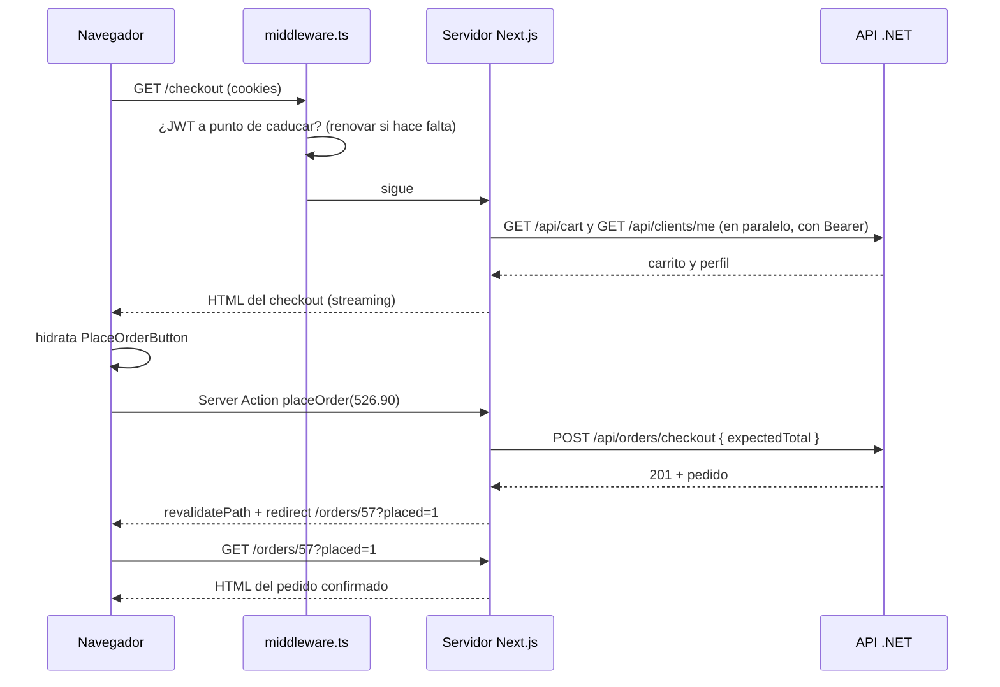

# Guía de la web de Furnistore

Esta guía explica la aplicación web de Furnistore (`apps/web`) de punta a punta: cómo funciona la web por debajo, cómo está construida esta aplicación con Next.js y React, por qué se tomó cada decisión y qué hace cada pantalla. Es la compañera de la guía de la API: está pensada para alguien que sabe programar pero no domina el desarrollo web moderno, y quiere llegar a poder modificar este proyecto, o cualquier proyecto Next.js existente, con criterio.

**Cómo leerla.** Casi todos los apartados siguen el mismo esquema:

- **Concepto:** qué es la pieza y qué problema resuelve, independientemente de Furnistore.
- **En Furnistore:** dónde está en el código, con fragmentos reales.
- **Por qué así:** qué alternativa se descartó y cuándo convendría cambiar la decisión.

Las rutas de archivo son relativas a `apps/web/src/` salvo que se diga otra cosa. Los fragmentos de código se copiaron del repositorio; a veces se recortan con `…`.

---

## Índice

**Parte I. Fundamentos**

1. Mapa general
2. Cómo funciona una aplicación web
3. React en lo esencial
4. Next.js y el App Router
5. Dónde se renderiza cada cosa: servidor y cliente
6. TypeScript y herramientas

**Parte II. Arquitectura**

7. La estructura de carpetas y sus reglas
8. Anatomía de un módulo
9. Leer datos: el cliente de la API
10. Escribir datos: Server Actions y Route Handlers
11. Estado en la URL
12. Recorrido completo: confirmar un pedido

**Parte III. Sesión y seguridad**

13. Login, registro y verificación de correo
14. JWT y refresh tokens en la web
15. Protección de rutas
16. Seguridad web: lista de comprobación

**Parte IV. Pantallas**

17. La tienda
18. El panel de administración

**Parte V. Interfaz y calidad**

19. Estilos: Tailwind, tokens, modo oscuro y shadcn/ui
20. Accesibilidad y estados de carga
21. Rendimiento e imágenes
22. Recetas para modificar el proyecto
23. Deuda conocida y glosario

---

# Parte I. Fundamentos

## 1. Mapa general

### 1.1 Qué es la web

`apps/web` es una aplicación **Next.js 15** (instalada: 15.5) con **React 19** y **TypeScript**. Tiene dos caras:

- **La tienda:** catálogo, detalle de producto, carrito, checkout, pedidos y perfil.
- **El panel de administración** (`/admin`): pedidos, productos, categorías, clientes, reportes y auditoría.

No tiene base de datos propia. Todo lo que muestra y todo lo que cambia pasa por la API .NET.

### 1.2 Tecnologías

| Pieza | Para qué |
|---|---|
| **Next.js 15** (App Router) | Framework: rutas, renderizado en servidor, Server Actions, middleware, optimización de imágenes. |
| **React 19** | Biblioteca para construir la interfaz con componentes. |
| **TypeScript 5** (modo `strict`) | JavaScript con tipos. |
| **Tailwind CSS 4** | Estilos con clases utilitarias. |
| **shadcn/ui** sobre **Radix UI** | Componentes base (botón, select, menú, tabla…) copiados al proyecto. |
| **nuqs** | Leer y escribir el estado en la URL (`?q=mesa&page=2`). |
| **TanStack Table** | Lógica de las tablas del panel. |
| **Recharts** | Gráficos de los reportes en pantalla. |
| **@react-pdf/renderer** | Generar los PDF de los reportes en el servidor. |
| **lucide-react** | Iconos. |
| **openapi-typescript** | Generar los tipos TypeScript a partir del contrato de la API. |

### 1.3 Cómo se arranca

```bash
# Desde la raíz: API y web a la vez
pnpm dev

# Solo la web, desde la raíz
pnpm dev --filter=@furnistore/web
```

El script `dev` de `apps/web/package.json` es `next dev`, que sirve la web en `http://localhost:3000` y recarga el navegador al guardar un archivo.

La web necesita dos variables en `apps/web/.env.local` (ver `.env.example`):

| Variable | Para qué |
|---|---|
| `API_BASE_URL` | Dirección de la API, por ejemplo `http://localhost:5135`. |
| `SUPABASE_URL` | Dominio desde el que se permiten imágenes de producto en `next/image`. Si falta, **la web no arranca** (lo comprueba `next.config.ts`). |

Ninguna lleva el prefijo `NEXT_PUBLIC_`, y es deliberado: en Next.js solo las variables con ese prefijo llegan al navegador. Así la dirección de la API nunca se expone al cliente (ver capítulo 2.4).

### 1.4 Las carpetas de un vistazo

```
apps/web/
├── package.json, next.config.ts, tsconfig.json, eslint.config.mjs, components.json
├── .env.example / .env.local
└── src/
    ├── middleware.ts        se ejecuta antes de cada petición de página (sesión)
    ├── app/                 las RUTAS: una carpeta por URL
    │   ├── layout.tsx       el HTML común a toda la web
    │   ├── (shop)/          tienda
    │   ├── (auth)/          login y registro
    │   ├── (admin)/admin/   panel
    │   └── api/auth/        endpoints HTTP propios: login, logout, registro
    ├── modules/             la LÓGICA, organizada por funcionalidad
    │   ├── products/  cart/  orders/  account/  auth/
    │   └── admin/     orders/  products/  categories/  customers/  reports/  audit/ …
    ├── components/          piezas visuales compartidas
    │   └── ui/              componentes base de shadcn/ui
    ├── lib/                 infraestructura: cliente de la API, sesión, errores, formatos
    └── assets/              imágenes estáticas
```

En cifras: unas 11.100 líneas de código propio (sin contar `lib/api/schema.d.ts`, que son 4.300 líneas generadas), 47 archivos de componentes de cliente, 8 archivos de Server Actions.

---

## 2. Cómo funciona una aplicación web

Este capítulo no es de Next.js: es lo que hay debajo de cualquier web. Sin esto, las decisiones de los capítulos siguientes no se entienden.

### 2.1 El navegador, HTML, CSS y JavaScript

El navegador entiende tres cosas:

- **HTML:** la estructura y el contenido (`<h1>Catálogo</h1>`).
- **CSS:** el aspecto (colores, tamaños, disposición).
- **JavaScript (JS):** el comportamiento (qué pasa al hacer clic, pedir datos, cambiar la página sin recargarla).

React, Next.js, TypeScript y Tailwind son herramientas para **producir** esas tres cosas de forma más cómoda. Al final, lo que llega al navegador siempre es HTML, CSS y JS.

### 2.2 HTTP: peticiones y respuestas

Todo lo que pasa en la web es una **petición HTTP** (método + URL + cabeceras + cuerpo opcional) y una **respuesta** (código de estado + cabeceras + cuerpo).

- `GET /` → el servidor responde con el HTML del catálogo.
- `POST /api/auth/login` con un JSON → el servidor responde `200` y unas cookies.

Códigos de estado que verás en este proyecto: `200` OK, `201` creado, `204` sin contenido, `302/307` redirección, `400` datos inválidos, `401` sin sesión, `403` sin permiso, `404` no existe, `409` conflicto, `429` demasiadas peticiones, `500` error del servidor.

### 2.3 Cookies

Una **cookie** es un dato pequeño que el servidor pide al navegador que guarde (cabecera `Set-Cookie`) y que el navegador **reenvía automáticamente** en cada petición posterior al mismo sitio (cabecera `Cookie`). Es el mecanismo estándar para mantener una sesión: el servidor no "recuerda" al usuario, es el navegador el que trae su credencial en cada petición.

Atributos que importan (Furnistore los usa todos, ver capítulo 16):

| Atributo | Efecto |
|---|---|
| `HttpOnly` | El JavaScript de la página **no** puede leerla. Protege la sesión si alguien consigue ejecutar código en la página (XSS). |
| `Secure` | Solo se envía por HTTPS. |
| `SameSite=Lax` | No se envía en peticiones `POST` que vienen de otros sitios. Protege contra CSRF. |
| `Max-Age` | Cuánto dura. |
| `Path` | En qué rutas se envía. |

### 2.4 Dónde se ejecuta el código

Esta es **la** idea clave de una aplicación Next.js: el mismo proyecto contiene código que corre en dos máquinas distintas.

- **El servidor** (Node.js, en tu máquina o en el hosting): tiene acceso a las variables de entorno, a la red interna y a las cookies `HttpOnly`. Los usuarios no ven su código.
- **El navegador** del usuario: solo tiene lo que el servidor le envía. Todo lo que llega al navegador es **público**: cualquiera puede abrir las herramientas de desarrollo y leerlo.

### 2.5 El patrón BFF de Furnistore

**Concepto.** Un **BFF** (*Backend For Frontend*) es un servidor que se pone entre el navegador y la API "de verdad", adaptado a lo que necesita esa interfaz.

**En Furnistore.** El servidor de Next.js hace de BFF. **El navegador nunca llama a la API .NET directamente:**

```
Navegador ──(cookies de sesión)──► Servidor Next.js ──(Authorization: Bearer <JWT>)──► API .NET ──► PostgreSQL
           ◄──── HTML / JSON ────                    ◄──────────── JSON ────────────
```

1. El navegador pide páginas o ejecuta acciones contra el servidor de Next.js, enviando sus cookies.
2. El servidor lee el JWT de la cookie, llama a la API con la cabecera `Authorization` y recibe JSON.
3. El servidor convierte ese JSON en HTML (o en una respuesta para la acción) y lo devuelve.

**Por qué así:**

- El JWT vive en una cookie `HttpOnly`: el JavaScript del navegador nunca lo ve, así que un script malicioso no puede robarlo.
- La dirección de la API no se publica, y la API no necesita aceptar llamadas desde navegadores de cualquier origen.
- El servidor de Next.js puede combinar varias llamadas a la API en una sola página (ver `Promise.all` en el capítulo 21).

La alternativa clásica es una **SPA** (*Single Page Application*): el navegador descarga una aplicación JS vacía, guarda el token en `localStorage` y llama a la API directamente. Es más simple de montar, pero el token queda accesible a cualquier script de la página y todo el contenido se pinta tarde, después de descargar y ejecutar el JS.

---

## 3. React en lo esencial

### 3.1 Componentes y JSX

**Concepto.** En React la interfaz se construye con **componentes**: funciones que reciben datos (**props**) y devuelven qué pintar, escrito en **JSX** (una sintaxis parecida a HTML dentro de JS/TS).

**En Furnistore.** `components/panel.tsx`, completo:

```tsx
export function Panel({ children }: { children: ReactNode }) {
  return (
    <div className="flex flex-col items-center gap-3 border border-dashed border-hairline py-20 text-center">
      <p className="text-ink-muted">{children}</p>
    </div>
  );
}
```

Y se usa así: `<Panel>Tu carrito está vacío.</Panel>`. Diferencias con HTML: `className` en lugar de `class`, `htmlFor` en lugar de `for`, y `{expresión}` para meter valores de JS.

Las listas se pintan con `map`, y cada elemento lleva una `key` única para que React sepa cuál es cuál al actualizar:

```tsx
{products.map((product) => (
  <ProductCard key={product.id} product={product} isAuthenticated={isAuthenticated} />
))}
```

### 3.2 Estado y re-renderizado

**Concepto.** El **estado** es un dato que, al cambiar, hace que React vuelva a ejecutar el componente y actualice la pantalla. Se declara con el *hook* `useState`:

```tsx
const [error, setError] = useState<string | null>(null);
…
setError("Código incorrecto.");   // React vuelve a pintar el componente con el nuevo valor
```

Nunca se modifica el estado directamente (`error = "..."`): siempre con su función `set…`.

### 3.3 Los hooks que usa Furnistore

Un **hook** es una función de React que empieza por `use` y solo se puede llamar en el cuerpo de un componente de cliente.

| Hook | Para qué | Ejemplo en Furnistore |
|---|---|---|
| `useState` | Estado local. | Mensajes de error, "pendiente", el código de verificación tecleado. |
| `useEffect` | Ejecutar algo **después** de pintar, y limpiarlo al desmontar. | `AddToCartButton` quita el "Agregado ✓" a los 2 s; `ImagePicker` libera la URL de la vista previa. |
| `useTransition` | Marcar una actualización como "transición" y saber si está en curso (`pending`). | Casi todos los botones que llaman a una Server Action. |
| `useOptimistic` | Mostrar el resultado esperado **antes** de que responda el servidor. | `CartGrill`: el carrito cambia al instante al pulsar `+`. |
| `useRef` | Guardar una referencia que no provoca re-render, por ejemplo a un elemento del DOM. | `ImagePicker` guarda el `<input type="file">` para poder vaciarlo. |
| `useContext` / `createContext` | Compartir un valor con todos los componentes de debajo sin pasarlo por props. | `TableFrame` comparte su `startTransition` con los filtros y la tabla. |
| `useRouter` (de Next) | Navegar desde código: `router.push`, `router.refresh`. | Tras el login: `router.push(next); router.refresh();`. |

Y uno que no es un hook pero aparece mucho: **`cache()`** de React, que se ve en el capítulo 9.

---

## 4. Next.js y el App Router

### 4.1 Las rutas son carpetas

**Concepto.** En el App Router de Next.js, **la estructura de carpetas dentro de `app/` define las URLs.** Una carpeta es un segmento de la URL, y un archivo con nombre especial dentro de ella define qué hace ese segmento.

| Archivo | Qué es |
|---|---|
| `page.tsx` | La página de esa URL. Sin `page.tsx`, la URL no existe. |
| `layout.tsx` | El "marco" que envuelve a la página y a todas las de debajo. No se vuelve a montar al navegar entre ellas. |
| `loading.tsx` | Lo que se muestra mientras la página carga (capítulo 5.6). |
| `error.tsx` | Lo que se muestra si la página lanza un error. |
| `not-found.tsx` | Lo que se muestra al llamar a `notFound()`. |
| `route.ts` | Un endpoint HTTP (devuelve JSON o un archivo, no una página). |

### 4.2 Segmentos especiales

- **`[productSlug]`**: segmento **dinámico**. `app/(shop)/[productSlug]/page.tsx` atiende `/mesa-de-centro-nogal-5`, `/silla-plegable-bambu-4`… y recibe el valor en `params.productSlug`.
- **`(shop)`, `(auth)`, `(admin)`**: **grupos de rutas**. El paréntesis hace que la carpeta **no** aparezca en la URL: `app/(shop)/cart/page.tsx` es `/cart`, no `/shop/cart`. Sirven para dar un `layout` distinto a cada grupo sin cambiar las URLs.

### 4.3 El mapa de rutas de Furnistore

| URL | Archivo | Qué es |
|---|---|---|
| `/` | `(shop)/page.tsx` | Catálogo |
| `/{slug}-{id}` | `(shop)/[productSlug]/page.tsx` | Detalle de producto |
| `/cart` | `(shop)/cart/page.tsx` | Carrito |
| `/checkout` | `(shop)/checkout/page.tsx` | Finalizar compra |
| `/orders`, `/orders/{id}` | `(shop)/orders/...` | Mis pedidos y detalle |
| `/profile` | `(shop)/profile/page.tsx` | Mi perfil |
| `/login`, `/register` | `(auth)/...` | Acceso |
| `/admin` | `(admin)/admin/page.tsx` | Resumen del panel |
| `/admin/orders`, `/admin/orders/{id}` | `(admin)/admin/orders/...` | Pedidos |
| `/admin/products`, `/new`, `/{id}` | `(admin)/admin/products/...` | Productos |
| `/admin/categories` | `(admin)/admin/categories/page.tsx` | Categorías |
| `/admin/customers`, `/{id}` | `(admin)/admin/customers/...` | Clientes |
| `/admin/reports/{report}` | `(admin)/admin/reports/[report]/page.tsx` | Reportes |
| `/admin/reports/{report}/pdf` y `/csv` | `.../[report]/pdf/route.ts`, `csv/route.ts` | Descarga de reportes |
| `/admin/audit` | `(admin)/admin/audit/page.tsx` | Auditoría |
| `/api/auth/login`, `/logout`, `/register` | `app/api/auth/*/route.ts` | Endpoints de sesión |

### 4.4 Los layouts anidados

Una página se pinta dentro de **todos** los layouts de sus carpetas superiores:

```
app/layout.tsx                     <html>, fuentes, tema, NuqsAdapter
└── app/(shop)/layout.tsx          SiteHeader + página + SiteFooter
    └── app/(shop)/cart/page.tsx   el carrito
```

```
app/layout.tsx
└── app/(admin)/admin/layout.tsx   comprueba que sea admin + AdminShell (barra lateral)
    └── app/(admin)/admin/orders/page.tsx
```

El grupo `(auth)` tiene un layout que solo devuelve `children`: las páginas de login y registro no llevan la cabecera de la tienda.

### 4.5 `params` y `searchParams` son promesas

En Next.js 15, una página recibe los segmentos dinámicos (`params`) y la *query string* (`searchParams`) como **promesas** que hay que esperar:

```tsx
export default async function Page({
  searchParams,
}: {
  searchParams: Promise<{ q?: string; page?: string }>;
}) {
  const { q, page } = await searchParams;
  return <ProductContainer query={q} page={page} />;
}
```

Si ves código de Next.js 13 o 14 con `params.id` sin `await`, es la forma antigua.

### 4.6 Metadatos

Cada página puede exportar `metadata` para el `<title>` y otras etiquetas:

```tsx
export const metadata: Metadata = {
  title: "Carrito",
  robots: { index: false, follow: false },
};
```

El layout raíz define la plantilla `"%s · Furnistore"`, así que el título final es "Carrito · Furnistore". Las páginas privadas (carrito, checkout, pedidos, perfil, todo el panel) llevan `robots: noindex` para que los buscadores no las indexen. Cuando el título depende de los datos se usa la función `generateMetadata` (por ejemplo, en `/admin/reports/[report]`).

---

## 5. Dónde se renderiza cada cosa: servidor y cliente

### 5.1 Las estrategias de renderizado

"Renderizar" es convertir los datos en HTML. Hay cuatro estrategias clásicas:

| Estrategia | Cuándo se genera el HTML | Bueno para | Malo para |
|---|---|---|---|
| **CSR** (*Client-Side Rendering*) | En el navegador, después de descargar el JS y pedir los datos. | Aplicaciones muy interactivas detrás de un login. | Primera carga lenta (pantalla en blanco), SEO pobre, el token vive en el navegador. |
| **SSR** (*Server-Side Rendering*) | En el servidor, **en cada petición**. | Datos que cambian o dependen del usuario. | Cada visita cuesta trabajo al servidor. |
| **SSG** (*Static Site Generation*) | En el servidor, **una vez, al compilar**. | Contenido que casi no cambia (un blog, una página "Acerca de"). | Datos que cambian. |
| **ISR** (*Incremental Static Regeneration*) | Como SSG, pero se regenera cada cierto tiempo o bajo demanda. | Catálogos grandes que cambian poco. | Datos por usuario. |

### 5.2 Server Components y Client Components

**Concepto.** En el App Router, **todo componente es de servidor por defecto** (*React Server Component*, RSC). Un Server Component:

- Se ejecuta **solo en el servidor**. Su código no se envía al navegador.
- Puede ser `async` y esperar datos directamente (`await getProducts()`).
- Puede leer cookies, variables de entorno y llamar a la API.
- **No** puede tener estado, efectos ni manejadores de eventos (`onClick`), porque en el servidor no hay usuario que haga clic.

Cuando un componente necesita interactividad, se marca con **`"use client"`** en la primera línea. Un Client Component:

- Se renderiza una primera vez en el servidor (para que el HTML llegue completo) y **además** su código se envía al navegador, donde se "activa" (capítulo 5.5).
- Puede usar `useState`, `useEffect`, `onClick`…
- **No** puede ser `async` ni leer cookies `HttpOnly`.

`"use client"` marca una **frontera**: ese archivo y todo lo que importe pasan a ser código de cliente. Por eso conviene que los componentes de cliente sean **hojas** pequeñas del árbol, y que el servidor les pase los datos ya cargados por props. Esas props tienen que ser **serializables** (texto, números, objetos y arrays simples, otros componentes); no pueden ser, por ejemplo, una instancia de clase. La única excepción son las Server Actions, que sí se pueden pasar como props (capítulo 10).

### 5.3 Cómo lo usa Furnistore

La regla del proyecto: **los datos se cargan en el servidor; el cliente solo se encarga de la interacción.**

```
ProductContainer      (servidor)  await getProducts(...)        ← carga datos
└── ProductGrill      (servidor)  pinta la rejilla
    └── ProductCard   (servidor)  imagen, nombre, precio
        └── AddToCartButton  ("use client")  estado "Agregando…", llama a la acción
```

Solo el botón viaja al navegador como JS; la rejilla y las tarjetas llegan como HTML ya hecho. En todo `src/` hay 47 archivos con `"use client"`, y todos son de este tipo: botones, formularios, filtros, menús, gráficos, el selector de tema.

**Todas las páginas de Furnistore son SSR dinámico.** No hay SSG ni ISR, por tres razones:

1. Casi todas las páginas leen la cookie de sesión (aunque sea para pintar la cabecera), y leer cookies obliga a Next.js a renderizar en cada petición.
2. El cliente de la API pide los datos con `cache: "no-store"` (capítulo 9): stock y precios cambian, y mostrar uno viejo provoca errores en el checkout.
3. Gran parte del contenido depende del usuario (carrito, pedidos, perfil, panel).

**Cuándo habría que revisarlo.** Si el catálogo tuviera mucho tráfico, el listado público podría pasar a ISR (regenerarse cada minuto) separando la cabecera personalizada. Hoy no compensa la complejidad.

### 5.4 Componentes de servidor que viven dentro de componentes de cliente

Un componente de cliente no puede **importar** uno de servidor, pero sí **recibirlo como `children`** ya renderizado. Furnistore lo usa en el panel: `TableFrame` es de cliente (comparte una transición), pero dentro recibe la tabla y los filtros que el contenedor de servidor ya preparó.

### 5.5 Hidratación

**Concepto.** Cuando llega una página, el navegador muestra primero el HTML que hizo el servidor. Luego descarga el JS de los componentes de cliente y React "conecta" los manejadores de eventos a ese HTML existente sin volver a pintarlo. Eso es la **hidratación**. Para que funcione, el HTML que genera el cliente en su primera pasada tiene que coincidir con el del servidor; si no, React avisa de un *hydration mismatch*.

**En Furnistore.** El modo oscuro es el caso típico de desajuste: el servidor no sabe si el usuario eligió tema oscuro (está en `localStorage`, que solo existe en el navegador). La solución está en `app/layout.tsx`:

```tsx
const THEME_INIT_SCRIPT = `(function(){try{var s=localStorage.getItem('theme');var d=s?s==='dark':window.matchMedia('(prefers-color-scheme: dark)').matches;if(d)document.documentElement.classList.add('dark');}catch(e){}})();`;
…
<html lang="es" suppressHydrationWarning …>
  <head>
    <script dangerouslySetInnerHTML={{ __html: THEME_INIT_SCRIPT }} />
  </head>
```

- El script se ejecuta **antes de pintar**, y añade la clase `dark` a `<html>` si toca. Así no hay un destello del tema claro.
- `suppressHydrationWarning` le dice a React que ese atributo de `<html>` puede diferir del servidor a propósito.
- `ThemeToggle` lee la clase actual en un `useEffect` (después de hidratar), no durante el render, por la misma razón.

### 5.6 Streaming y Suspense

**Concepto.** Con **streaming**, el servidor no espera a tener toda la página para empezar a enviarla: manda primero lo que está listo y el resto después, por la misma conexión. Las partes que todavía cargan se envuelven en `<Suspense fallback={…}>`, que muestra el `fallback` mientras tanto.

**En Furnistore:**

- Cada `loading.tsx` es un `Suspense` automático alrededor de la página. Por ejemplo, `app/(shop)/loading.tsx` muestra una silla parpadeando mientras el servidor espera a la API.
- En la cabecera, el contador del carrito va en su propio `Suspense`:

  ```tsx
  <Suspense fallback={<CartLink count={null} />}>
    <CartBadge />
  </Suspense>
  ```

  La cabecera aparece al instante con el icono del carrito, y el número se rellena cuando llega la respuesta de `/api/cart`.

**Un efecto secundario conocido.** Con streaming, el código de estado HTTP (`200`) se envía al principio. Si después la página llama a `notFound()`, el usuario ve la página 404 correcta, pero el código HTTP sigue siendo `200`. Afecta a las rutas de la tienda con `loading.tsx`; está aceptado porque esas páginas no se indexan o no importa el código exacto.

### 5.7 Las cachés de Next.js, y por qué casi todas están apagadas

Next.js tiene varias capas de caché, y es la fuente de confusión número uno al empezar:

| Caché | Qué guarda | En Furnistore |
|---|---|---|
| **Data Cache** (`fetch`) | Respuestas de `fetch` en el servidor, entre peticiones. | **Apagada**: `apiFetch` usa `cache: "no-store"`. |
| **Full Route Cache** | El HTML de páginas estáticas. | No aplica: todas las páginas son dinámicas. |
| **`cache()` de React** | El resultado de una función **durante una misma petición**. | Se usa para no pedir dos veces lo mismo al renderizar una página (capítulo 9.3). |
| **Router Cache** | En el navegador, las páginas ya visitadas, para que "atrás" sea instantáneo. | Activa; se invalida con `revalidatePath` y `router.refresh()` tras cada cambio (capítulo 10). |
| **Caché de imágenes** | Las imágenes optimizadas por `next/image`. | Activa, 31 días (capítulo 21). |

---

## 6. TypeScript y herramientas

### 6.1 TypeScript estricto

`tsconfig.json` activa `"strict": true`: el compilador no permite usar algo que podría ser `null` o `undefined` sin comprobarlo, ni dejar parámetros sin tipo. `pnpm --filter @furnistore/web exec tsc --noEmit` comprueba los tipos sin generar nada.

El alias `"@/*": ["./src/*"]` permite importar con rutas absolutas: `import { apiFetch } from "@/lib/api/client"` en lugar de `../../../lib/api/client`.

### 6.2 Tipos generados desde la API

**Concepto.** La API publica su contrato en OpenAPI (`apps/api/openapi.json`). En lugar de escribir a mano los tipos de cada respuesta, se **generan**.

**En Furnistore.**

```bash
pnpm --filter @furnistore/web gen:api
# = openapi-typescript ../api/openapi.json -o src/lib/api/schema.d.ts --properties-required-by-default
```

Eso produce `lib/api/schema.d.ts`, y `lib/api/contract.ts` lo expone con un nombre corto:

```ts
import type { components } from "@/lib/api/schema";
export type ApiSchemas = components["schemas"];
```

Cada módulo define sus tipos a partir de ahí:

```ts
// modules/cart/types.ts
export type Cart = ApiSchemas["CartResponse"];
export type CartItem = ApiSchemas["CartItemResponse"];
```

**Por qué así.** Si alguien cambia un contrato en la API, se regenera `openapi.json`, se ejecuta `gen:api` y TypeScript marca en rojo cada sitio de la web que ya no encaja. Los dos proyectos no pueden desincronizarse en silencio.

### 6.3 Construcciones de TypeScript que verás

| Construcción | Qué significa | Ejemplo |
|---|---|---|
| `type X = { … }` | Describe la forma de un objeto. | `type SessionUser = { email: string; isAdmin: boolean }` |
| Uniones discriminadas | Un tipo que es "una cosa u otra", distinguidas por un campo. | `{ ok: true; value: T } \| { ok: false; error: E }` |
| `satisfies` | Comprueba que un valor cumple un tipo sin cambiar su tipo inferido. | `{ productId, quantity } satisfies ApiSchemas["AddCartItemRequest"]` |
| `as const` | Trata un array u objeto como valores literales fijos. | `["Active", "Archived"] as const` |
| `Record<K, V>` | Objeto con claves de tipo `K` y valores `V`. | `Record<OrderStatus, string>` para las etiquetas de estado. |
| `Partial<T>` | Todas las propiedades de `T`, opcionales. | `Partial<Record<ProductField, string>>` para los errores de un formulario. |
| `value is X` | Función que, si devuelve `true`, le dice al compilador que el valor es de tipo `X`. | `function isId(value: unknown): value is number` |
| `unknown` | "No sé qué es": obliga a comprobarlo antes de usarlo. | Los parámetros de las Server Actions. |

### 6.4 Lint y monorepo

- **ESLint** (`eslint.config.mjs`) aplica las reglas de Next.js (`next/core-web-vitals`) y de TypeScript. `pnpm lint` lo ejecuta.
- La web es un paquete del monorepo (`@furnistore/web`); Turborepo orquesta `dev`, `build` y `lint` de la web y la API desde la raíz.

---

# Parte II. Arquitectura

## 7. La estructura de carpetas y sus reglas

### 7.1 Las cuatro zonas

| Carpeta | Qué contiene | Regla |
|---|---|---|
| `app/` | Rutas: `page.tsx`, `layout.tsx`, `loading.tsx`, `route.ts`. | **Finas.** Una página solo lee `params`/`searchParams`, valida el formato y devuelve un `Container`. No carga datos ni tiene lógica. |
| `modules/` | Toda la lógica y la interfaz de cada funcionalidad. | Organizada **por funcionalidad** (`cart/`, `orders/`, `admin/products/`…), no por tipo de archivo. |
| `components/` | Piezas visuales que usan varios módulos: cabecera, pie, paginación, `Panel`, y los componentes base en `ui/`. | No conocen ninguna funcionalidad concreta. |
| `lib/` | Infraestructura: cliente de la API, sesión, tipo `Result`, errores, formato de fechas y precios. | No conoce ninguna pantalla. |

Una página típica, completa (`app/(shop)/checkout/page.tsx`):

```tsx
export const metadata: Metadata = {
  title: "Finalizar compra",
  robots: { index: false, follow: false },
};

export default function Page() {
  return <CheckoutContainer />;
}
```

### 7.2 Por qué separar rutas y módulos

- Las carpetas de `app/` tienen nombres impuestos por Next.js (`page.tsx`, `(shop)`, `[productSlug]`). Si la lógica viviera ahí, una funcionalidad acabaría repartida entre rutas.
- Un mismo módulo sirve a varias rutas: `modules/account/` lo usan `/profile` y `/checkout`; `modules/admin/table/` lo usan todos los listados del panel.
- Si mañana cambia una URL, solo se mueve la carpeta de `app/`; el módulo no se toca.

**Cuándo habría que revisarlo.** En un proyecto muy pequeño, esta separación sobra y se puede poner todo en `app/`. Aquí, con unas 30 pantallas, compensa.

---

## 8. Anatomía de un módulo

### 8.1 Los archivos de un módulo

Casi todos los módulos tienen los mismos tipos de archivo. `modules/orders/` como ejemplo:

| Archivo | Dónde corre | Qué hace |
|---|---|---|
| `types.ts` | — | Los tipos del módulo, sacados de `ApiSchemas`. |
| `api.ts` | Servidor | Una función por endpoint de la API: `getOrders`, `getOrder`, `checkout`, `cancelOrder`. Devuelven `Result`. |
| `actions.ts` | Servidor (`"use server"`) | Server Actions: lo que el usuario puede **cambiar** (`placeOrder`, `cancelOrder`). Validan, llaman a `api.ts`, refrescan y redirigen. |
| `error-messages.ts` | Ambos | Traduce los códigos de error de la API a mensajes para el usuario. |
| `list/orders-container.tsx` | Servidor | Carga los datos y decide qué pintar: error, vacío o la lista. |
| `list/orders-grill.tsx`, `list/order-card.tsx` | Servidor | Pintan los datos que reciben. |
| `detail/order-detail-container.tsx`, `detail/order-detail-view.tsx` | Servidor | Igual, para el detalle. |
| `detail/cancel-order-button.tsx` | Cliente | La parte interactiva: confirmar, motivo, "Cancelando…". |

### 8.2 La convención de nombres de componentes

| Sufijo | Rol | ¿Carga datos? |
|---|---|---|
| `…Container` | La parte de arriba de cada pantalla. Pide los datos, maneja los casos (sin sesión → `redirect`, no existe → `notFound()`, error → `Panel`, vacío → `Panel`) y pasa los datos a la vista. | **Sí**, el único. |
| `…Grill` | Una rejilla o lista de elementos. | No |
| `…Card` | Un elemento de la lista. | No |
| `…View` | La vista de una sola entidad (detalle). | No |
| `…Form` | Un formulario: solo pinta campos y errores. | No |
| `…Editor` | Envuelve un `Form` con el estado (pendiente, errores, mensaje) y la llamada a la acción. Es de cliente. | No |

**Por qué así.** Solo hay un lugar por pantalla que habla con la API y decide qué casos existen. El resto son componentes que reciben datos y pintan, fáciles de leer y reutilizar.

### 8.3 Un `Container` real

`modules/orders/list/orders-container.tsx`, resumido:

```tsx
export async function OrdersContainer({ page }: { page?: string }) {
  const requestedPage = Number.parseInt(page ?? "1", 10);
  const currentPage = Number.isFinite(requestedPage) ? Math.max(1, requestedPage) : 1;

  const result = await getOrders({ page: currentPage, pageSize: PAGE_SIZE });

  if (!result.ok && result.error.kind === "unauthorized") {
    redirect(`/login?next=${encodeURIComponent(hrefFor(currentPage))}`);
  }

  return (
    <div …>
      <h1 …>Mis pedidos</h1>
      {!result.ok ? (
        <Panel>{orderErrorMessage(result.error)}</Panel>
      ) : result.value.total === 0 ? (
        <Panel>Todavía no tienes pedidos. …</Panel>
      ) : (
        <>
          <OrdersGrill orders={result.value.items} />
          {totalPages > 1 && <Pagination … />}
        </>
      )}
    </div>
  );
}
```

Fíjate en que:

- Es una función `async`: espera los datos directamente, sin `useEffect` ni estados de "cargando" (de eso se encarga `loading.tsx`).
- Normaliza la entrada: un `?page=abc` o `?page=-3` se convierte en la página 1.
- Trata **todos** los casos: sin sesión, error, vacío y con datos.

---

## 9. Leer datos: el cliente de la API

### 9.1 `apiFetch`: una sola puerta hacia la API

Toda llamada a la API pasa por `lib/api/client.ts`:

```ts
export async function apiFetch<T>(path: string, init: ApiFetchInit = {}): Promise<Result<T, AppError>> {
  const { body, headers, timeoutMs = DEFAULT_TIMEOUT_MS, ...rest } = init;
  const isForm = body instanceof FormData;

  let response: Response;
  try {
    response = await fetch(`${getBaseUrl()}${path}`, {
      ...rest,
      headers: isForm ? headers : { "Content-Type": "application/json", ...headers },
      body: isForm ? body : body !== undefined ? JSON.stringify(body) : undefined,
      cache: "no-store",
      signal: AbortSignal.timeout(timeoutMs),
    });
  } catch (cause) {
    const kind = isTimeout(cause) ? "timeout" : "network";
    return failure({ kind, messages: [] }, method, path, cause);
  }

  if (response.status === 204) return ok(undefined as T);
  const data = await response.json().catch(() => null);

  if (!response.ok) {
    return failure({ kind: kindForStatus(response.status), status: response.status,
                     code: extractCode(data), messages: extractMessages(data) }, method, path);
  }
  return ok(data as T);
}
```

Lo que garantiza:

- **Nunca lanza una excepción**: siempre devuelve un `Result`. Quien llama está obligado a mirar `result.ok`.
- **Timeout**: 8 segundos por defecto (`AbortSignal.timeout`). Algunas llamadas lo amplían: registro y reenvío de código 20 s (envían un correo), checkout 20 s, subida de imagen 30 s. Sin timeout, una API colgada dejaría la página cargando indefinidamente.
- **Sin caché** (`cache: "no-store"`), por las razones del capítulo 5.3.
- **JSON o formulario**: si el cuerpo es un `FormData` (subida de imágenes), lo envía tal cual para que `fetch` ponga la cabecera `multipart/form-data` correcta.
- **Errores normalizados**: convierte el `ProblemDetails` de la API en un `AppError`, y escribe en el log del servidor `[api] POST /api/orders/checkout → conflict 409 checkout.insufficient_stock`.

La primera línea del archivo es `import "server-only";`. Ese paquete hace que **la compilación falle** si algún componente de cliente intenta importar este archivo. Como `apiFetch` usa `API_BASE_URL` y, en su versión autenticada, el JWT, no debe llegar nunca al navegador. Ocho archivos de `lib/` y `modules/` llevan esta protección.

### 9.2 `Result` y `AppError`

Es el mismo patrón que la API (`Result<T>` en .NET), adaptado a TypeScript (`lib/result.ts`):

```ts
export type Result<T, E = AppError> = { ok: true; value: T } | { ok: false; error: E };
```

Y el error (`lib/errors.ts`):

```ts
export type AppError = {
  kind: AppErrorKind;     // "network" | "timeout" | "unauthorized" | "notFound" | "conflict" | "rateLimited" | "validation" | "server" | "unexpected"
  status?: number;        // el código HTTP, si lo hubo
  code?: string;          // el código de la API, p. ej. "checkout.price_changed"
  messages: string[];     // los mensajes que vinieron en el cuerpo
};
```

| HTTP | `kind` |
|---|---|
| sin respuesta | `network` o `timeout` |
| 401, 403 | `unauthorized` |
| 404 | `notFound` |
| 409 | `conflict` |
| 429 | `rateLimited` |
| otros 4xx | `validation` |
| 5xx | `server` |

### 9.3 `authedApiFetch` y `cache()`

`lib/api/authed.ts` añade el token de la sesión:

```ts
export async function authedApiFetch<T>(path: string, init: ApiFetchInit = {}) {
  const token = await getSession();
  if (!token) return err({ kind: "unauthorized", messages: [] });

  return apiFetch<T>(path, { ...init, headers: { ...init.headers, Authorization: `Bearer ${token}` } });
}
```

Si no hay sesión, ni siquiera llama a la API.

Algunas lecturas se envuelven en `cache()` de React:

```ts
export const getCart = cache((): Promise<Result<Cart>> => authedApiFetch<Cart>("/api/cart"));
```

`cache()` **no** es una caché entre usuarios ni entre peticiones: solo evita repetir la misma llamada **dentro de un mismo renderizado**. En la página de checkout, la cabecera pide el carrito (para el contador) y `CheckoutContainer` también; gracias a `cache()`, la API recibe una sola llamada.

### 9.4 De código de error a mensaje

Cada módulo tiene su `error-messages.ts`, que decide qué texto ver según el `code` de la API, con un mensaje genérico por `kind` como respaldo:

```ts
const ORDER_MESSAGES: Record<string, string> = {
  "checkout.empty_cart": "Tu carrito está vacío.",
  "checkout.profile_incomplete": "Completa tus datos de envío antes de confirmar el pedido.",
  "checkout.price_changed": "Los precios de tu carrito cambiaron. Revisa el nuevo total y confirma de nuevo.",
  …
};

const SERVER_WORDED = new Set(["checkout.insufficient_stock", "checkout.product_unavailable", "order.invalid_transition"]);

export function orderErrorMessage(error: AppError): string {
  if (error.code && SERVER_WORDED.has(error.code) && error.messages[0]) return error.messages[0];
  return (error.code && ORDER_MESSAGES[error.code]) || toUserMessage(error);
}
```

Algunos errores se muestran con el texto que redactó la API (`SERVER_WORDED`) porque incluyen datos que la web no tiene, como "quedan 2". En el panel, `adminErrorMessage` usa siempre el mensaje de la API.

**Por qué así.** La interfaz decide su propio lenguaje sin depender de cómo redacte la API; y si la API añade un código nuevo, la web muestra al menos un mensaje genérico razonable.

---

## 10. Escribir datos: Server Actions y Route Handlers

### 10.1 Server Actions

**Concepto.** Una **Server Action** es una función `async` del servidor que un componente de cliente puede llamar **como si fuera una función normal**. Se declara en un archivo que empieza con `"use server"`. Por debajo, Next.js la convierte en una petición `POST` a la página actual con un identificador de la acción; los argumentos y el valor devuelto viajan serializados.

**En Furnistore.** Toda mutación que hace el usuario desde la interfaz (carrito, pedidos, perfil, todo el panel) es una Server Action. Hay ocho archivos `actions.ts`.

`modules/cart/actions.ts`, la acción de añadir al carrito:

```ts
"use server";

export async function addToCart(productId: number, quantity: number, returnTo: string): Promise<CartActionResult> {
  if (!isPositiveInteger(productId) || !isPositiveInteger(quantity) || quantity > MAX_QUANTITY) {
    return { ok: false, message: "Cantidad no válida." };
  }
  return settle(await addCartItem(productId, quantity), safeNextPath(returnTo));
}

function settle(result: Result<Cart>, returnTo: string): CartActionResult {
  if (result.ok) {
    revalidatePath("/", "layout");
    return { ok: true };
  }
  if (result.error.kind === "unauthorized") {
    redirect(`/login?next=${encodeURIComponent(returnTo)}`);
  }
  …
  return { ok: false, message: cartErrorMessage(result.error) };
}
```

Todas las acciones siguen los mismos pasos:

1. **Validar los argumentos.** Una Server Action es un endpoint público: cualquiera puede llamarla con cualquier dato, aunque la interfaz no lo permita. Por eso los parámetros se tratan como `unknown` o se comprueban (`isPositiveInteger`, longitud del motivo…). **Nunca se confía en el cliente.**
2. **Llamar a la API** a través de `api.ts`.
3. **Si salió bien:** `revalidatePath("/", "layout")` y, si procede, `redirect(...)`.
4. **Si no hay sesión:** `redirect` al login con `?next=` para volver después.
5. **Si falló:** devolver `{ ok: false, message }` para que el componente lo muestre.

**`revalidatePath("/", "layout")`** invalida todo lo que el navegador tiene guardado de todas las rutas (el Router Cache del capítulo 5.7). Así, tras añadir algo al carrito, el contador de la cabecera y cualquier página que se visite después se piden de nuevo con los datos actualizados. Es amplio a propósito: es más sencillo que calcular qué rutas exactas dependen de cada cambio, y en esta aplicación el coste es despreciable.

**`redirect()`** dentro de una acción no devuelve: interrumpe la función y le dice al navegador que navegue. Por eso, tras un checkout correcto, `placeOrder` termina directamente en `/orders/{id}?placed=1`.

### 10.2 Llamar a una acción desde el cliente

El patrón es siempre `useTransition` + llamada + estado de error. `modules/orders/checkout/place-order-button.tsx`:

```tsx
"use client";

export function PlaceOrderButton({ expectedTotal, disabled }: { expectedTotal: number; disabled: boolean }) {
  const [error, setError] = useState<string | null>(null);
  const [pending, startTransition] = useTransition();

  function handleClick() {
    setError(null);
    startTransition(async () => {
      const result = await placeOrder(expectedTotal);
      if (!result.ok) setError(result.message);
    });
  }

  return (
    <Button disabled={disabled || pending} onClick={handleClick}>
      {pending ? "Confirmando…" : "Confirmar pedido"}
    </Button>
    …
  );
}
```

- `pending` desactiva el botón y cambia el texto: evita el doble clic.
- Si la acción redirige, la navegación ocurre sola; si devuelve error, se muestra.
- Mientras la transición está en curso, React mantiene la pantalla actual en lugar de mostrar el `loading.tsx`.

Para formularios con varios campos, el componente `…Editor` hace lo mismo con `new FormData(event.currentTarget)` y además guarda los errores por campo (`fieldErrors`) que devuelve la acción.

### 10.3 Pasar argumentos fijos a una acción: `.bind`

En la edición de un producto, el formulario solo envía los campos, pero la acción necesita también el `id` y la `version`. El contenedor de servidor los fija con `bind`:

```tsx
<ProductEditor
  product={value}
  categories={categories.value.items}
  action={updateProduct.bind(null, value.id, value.version)}
/>
```

`updateProduct(id, version, formData)` se convierte en una función que solo espera `formData`. Next.js serializa esos argumentos fijados de forma segura.

### 10.4 Interfaz optimista

**Concepto.** En una interfaz **optimista**, el cambio se muestra antes de que el servidor lo confirme; si falla, se deshace.

**En Furnistore.** El carrito (`modules/cart/list/cart-grill.tsx`) usa `useOptimistic`:

```tsx
const [items, applyOptimistic] = useOptimistic(cart.items, applyChange);
const [pending, startTransition] = useTransition();

function run(change: CartChange, action: () => Promise<CartActionResult>) {
  setError(null);
  startTransition(async () => {
    applyOptimistic(change);           // la cantidad cambia en pantalla al instante
    const result = await action();     // la acción llama a la API y revalida
    if (!result.ok) setError(result.message);
  });
}
```

Al terminar la transición, React descarta el valor optimista y usa los datos nuevos del servidor. Si la acción falló, vuelven los datos de antes y aparece el error. Mientras la cantidad optimista no coincide con la confirmada, el subtotal de esa línea se muestra como `…` en lugar de un número que podría ser incorrecto.

### 10.5 Route Handlers

**Concepto.** Un archivo `route.ts` define un endpoint HTTP clásico: exporta funciones con el nombre del método (`GET`, `POST`…) que reciben un `Request` y devuelven un `Response`.

**En Furnistore** se usan en dos situaciones:

| Ruta | Por qué un Route Handler y no una Server Action |
|---|---|
| `POST /api/auth/login`, `/register`, `/logout` | El login y el registro se hacen con `fetch` desde componentes de cliente y deben **escribir o borrar las cookies** de sesión en la respuesta; un endpoint explícito deja claro dónde ocurre eso. |
| `GET /admin/reports/{report}/pdf` y `/csv` | Devuelven un **archivo** con cabeceras de descarga (`Content-Disposition: attachment`). Una Server Action solo puede devolver datos serializables, no un archivo. |

El middleware excluye las rutas `/api/` (capítulo 15), así que los endpoints de sesión no pasan por la renovación de tokens.

---

## 11. Estado en la URL

### 11.1 Concepto

Filtros, búsquedas, ordenación y página actual son **estado**. Pueden vivir en `useState` (en memoria del navegador) o en la **URL** (`?q=mesa&status=Active&page=2`). Guardarlos en la URL tiene ventajas claras:

- Se puede compartir o guardar el enlace y se ve lo mismo.
- Los botones "atrás" y "adelante" del navegador funcionan.
- El servidor puede leerlos y renderizar la página ya filtrada (SSR), sin pasos intermedios en el cliente.

### 11.2 nuqs

**nuqs** es una librería que trata un parámetro de la URL como si fuera un `useState`. El adaptador se instala una vez en el layout raíz (`<NuqsAdapter>`).

**Leer en el cliente y escribir en la URL** (`modules/products/product-search-bar.tsx`):

```tsx
const [{ q }, setSearch] = useQueryStates(
  { q: parseAsString.withDefault(""), page: parseAsInteger.withDefault(1) },
  { shallow: false, clearOnDefault: true, limitUrlUpdates: debounce(300) },
);
…
<Input value={q} onChange={(event) => setSearch({ q: event.target.value, page: null })} />
```

- **`shallow: false`** es lo que hace funcionar la búsqueda: le dice a Next.js que, al cambiar la URL, **vuelva a renderizar la página en el servidor** con el nuevo `searchParams`. Con el valor por defecto (`true`), solo cambiaría la URL y el catálogo no se actualizaría.
- **`debounce(300)`**: espera 300 ms sin teclear antes de actualizar la URL, para no pedir una página por cada letra.
- **`page: null`**: al cambiar la búsqueda se vuelve a la primera página.
- **`clearOnDefault`**: si el valor es el de por defecto, el parámetro desaparece de la URL (`/` en lugar de `/?q=`).

**Leer en el servidor** (`modules/admin/products/search-params.ts`):

```ts
export const productSearchParams = {
  page: parseAsInteger.withDefault(1),
  q: parseAsString.withDefault(""),
  status: parseAsStringLiteral(["Active", "Archived"] as const),
  categoryId: parseAsInteger,
  maxStock: parseAsInteger,
  sort: parseAsString.withDefault("name"),
};
export const loadProductSearchParams = createLoader(productSearchParams);
```

El contenedor llama a `await loadProductSearchParams(searchParams)` y recibe valores ya tipados y validados: un `?page=abc` se convierte en `1`, un `?status=Otro` en `null`. Los mismos parsers sirven en el cliente (filtros) y en el servidor (contenedor).

### 11.3 Las tablas del panel

Los listados del panel combinan nuqs con una transición compartida:

```
AdminProductsContainer   (servidor)  lee la URL con el loader, pide los datos
└── TableFrame           (cliente)   crea una transición y la comparte por contexto
    ├── SearchFilter, SelectFilter   (cliente)  escriben ?q, ?status… en la URL
    ├── ProductsTable → DataTable    (cliente)  escribe ?sort al pulsar una cabecera
    └── TablePagination              (cliente)  escribe ?page
```

Los filtros pasan a nuqs el `startTransition` de `TableFrame`. Mientras el servidor vuelve a renderizar, `TableFrame` marca `aria-busy` y la tabla se atenúa. Así el usuario ve que algo está pasando sin perder la tabla anterior.

`DataTable` usa **TanStack Table**, una librería *headless*: aporta la lógica (filas, columnas, celdas) y la apariencia la pone el componente. La ordenación **no** la hace la librería en el navegador: el clic en una cabecera solo cambia `?sort=price` o `?sort=-price` en la URL, y el servidor pide a la API los datos ya ordenados. Es necesario porque los datos están paginados: ordenar en el navegador solo ordenaría la página actual.

---

## 12. Recorrido completo: confirmar un pedido

Este capítulo sigue de principio a fin lo que pasa cuando un cliente entra en `/checkout` y pulsa "Confirmar pedido". Es el equivalente del capítulo 7 de la guía de la API, visto desde la web.



**1. El middleware.** Antes de nada se ejecuta `middleware.ts`. `/checkout` es una ruta privada: si no hay sesión válida, redirige a `/login?next=/checkout`. Si el JWT caduca en menos de 2 minutos, lo renueva (capítulo 14).

**2. Los layouts.** Se ejecutan `app/layout.tsx` y `app/(shop)/layout.tsx`. La cabecera (`SiteHeader`) lee la sesión con `getSessionUser()` y empieza a cargar el contador del carrito dentro de un `Suspense`. Mientras, `loading.tsx` muestra la silla parpadeando.

**3. El contenedor** (`modules/orders/checkout/checkout-container.tsx`):

```tsx
const [cart, account] = await Promise.all([getCart(), getAccount()]);

if ((!cart.ok && cart.error.kind === "unauthorized") || (!account.ok && account.error.kind === "unauthorized")) {
  redirect("/login?next=/checkout");
}
if (cart.ok && cart.value.items.length === 0) {
  redirect("/cart");
}
```

- Pide carrito y perfil **en paralelo** con `Promise.all`.
- Gracias a `cache()`, el carrito que pidió la cabecera y el que pide el contenedor son la misma llamada.
- Si el carrito está vacío, no tiene sentido estar aquí: redirige al carrito.
- Si algún producto ya no se puede comprar en esa cantidad (`isPurchasable`), muestra un aviso con enlace al carrito en lugar del botón.
- Si no, pinta `CheckoutShipping` (los datos de envío, editables) y `CheckoutSummary`, que incluye `PlaceOrderButton` con `expectedTotal = cart.total` y desactivado si el perfil está incompleto.

**4. HTML e hidratación.** El servidor envía el HTML; el navegador lo muestra y luego hidrata los componentes de cliente (el botón y el editor de dirección).

**5. El clic.** `PlaceOrderButton` llama a `placeOrder(526.90)` dentro de una transición: el botón pasa a "Confirmando…".

**6. La Server Action** (`modules/orders/actions.ts`):

```ts
export async function placeOrder(expectedTotal: number): Promise<OrderActionResult> {
  if (typeof expectedTotal !== "number" || !Number.isFinite(expectedTotal) || expectedTotal < 0 || expectedTotal > MAX_TOTAL) {
    return { ok: false, message: "El total no es válido. Recarga la página." };
  }

  const result = await checkout(expectedTotal);

  if (result.ok) {
    revalidatePath("/", "layout");
    redirect(`/orders/${result.value.id}?placed=1`);
  }

  const { error } = result;
  if (error.kind === "unauthorized") redirect("/login?next=/checkout");

  if (error.kind === "timeout" || error.kind === "network") {
    return { ok: false, message: "No pudimos confirmar si tu pedido se registró. Revisa «Mis pedidos» antes de intentarlo de nuevo." };
  }

  revalidatePath("/", "layout");
  if (error.code === "checkout.empty_cart") redirect("/cart");
  return { ok: false, message: orderErrorMessage(error) };
}
```

Tres detalles que muestran el cuidado necesario en una operación que cobra dinero:

- **`expectedTotal`** es el total que **vio** el cliente. La API lo compara con el real y, si un precio cambió entretanto, rechaza la compra (`checkout.price_changed`) en lugar de cobrar otra cantidad.
- **Timeout o red caída:** la petición pudo llegar a la API y crear el pedido aunque la respuesta se perdiera. Por eso el mensaje no dice "falló, inténtalo de nuevo" (podría crear un pedido duplicado), sino "revisa Mis pedidos".
- **Error de negocio** (sin stock, precio cambiado…): se revalida igualmente para que, al recargar, el carrito muestre el stock y los precios actuales.

**7. La API** procesa el checkout (capítulo 7 de la guía de la API) y responde `201` con el pedido.

**8. La redirección.** `revalidatePath` invalida las páginas guardadas, y `redirect` lleva al navegador a `/orders/57?placed=1`. Esa página se renderiza en el servidor; `placed=1` hace que `OrderDetailView` muestre el mensaje de "pedido confirmado". El contador del carrito de la cabecera ya marca 0.

---

# Parte III. Sesión y seguridad

## 13. Login, registro y verificación de correo

### 13.1 El login paso a paso

1. **`/login`** (`app/(auth)/login/page.tsx`) es un componente de servidor. Lee `?next=` de la URL, lo limpia con `safeNextPath` (13.4) y pinta `LoginContainer`.
2. **`LoginContainer`** es de cliente. Al enviar el formulario llama a `signIn(email, password)` (`modules/auth/sign-in.ts`), que hace:

   ```ts
   const res = await fetch("/api/auth/login", {
     method: "POST",
     headers: { "Content-Type": "application/json" },
     body: JSON.stringify({ email, password }),
   });
   ```

   Es una petición al **servidor de Next.js**, no a la API.
3. **El Route Handler** `app/api/auth/login/route.ts` reenvía las credenciales a la API (`POST /api/authentication/login`), junto con la IP real del usuario en `X-Forwarded-For` para que el rate limiting de la API cuente por persona y no por servidor. Si la API responde bien, guarda los dos tokens en cookies:

   ```ts
   const response = NextResponse.json({ ok: true });
   response.cookies.set(SESSION_COOKIE, result.value.token, sessionCookieOptions);
   response.cookies.set(REFRESH_COOKIE, result.value.refreshToken, sessionCookieOptions);
   return response;
   ```

4. **De vuelta en el cliente**, `LoginContainer` hace:

   ```ts
   router.push(next);   // ir a donde quería ir
   router.refresh();    // volver a pedir los componentes de servidor, que ahora ven la cookie
   ```

   Sin `router.refresh()`, la cabecera seguiría mostrando "sin sesión" hasta recargar.

### 13.2 Correo sin confirmar

Si la API responde con el código `auth.email_not_confirmed`, `LoginContainer` no muestra un error: cambia a `VerifyEmailStep`, que pide el código de 6 dígitos. Al verificarlo (Server Action `verifyEmailCode`), repite el login automáticamente con las credenciales que ya tenía en memoria. El usuario no tiene que volver a escribirlas.

### 13.3 Registro

`RegisterContainer` envía el formulario a `POST /api/auth/register` (Route Handler → API). Si sale bien, pasa a `VerifyEmailStep`; tras verificar el correo, inicia sesión con `signIn` y lleva a la portada.

El formulario pide nombre, apellidos, carnet de identidad, correo y contraseña. Antes de enviar, el contenedor revisa el carnet con las mismas funciones del perfil (`normalizeIdentityCard` e `isValidIdentityCard`, en `account-validation.ts`): 11 dígitos y una fecha de nacimiento que exista y no sea futura. Si la API responde `client.identity_card_taken`, se muestra "Ese carnet de identidad ya está registrado en otra cuenta."

`ResendConfirmation` permite pedir otro código, con una cuenta atrás de 60 segundos en el botón, la misma espera que impone la API.

### 13.4 Redirecciones seguras: `safeNextPath`

**Concepto.** Una **redirección abierta** (*open redirect*) es una vulnerabilidad: si `/login?next=https://sitio-malicioso.com` redirigiera allí tras el login, un atacante podría enviar un enlace legítimo de Furnistore que acaba en su web.

**En Furnistore.** Todo valor de `next` pasa por `modules/auth/safe-next-path.ts`:

```ts
export function safeNextPath(value: unknown): string {
  if (typeof value !== "string" || !value.startsWith("/")) return "/";
  try {
    const url = new URL(value, ORIGIN);
    return url.origin === ORIGIN ? `${url.pathname}${url.search}${url.hash}` : "/";
  } catch {
    return "/";
  }
}
```

Solo acepta rutas del propio sitio. Cubre también trucos como `//evil.com`, que empieza por `/` pero el navegador interpreta como otro dominio.

### 13.5 Logout

`UserMenu` hace `POST /api/auth/logout`. El Route Handler avisa a la API para que **revoque** el refresh token (así deja de servir aunque alguien lo hubiera copiado) y borra las dos cookies. Si la API no responde, las cookies se borran igual: el usuario quiere salir.

---

## 14. JWT y refresh tokens en la web

### 14.1 Concepto: dos tokens

**Un JWT** (*JSON Web Token*) es un texto con tres partes separadas por puntos: `cabecera.datos.firma`. Los datos (*claims*) van en Base64, es decir, **cualquiera puede leerlos**; la firma garantiza que nadie los ha modificado, y solo la puede comprobar quien tiene el secreto (la API). El de Furnistore lleva, entre otros, el `email`, los roles y `exp` (cuándo caduca).

Se usan **dos** tokens porque hay un dilema:

- Un token que dura mucho es cómodo, pero si lo roban sirve durante mucho tiempo y no se puede invalidar fácilmente.
- Un token que dura poco es seguro, pero obligaría a iniciar sesión cada hora.

La solución estándar:

| Token | Dura | Para qué | Dónde |
|---|---|---|---|
| **Access token** (el JWT) | 1 hora | Se envía a la API en cada petición. | Cookie `session` |
| **Refresh token** | 30 días | Solo sirve para pedir un JWT nuevo. Es de un solo uso: cada renovación devuelve uno nuevo (**rotación**) y la API puede revocarlo. | Cookie `refresh_token` |

Las dos cookies (`lib/session-constants.ts`):

```ts
export const sessionCookieOptions = {
  httpOnly: true,
  secure: process.env.NODE_ENV === "production",
  sameSite: "lax" as const,
  path: "/",
  maxAge: SESSION_MAX_AGE,      // 30 días
};
```

### 14.2 La renovación en el middleware

**Concepto.** `middleware.ts` es código que Next.js ejecuta **antes** de cada petición que coincida con su `matcher`, antes de renderizar nada. Puede dejar pasar la petición, redirigirla o modificar sus cookies.

**En Furnistore.** El middleware se encarga de que el JWT nunca caduque mientras el usuario navega:

```ts
export async function middleware(request: NextRequest) {
  const token = request.cookies.get(SESSION_COOKIE)?.value;
  const refreshToken = request.cookies.get(REFRESH_COOKIE)?.value;
  const remaining = secondsUntilExpiry(readSessionClaims(token));
  const privatePath = isPrivate(request.nextUrl.pathname);

  if (remaining > RENEW_BEFORE_SECONDS || !token || !refreshToken) {
    if (remaining > 0) return NextResponse.next();
    return privatePath ? toLogin(request) : NextResponse.next();
  }

  const outcome = await refreshSession(token, refreshToken, clientIp(request));

  if (outcome.kind === "renewed") {
    request.cookies.set(SESSION_COOKIE, outcome.token);
    request.cookies.set(REFRESH_COOKIE, outcome.refreshToken);

    const response = NextResponse.next({ request: { headers: request.headers } });
    response.cookies.set(SESSION_COOKIE, outcome.token, sessionCookieOptions);
    response.cookies.set(REFRESH_COOKIE, outcome.refreshToken, sessionCookieOptions);
    return response;
  }

  if (remaining > 0) return NextResponse.next();
  if (outcome.kind === "rejected") {
    return clearSession(privatePath ? toLogin(request) : NextResponse.next());
  }
  return privatePath ? toLogin(request) : NextResponse.next();
}
```

La lógica, caso por caso:

| Situación | Qué hace |
|---|---|
| Al JWT le quedan más de 2 minutos | Deja pasar. Es el caso normal y no cuesta nada. |
| No hay tokens o el JWT ya caducó sin refresh | Ruta privada → login; ruta pública → deja pasar como visitante. |
| Al JWT le quedan menos de 2 minutos (o ya caducó) y hay refresh token | Pide tokens nuevos a la API (`lib/session-refresh.ts`, timeout de 5 s). |
| → La API los dio (`renewed`) | Escribe las cookies nuevas **en la petición** y **en la respuesta** (ver abajo). |
| → La API los rechazó (`rejected`, 401/403) | El refresh token ya no vale (revocado, caducado o reutilizado). Borra las cookies; si la ruta es privada, al login. |
| → La API no respondió (`unavailable`) | Si el JWT todavía no ha caducado, deja pasar sin tocar nada: se reintentará en la siguiente navegación. No se cierra la sesión por un fallo de red. |

**Por qué se escriben las cookies dos veces.**

- `response.cookies.set(...)` manda `Set-Cookie` al navegador, para las **próximas** peticiones.
- `request.cookies.set(...)` + `NextResponse.next({ request: { headers } })` modifica la petición **actual** antes de que llegue a las páginas. Sin esto, los componentes de servidor de esta misma petición leerían todavía el JWT viejo, a punto de caducar.

**Por qué renovar antes de que caduque (2 minutos de margen).** Si se esperara a que caducara, una página que empieza a renderizar con un JWT válido podría hacer su última llamada a la API ya con el JWT caducado.

**El `matcher`** limita dónde se ejecuta:

```ts
matcher: ["/((?!api/|_next/static|_next/image|favicon.ico|.*\\.(?:png|jpg|jpeg|svg|webp|ico)$).*)"],
```

Excluye los Route Handlers de `/api/`, los archivos estáticos y las imágenes: no tiene sentido renovar sesiones para descargar un icono.

### 14.3 Leer la sesión en el servidor

`lib/session.ts` (con `server-only`) ofrece dos funciones a los componentes de servidor:

- `getSession()`: el JWT, si existe y no ha caducado. Lo usa `authedApiFetch`.
- `getSessionUser()`: `{ email, isAdmin }`, sacados de los *claims*. Lo usan la cabecera, el layout del panel y el perfil.

Ambas leen la cookie con `cookies()` de `next/headers` y decodifican el JWT con `lib/session-token.ts`.

### 14.4 Importante: la web lee el JWT, pero no lo verifica

`readSessionClaims` decodifica el Base64 del JWT **sin comprobar la firma**. La web no tiene el secreto y no lo necesita:

- La web usa los *claims* solo para **decisiones de interfaz**: mostrar el nombre en la cabecera, si enseñar el enlace al panel, si toca renovar el token.
- **Quien protege los datos es la API**, que sí verifica la firma en cada petición.

Si alguien fabricara a mano una cookie con un JWT falso que dijera `role: Admin`, el layout del panel le dejaría ver la estructura de la página vacía, pero cada llamada a la API respondería 401 y no obtendría ningún dato. Es una regla general: **la seguridad real siempre está en el servidor que tiene los datos; la interfaz solo puede ocultar.**

---

## 15. Protección de rutas

Hay tres niveles, cada uno con su papel:

| Nivel | Dónde | Qué hace |
|---|---|---|
| 1. Middleware | `middleware.ts` | Rutas privadas (`/cart`, `/checkout`, `/orders…`, `/profile`, `/admin…`) sin sesión válida → `/login?next=…`. |
| 2. Layout / Container | `app/(admin)/admin/layout.tsx` y cada `…Container` | El layout del panel: sin sesión → login; con sesión pero sin rol `Admin` → `notFound()`. Cada contenedor: si la API responde `unauthorized` → login. |
| 3. API | La API .NET | Rechaza cualquier petición sin JWT válido o sin el rol necesario. Es la única barrera que de verdad protege los datos. |

El layout del panel:

```tsx
export default async function AdminLayout({ children }: { children: ReactNode }) {
  const user = await getSessionUser();
  if (!user) redirect("/login?next=/admin");
  if (!user.isAdmin) notFound();
  return <AdminShell email={user.email}>{children}</AdminShell>;
}
```

**Por qué `notFound()` y no "acceso denegado".** A un cliente normal no se le confirma que existe un panel en `/admin`: ve la misma página que con cualquier URL inexistente.

**Por qué los contenedores también comprueban `unauthorized`** si ya lo hizo el middleware: entre el middleware y la llamada a la API, la sesión puede haber sido revocada (por ejemplo, un administrador desactivó la cuenta). El contenedor maneja ese caso en lugar de mostrar un error genérico.

---

## 16. Seguridad web: lista de comprobación

| Riesgo | Qué es | Cómo se cubre en Furnistore |
|---|---|---|
| **Robo del token por XSS** | Un script inyectado en la página lee el token y lo envía a un atacante. | Los tokens están en cookies `HttpOnly`: el JavaScript no puede leerlos. |
| **XSS** (inyectar código) | Mostrar texto de usuarios como HTML ejecutable. | React escapa todo lo que se pinta con `{…}`. El único `dangerouslySetInnerHTML` es el script del tema, que es un texto fijo del propio código. |
| **CSRF** | Otra web hace que el navegador del usuario envíe una petición a Furnistore con sus cookies. | Cookies `SameSite=Lax` (no se envían en `POST` desde otros sitios); además, Next.js comprueba que el origen de cada Server Action sea el propio sitio. |
| **Exponer secretos** | Que la URL de la API, tokens o claves lleguen al navegador. | Sin variables `NEXT_PUBLIC_`; el cliente de la API y la sesión llevan `import "server-only"`, que hace fallar la compilación si se importan desde el cliente. |
| **Confiar en el cliente** | Aceptar sin comprobar lo que envía el navegador. | Cada Server Action valida sus argumentos (tipo, rango, longitud) y los formularios se validan otra vez en el servidor (`parseAccountForm`, `parseProductForm`), aunque el navegador ya los haya validado. |
| **Redirección abierta** | `?next=` lleva a otro dominio. | `safeNextPath` (13.4). |
| **Fuerza bruta** | Probar contraseñas o códigos sin límite. | La API limita por IP; la web le reenvía la IP real del usuario en `X-Forwarded-For`. |
| **IDs manipulados en la URL** | `/orders/abc`, `/orders/99999999999`. | Las páginas validan el formato del id antes de llamar a la API (`parseRouteId` en el panel, expresión regular en `/orders/[orderId]`); la API comprueba además que el pedido sea del usuario. |
| **Indexar páginas privadas** | Que un buscador guarde páginas de usuario. | `robots: noindex` en carrito, checkout, pedidos, perfil y panel. |
| **Archivos de exportación en caché** | Que un proxy guarde un PDF con datos del negocio. | Las descargas llevan `Cache-Control: no-store`. |

---

# Parte IV. Pantallas

Para cada pantalla: ruta, cómo se renderiza, qué datos carga, qué puede hacer el usuario y qué componentes intervienen. "Servidor" quiere decir que la página se genera en el servidor en cada petición; las partes interactivas se indican aparte.

## 17. La tienda

### 17.1 Catálogo — `/`

- **Render:** servidor (`ProductContainer`). Interactivos: buscador (`ProductSearchBar`) y botones "Agregar al carrito".
- **Datos:** `GET /api/products?page&pageSize=12&search`. Solo productos activos.
- **Búsqueda:** el buscador de la cabecera escribe `?q=` en la URL con nuqs (300 ms de espera); el servidor vuelve a renderizar con los resultados. La paginación usa enlaces normales (`/?q=mesa&page=2`), así que también funciona sin JavaScript.
- **Tarjeta (`ProductCard`):** imagen con `next/image` o, si no tiene, un dibujo de mueble (`FURNITURE_MARKS`, elegido según el id); nombre, precio y botón.
- **Botón "Agregar al carrito" (`AddToCartButton`):**
  - Sin stock → "Agotado", desactivado.
  - Sin sesión → es un enlace a `/login?next=<este producto>`.
  - Con sesión → llama a la acción `addToCart`; muestra "Agregando…" y luego "Agregado ✓" durante 2 s. El contador de la cabecera se actualiza por la revalidación.
- **Estados:** error de la API → `Panel` con el mensaje; sin resultados → "Sin resultados para …".

### 17.2 Detalle de producto — `/{slug}-{id}`

- **Render:** servidor (`ProductDetailContainer` → `ProductDetailView`).
- **URL:** el nombre se convierte en *slug* (`Mesa de Centro Nogal` → `mesa-de-centro-nogal`) y se le añade el id: `/mesa-de-centro-nogal-5` (`modules/products/slug.ts`). La página **solo usa el id** del final; el nombre es para que la URL sea legible y buena para buscadores. El slug no se guarda en la base de datos: se calcula al pintar el enlace.
- **Datos:** `GET /api/products/{id}`. Si no existe → `notFound()`.
- **Contenido:** imagen, precio, descripción, ficha (`ProductSpecs`: dimensiones y material) y `AddToCartButton` con selector de cantidad: botones `+`/`−` y un campo donde también se puede escribir la cantidad. Al salir del campo, el valor se ajusta entre 1 y el stock disponible.

### 17.3 Login y registro — `/login`, `/register`

Ver capítulo 13. Pantalla dividida: foto a la izquierda (`assets/login-hero.jpg`, importada como módulo para que Next.js la optimice) y formulario a la derecha (`AuthShell`). Los formularios son de cliente; el paso de verificación de correo aparece en la misma página, sin navegar.

### 17.4 Carrito — `/cart`

- **Render:** servidor (`CartContainer`) + cliente (`CartGrill`).
- **Datos:** `GET /api/cart`.
- **Acciones:** `+`/`−`, escribir la cantidad en el campo (se aplica al salir de él y se ajusta entre 1 y el stock) y "Quitar", con **interfaz optimista** (capítulo 10.4).
- **Avisos por línea:** producto archivado ("ya no está disponible") o cantidad mayor que el stock ("Solo quedan 2"). Con cualquiera de ellos, el botón "Continuar al pago" del resumen queda bloqueado (`isPurchasable` en `cart-rules.ts`).
- **Resumen (`CartSummary`):** número de artículos, subtotal, envío ("Gratis") y total.

### 17.5 Checkout — `/checkout`

Recorrido completo en el capítulo 12. Además:

- **Datos de envío (`CheckoutShipping`):** si el perfil está completo, muestra la dirección con un botón "Cambiar"; si no, muestra directamente el formulario. Es el mismo `AccountEditor` del perfil, con la acción `saveAccount.bind(null, "/checkout")`.
- **Resumen (`CheckoutSummary`):** líneas, totales y `PlaceOrderButton`, desactivado hasta que el perfil esté completo.

### 17.6 Mis pedidos — `/orders`

- **Render:** servidor (`OrdersContainer` → `OrdersGrill` → `OrderCard`).
- **Datos:** `GET /api/orders?page&pageSize=10`.
- **Cada tarjeta:** número, fecha, estado con color (`OrderStatusBadge`), miniaturas de los productos y total.

### 17.7 Detalle de pedido — `/orders/{id}`

- **Render:** servidor (`OrderDetailContainer` → `OrderDetailView`) + cliente (`CancelOrderButton`).
- **Datos:** `GET /api/orders/{id}`. La API solo devuelve pedidos del propio usuario; si no es suyo → 404.
- **Contenido:** línea de tiempo del estado (`OrderTimeline`: pagado → en preparación → enviado → entregado, o cancelado), productos, dirección de envío y totales.
- **`?placed=1`:** tras el checkout, muestra el aviso de pedido confirmado.
- **Cancelar:** solo si la API dice `canCancel` (pedido en estado "Pagado"). Pide confirmación y un motivo opcional.

### 17.8 Perfil — `/profile`

- **Render:** servidor (`ProfileContainer` → `ProfileView`) + cliente (`AccountEditor`).
- **Datos:** `GET /api/clients/me`.
- **Formulario (`AccountForm`):** nombre, apellidos, teléfono, carnet de identidad, calle, ciudad, provincia y notas de entrega.
- **Validación en dos sitios:** el navegador (`required`, `maxLength`…) y la Server Action (`parseAccountForm`, que también comprueba que el carnet tenga una fecha válida). Si la API responde `client.identity_card_taken`, el error se muestra junto al campo del carnet.

### 17.9 Páginas de error

| Archivo | Cuándo aparece |
|---|---|
| `app/not-found.tsx` (reutilizada por `(shop)/not-found.tsx`) | `notFound()` o una URL que no existe. |
| `app/(shop)/error.tsx` | Un componente de la tienda lanza una excepción. Es de cliente (React lo exige para poder ofrecer "Reintentar", que llama a `reset()`). |
| `loading.tsx` (tienda y panel) | Mientras el servidor prepara la página. |

---

## 18. El panel de administración

Todo el panel vive bajo `app/(admin)/admin/` y comparte `AdminShell`: cabecera con enlace "Ver tienda", selector de tema y menú de usuario, y una barra lateral (`AdminNav`). El layout comprueba el rol (capítulo 15).

Los listados siguen el mismo patrón (capítulo 11.3): filtros, ordenación y página en la URL; contenedor de servidor que lee la URL con un loader de nuqs y llama a la API; `TableFrame` + `DataTable` en el cliente.

### 18.1 Resumen — `/admin`

`DashboardContainer` hace tres llamadas en paralelo:

- Contadores de pedidos por estado (`GET /api/admin/orders/stats`).
- Productos activos con stock bajo (≤ 3), pidiendo `pageSize=1`: solo interesa el `total`.
- Las 8 últimas entradas de auditoría.

Cada tarjeta es un enlace al listado ya filtrado (por ejemplo, `/admin/orders?status=Paid&sort=placedAt`). Si una llamada falla, su tarjeta muestra "—" y el resto de la página funciona.

### 18.2 Pedidos — `/admin/orders` y `/admin/orders/{id}`

- **Listado:** pestañas por estado con su contador (`StatusTabs`), búsqueda por número, cliente o correo, y tabla ordenable. Cada fila muestra el **siguiente paso** posible como botón rápido (`OrderQuickAction`: "Pasar a preparación", "Marcar enviado", "Confirmar entrega"). Qué paso toca lo decide la API, que envía la lista de acciones permitidas de cada pedido; la web solo elige la primera que no es "Cancelar" (`forwardAction`).
- **Detalle:** datos del pedido y del cliente, líneas, historial y `OrderActionPanel` con el siguiente paso y la cancelación con motivo.
- **Acciones:** `advanceOrder` y `cancelOrderAsAdmin` (`modules/admin/orders/actions.ts`). Validan que la transición sea una de las tres conocidas antes de llamar a la API.

### 18.3 Productos — `/admin/products`, `/new`, `/{id}`

- **Listado:** búsqueda por nombre o material; filtros de estado, categoría y stock; ordenación por nombre, precio, stock y fecha.
- **Crear y editar:** `ProductForm` con nombre, descripción, precio, stock, categoría, imagen, dimensiones, material y "Visible en la tienda".
- **Imagen (`ImagePicker`):**
  - Al elegir un archivo se comprueban tipo y tamaño en el navegador y se muestra una **vista previa** con `URL.createObjectURL` (y se libera después con `revokeObjectURL`).
  - El archivo **no se sube hasta guardar**. La acción `createProduct`/`updateProduct` valida primero todo el formulario (`parseProductForm`), después sube la imagen a la API (`POST /api/admin/products/images`, multipart) y finalmente guarda el producto con la URL que devolvió.
  - Como la imagen viaja dentro de la Server Action, `next.config.ts` sube el límite de tamaño del cuerpo de las acciones a 6 MB (las imágenes pueden pesar hasta 5 MB).
- **Edición concurrente:** el formulario envía la `version` del producto. Si otra persona guardó entretanto, la API responde `admin.version_conflict` y `ProductEditor` muestra "Otra persona guardó cambios en este producto" con un botón para cargar la versión actual (`router.refresh()`). El formulario lleva `key={product.version}`, así que al llegar la nueva versión React lo vuelve a montar con los valores frescos.
- **Borrar:** solo aparece si el producto nunca se vendió (`hasOrders`); si no, la alternativa es archivarlo.
- **Historial:** la columna derecha muestra las entradas de auditoría de ese producto.

### 18.4 Categorías — `/admin/categories`

Tabla con el número de productos de cada categoría, ordenable por nombre o por ese número. Crear (`NewCategoryForm`), renombrar en la propia fila y borrar con confirmación en la fila (`CategoryRowActions`). La API impide borrar categorías con productos y repetir nombres; la web muestra su mensaje.

### 18.5 Clientes — `/admin/customers` y `/{id}`

- **Listado:** búsqueda por nombre, correo o teléfono (la API también busca por carnet); filtro por tipo de cuenta (administradores, bloqueadas, desactivadas, sin confirmar); insignias en cada fila (`CustomerBadges`).
- **Detalle:** perfil editable (reutiliza `AccountForm` y `parseAccountForm` del módulo `account`, con control de versión igual que productos) y **acciones de cuenta** (`AccountActions`): desbloquear, desactivar o reactivar, dar o quitar el rol de administrador.
  - Las acciones delicadas piden confirmación con una explicación de la consecuencia.
  - Las acciones que la API rechazaría se muestran desactivadas con el motivo, por ejemplo "No puedes desactivar tu propia cuenta". Esto es solo comodidad: la regla real está en la API.

### 18.6 Reportes — `/admin/reports/{report}`

- **Seis reportes:** ventas, productos, operación, cancelaciones, inventario y clientes. `definitions.ts` los describe (título, nombre de archivo, si usan período y agrupación). `/admin/reports` redirige a `/admin/reports/sales`.
- **Render:** servidor (`ReportScreenContainer`) para los datos; cliente para los gráficos (Recharts necesita el navegador para medir y animar) y para el menú de exportación.
- **Período y agrupación** en la URL (`?from=2026-10-01&to=2026-10-11&groupBy=Day`), leídos con un parser propio (`parseAsDay`) que rechaza fechas imposibles como `2026-02-30`.
- **Exportar:** `ExportMenu` pide `/admin/reports/{report}/pdf` o `/csv` con `fetch`, recibe el archivo como *blob* y lo descarga creando un enlace temporal, con el nombre que viene en `Content-Disposition`.
- **Los Route Handlers de exportación:**
  1. Comprueban que el usuario sea administrador.
  2. Piden los datos a la API.
  3. Generan el archivo **en el servidor**: el PDF con `@react-pdf/renderer` (`renderToBuffer`), que dibuja el documento con componentes React propios (`PdfReport`, `SalesPdf`…), sin navegador ni programas externos; el CSV con `toCsv`.
  4. Registran la exportación en la auditoría de la API.
  5. Devuelven el archivo con `Content-Disposition: attachment` y `Cache-Control: no-store`.
- `registry.ts` es el único lugar que asocia cada *slug* con su tabla y su PDF. Usa un `switch` sobre un tipo unión, así que si se añade un séptimo reporte, TypeScript marca los sitios que faltan.

### 18.7 Auditoría — `/admin/audit`

Listado paginado de todo lo que hicieron los administradores, filtrable por tipo de entidad. Cada entrada (`AuditEntryItem`) muestra quién, cuándo, el resumen y los campos que cambiaron, con nombres legibles (`audit-labels.ts`). El mismo componente aparece en el resumen y en el historial de cada producto.

---

# Parte V. Interfaz y calidad

## 19. Estilos: Tailwind, tokens, modo oscuro y shadcn/ui

### 19.1 Tailwind CSS

**Concepto.** En lugar de escribir CSS en archivos aparte, Tailwind ofrece **clases utilitarias** que se combinan en el propio JSX: `flex` (flexbox), `gap-4` (separación), `px-6` (relleno horizontal), `text-sm` (tamaño de texto), `lg:grid-cols-3` (tres columnas a partir de pantallas grandes), `hover:text-accent` (color al pasar el ratón). Al compilar, Tailwind genera solo el CSS de las clases que se usan.

**Por qué así.** El estilo está junto al componente al que afecta; no hay que inventar nombres de clases ni buscar en qué archivo CSS está una regla; y no queda CSS muerto.

### 19.2 Tokens de diseño

`app/globals.css` define la paleta como **variables CSS**, con un juego para el modo claro y otro para el oscuro:

```css
:root {
  --surface: #ede7dd;        /* fondo */
  --surface-raised: #faf7f2; /* tarjetas */
  --ink: #211c16;            /* texto */
  --ink-muted: #6b6255;      /* texto secundario */
  --accent: #8f6526;         /* color de marca */
  --hairline: #ddd5c6;       /* bordes */
  --brick: #a83a26;          /* errores */
  …
}

.dark {
  --surface: #1b1712;
  --ink: #ede3d3;
  --accent: #d9a455;
  …
}
```

Y las conecta con Tailwind en `@theme inline`, de modo que existen clases como `bg-surface`, `text-ink`, `text-ink-muted`, `border-hairline`, `text-brick`. **Los componentes nunca usan colores literales** (`text-[#211c16]`), siempre estos nombres. Así, cambiar la paleta o el modo oscuro es cambiar un archivo.

`globals.css` también asigna estos tokens a los nombres que espera shadcn/ui (`--primary: var(--accent)`, `--destructive: var(--brick)`…), para que los componentes base usen la misma paleta.

### 19.3 Modo oscuro

- Tailwind se configura para que la variante `dark:` dependa de una **clase** en `<html>` (`@custom-variant dark (&:where(.dark, .dark *))`), no solo de la preferencia del sistema.
- La preferencia se guarda en `localStorage` (`ThemeToggle`). Si no hay ninguna, se usa la del sistema.
- El script del layout aplica la clase antes de pintar para evitar el destello (capítulo 5.5).

### 19.4 Fuentes

`app/layout.tsx` carga tres fuentes con `next/font/google`: Bricolage Grotesque (títulos), Karla (texto) e IBM Plex Mono (precios y números). `next/font` las descarga al compilar y las sirve desde el propio sitio: no hay peticiones a Google desde el navegador del usuario y se evita que el texto "salte" al cargar la fuente.

### 19.5 shadcn/ui y Radix

**Concepto.** **shadcn/ui** no es una dependencia que se instala y se actualiza: es una colección de componentes que se **copian** al proyecto (`components/ui/`, 12 archivos) y pasan a ser código propio. Por debajo usan **Radix UI**, que resuelve lo difícil de los componentes interactivos: accesibilidad, teclado y foco en menús desplegables, selects o checkboxes.

**Tres técnicas que verás en `components/ui/`:**

- **`cva`** (*class-variance-authority*): define las variantes de un componente como datos:

  ```ts
  const buttonVariants = cva("inline-flex items-center … disabled:opacity-50", {
    variants: {
      variant: { default: "bg-primary text-primary-foreground …", outline: "…", ghost: "…", destructive: "…" },
      size: { default: "h-8 …", sm: "h-7 …", icon: "size-8", … },
    },
  });
  ```

  Y se usa como `<Button variant="outline" size="sm">`.
- **`asChild`**: el componente no pinta su propia etiqueta, sino que pasa sus estilos y comportamiento a su hijo. `<Button asChild><Link href="/admin/products/new">…</Link></Button>` produce un **enlace** con aspecto de botón, que es lo correcto para navegar (un `<button>` dentro de un `<a>` no es HTML válido).
- **`cn(...)`**: combina clases condicionales y resuelve conflictos de Tailwind (si llegan `px-2` y `px-4`, gana la última).

**Por qué shadcn.** Al ser código propio, se adapta sin pelear con una librería: los componentes de Furnistore usan sus tokens y su tipografía. El inconveniente es que no se actualizan solos.

---

## 20. Accesibilidad y estados de carga

### 20.1 Accesibilidad

La accesibilidad hace que la web sea usable con teclado, lector de pantalla o con dificultades visuales. Lo que aplica Furnistore:

| Técnica | Para qué | Ejemplo |
|---|---|---|
| `<Label htmlFor>` + `id` | El lector de pantalla anuncia el nombre del campo; hacer clic en la etiqueta enfoca el campo. | Todos los formularios. |
| `aria-invalid` + `aria-describedby` | Anuncia que un campo tiene error y cuál es. | `AccountForm`, `ProductForm`. |
| `role="alert"` | Anuncia un error en cuanto aparece. | Errores de login, checkout, cancelación. |
| `role="status"` / `aria-live="polite"` | Anuncia un cambio sin interrumpir. | "Cambios guardados", errores del botón de carrito. |
| `aria-label` | Da nombre a botones que solo tienen icono. | "Quitar una unidad", "Iniciar sesión", el selector de tema. |
| `aria-busy` | Indica que una zona se está actualizando. | `TableFrame`. |
| `aria-sort` | Indica por qué columna está ordenada una tabla. | `DataTable`. |
| `focus-visible:outline` | Contorno visible al navegar con teclado. | Enlaces de la cabecera, tarjetas del resumen. |
| `alt` en imágenes | Describe la imagen; `alt=""` si es decorativa. | `alt={product.name}`; miniaturas de tablas con `alt=""` porque el nombre ya está al lado. |
| `<html lang="es">` | El lector usa la pronunciación correcta. | `app/layout.tsx`. |

### 20.2 Estados de carga y de espera

| Situación | Cómo se ve |
|---|---|
| La página carga datos | `loading.tsx` (silla parpadeando). |
| Un trozo de la página tarda más | `Suspense` con un `fallback` (contador del carrito). |
| Una acción está en curso | Botón desactivado y texto en gerundio: "Agregando…", "Confirmando…", "Guardando…". |
| Una tabla se está filtrando | Se atenúa (`aria-busy`) pero sigue visible. |
| Un cambio del carrito | Se ve al instante (optimista). |

Desactivar el botón mientras `pending` evita además el doble envío, que en el checkout podría crear dos pedidos.

---

## 21. Rendimiento e imágenes

### 21.1 `next/image`

Todas las imágenes de producto usan el componente `Image` de Next.js:

```tsx
<Image
  src={image}
  alt={product.name}
  fill
  sizes="(min-width: 1280px) 25vw, (min-width: 1024px) 33vw, (min-width: 640px) 50vw, 100vw"
  className="object-cover"
/>
```

- Next.js **redimensiona y convierte** la imagen (a WebP o AVIF) en el servidor, y envía a cada dispositivo el tamaño que necesita.
- **`sizes`** le dice al navegador qué ancho ocupará la imagen según la pantalla, para que elija el archivo adecuado: una tarjeta que ocupa un cuarto de pantalla no necesita la foto a 2.000 px.
- **`fill`** hace que ocupe su contenedor, que tiene una proporción fija (`aspect-[4/5]`). Así el espacio está reservado antes de que cargue la imagen y la página no "salta".
- Solo se permiten imágenes de un dominio autorizado (`images.remotePatterns` en `next.config.ts`): el de Supabase Storage, ruta `/storage/v1/object/public/**`. Evita que alguien use el optimizador de la web para procesar imágenes de cualquier sitio.
- **`minimumCacheTTL: 2678400`** (31 días): Supabase sirve las imágenes con cabeceras que impiden guardarlas en caché, así que sin este ajuste Next.js volvería a descargarlas y procesarlas constantemente. Como el nombre de cada imagen subida es único, nunca cambia su contenido y es seguro guardarlas mucho tiempo. Este efecto solo se ve en una compilación de producción; `next dev` siempre desactiva la caché.

### 21.2 Llamadas en paralelo

Cuando una pantalla necesita varios datos independientes, se piden a la vez:

```ts
const [product, categories, history] = await Promise.all([
  getAdminProduct(id),
  getAdminCategories(),
  getAuditEntries({ page: 1, pageSize: 50, entityType: "Product", entityId: String(id) }),
]);
```

Con tres `await` seguidos, el tiempo sería la suma de los tres; con `Promise.all`, el de la llamada más lenta.

### 21.3 Menos JavaScript en el navegador

Como la mayoría de los componentes son de servidor, su código no se descarga. Solo viajan al navegador los 47 componentes interactivos, y las librerías pesadas que no se usan en el cliente (como `@react-pdf/renderer`) se quedan en el servidor.

### 21.4 Formato de fechas y precios

- **Fechas** (`lib/format-date.ts`): se formatean con `Intl.DateTimeFormat` en español y **en la zona horaria de la tienda** (`America/Havana`), no en la del servidor ni en la del navegador. Así un pedido hecho a las 23:30 en La Habana no aparece con fecha del día siguiente porque el servidor esté en UTC. Las fechas sin hora (la fecha estimada de entrega) se tratan como UTC para que no se desplacen un día.
- **Precios** (`lib/format-price.ts`): `$` + número con dos decimales en formato español (`$1234,56`).

---

## 22. Recetas para modificar el proyecto

### 22.1 Añadir una página

1. Crear el módulo (o reutilizar uno) en `modules/<funcionalidad>/`: `api.ts` con la llamada a la API, `types.ts`, y un `…Container` de servidor que cargue los datos y maneje sin sesión, no encontrado, error y vacío.
2. Crear `app/(shop|admin)/<ruta>/page.tsx` que solo lea `params`/`searchParams`, valide el formato y devuelva el contenedor.
3. Exportar `metadata` con el título y, si es privada, `robots: noindex`.
4. Si es privada y no está bajo `/admin`, añadirla a `PRIVATE_PATHS` en `middleware.ts`.

### 22.2 Añadir una acción (algo que el usuario puede cambiar)

1. En `modules/<funcionalidad>/api.ts`, la función que llama al endpoint con `authedApiFetch`.
2. En `actions.ts` (`"use server"`): validar argumentos, llamar a la API, `revalidatePath("/", "layout")`, `redirect` a login si `unauthorized`, y devolver `{ ok, message }`.
3. En un componente de cliente: `useTransition`, llamar a la acción y mostrar `pending` y el error.
4. Si la API tiene códigos de error nuevos, añadir su mensaje en `error-messages.ts`.

### 22.3 Cuando cambia la API

1. En la API: `pnpm --filter @furnistore/api openapi` (regenera `openapi.json`).
2. En la web: `pnpm --filter @furnistore/web gen:api` (regenera `schema.d.ts`).
3. `pnpm --filter @furnistore/web exec tsc --noEmit`: los errores de tipos señalan exactamente qué hay que adaptar.

### 22.4 Añadir un filtro a un listado del panel

1. Añadir el parámetro al objeto de `search-params.ts` del módulo (con su parser de nuqs).
2. Pasarlo a la función de `api.ts`, que lo añade a la *query* con `toQueryString`.
3. Añadir un `<SelectFilter param="…">` o `<SearchFilter>` en el contenedor.

### 22.5 Añadir un reporte

1. Añadir el *slug* a `REPORT_SLUGS` y su definición a `REPORTS` en `definitions.ts`.
2. Crear `views/<nombre>/` con la vista de pantalla, la tabla y el PDF.
3. Añadir un `case` en `registry.ts`, `render-report-pdf.tsx` y `report-view.tsx`. TypeScript señala los `switch` que no lo cubren.

---

## 23. Deuda conocida y glosario

### 23.1 Deuda conocida

Detalles encontrados al escribir esta guía. Ninguno rompe nada; son mejoras pendientes:

- **No hay pruebas automáticas en la web.** La calidad se comprueba con TypeScript, ESLint y las pruebas de integración de la API. Las candidatas obvias para empezar serían las funciones puras: `safeNextPath`, `parseAccountForm`, `parseProductForm`, `slugify`/`parseProductId`, `readSessionClaims`.
- **`refreshToken` en `modules/auth/api.ts` no se usa:** la renovación la hace `lib/session-refresh.ts`, que no puede usar `apiFetch` porque el middleware necesita distinguir "rechazado" de "API caída".
- **Validación de ids repetida:** `app/(shop)/orders/[orderId]/page.tsx` tiene su propia expresión regular en lugar de usar `parseRouteId` de `modules/admin/route-id.ts`.
- **Construcción de *query strings* repetida:** `modules/products/api.ts` monta la URL a mano en lugar de usar `toQueryString` de `lib/api/query.ts`, como hace el resto.
- **404 con código 200** en rutas de la tienda con streaming (capítulo 5.6).
- **Idioma y formato fijos en español:** fechas, precios y textos están escritos directamente en los componentes; añadir otro idioma exigiría extraerlos (ver la conversación sobre internacionalización).
- **`SUPABASE_URL` obligatoria:** `next.config.ts` no deja arrancar la web sin ella, aunque solo se usa para las imágenes. Si las imágenes dejan de estar en Supabase, habrá que cambiar `remotePatterns` y esa comprobación.

### 23.2 Glosario

| Término | Significado |
|---|---|
| **App Router** | El sistema de rutas de Next.js basado en la carpeta `app/` (desde la versión 13). El anterior era el *Pages Router* (`pages/`). |
| **BFF** | *Backend For Frontend*: servidor intermedio adaptado a una interfaz. Aquí, el servidor de Next.js. |
| **Client Component** | Componente marcado con `"use client"`: se hidrata en el navegador y puede tener estado e interactividad. |
| **CSR / SSR / SSG / ISR** | Estrategias de renderizado (capítulo 5.1). |
| **CSRF** | Ataque en el que otra web provoca peticiones con las cookies del usuario. |
| **Debounce** | Esperar a que el usuario deje de teclear un momento antes de actuar. |
| **Headless** | Librería que aporta lógica pero no apariencia (TanStack Table, Radix). |
| **Hidratación** | Conectar el JS de React al HTML que llegó del servidor. |
| **Hook** | Función de React que empieza por `use` (`useState`, `useTransition`…). |
| **HttpOnly** | Atributo de cookie que impide leerla desde JavaScript. |
| **JWT** | Token firmado con datos del usuario y fecha de caducidad. |
| **Middleware** | Código que se ejecuta antes de cada petición (`middleware.ts`). |
| **Optimista (UI)** | Mostrar el resultado de una acción antes de que el servidor la confirme. |
| **Props** | Los datos que un componente recibe de su padre. |
| **Refresh token** | Token de larga duración que solo sirve para obtener un JWT nuevo. |
| **Revalidar** | Marcar datos o páginas guardadas como viejos para que se vuelvan a pedir. |
| **Route Handler** | Archivo `route.ts`: un endpoint HTTP dentro de la web. |
| **RSC / Server Component** | Componente que se ejecuta solo en el servidor; su código no llega al navegador. |
| **Serializable** | Que se puede convertir a texto y reconstruir: lo que puede pasar del servidor al cliente como prop. |
| **Server Action** | Función de servidor (`"use server"`) llamable desde el cliente como una función normal. |
| **Slug** | Versión de un texto apta para URL: `Mesa de Centro` → `mesa-de-centro`. |
| **Streaming** | Enviar la página por partes a medida que están listas. |
| **Suspense** | Componente de React que muestra un `fallback` mientras su contenido carga. |
| **Transición** | Actualización marcada con `startTransition`, de la que se puede saber si está en curso. |
| **XSS** | Ataque que consigue ejecutar código propio dentro de la página de otro. |
